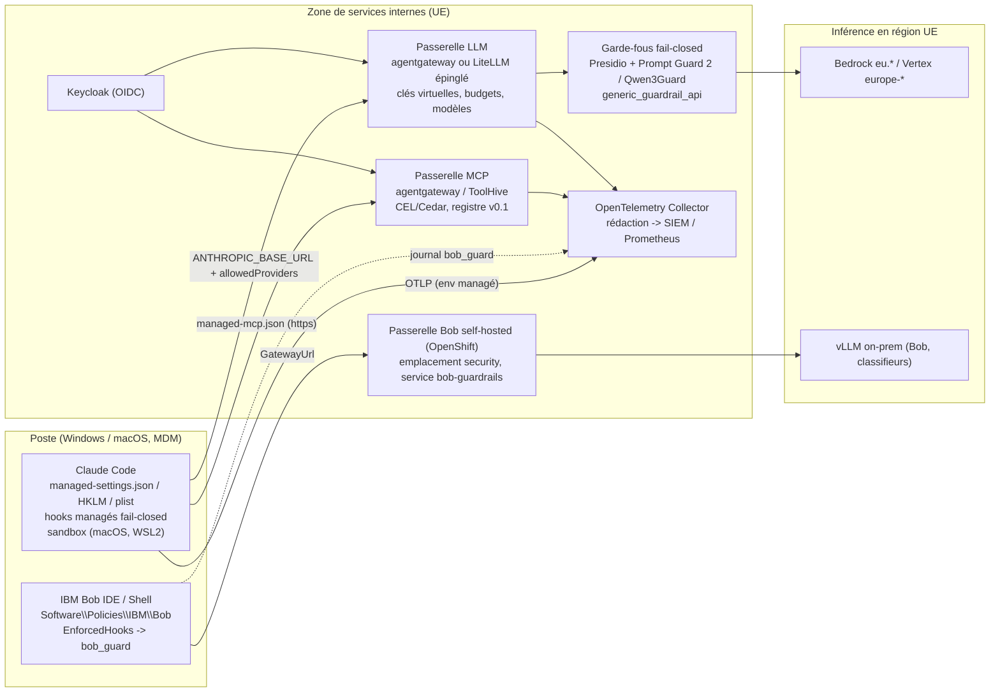

# L'open source encadre les agents de code, pas leurs clients

Au 28 octobre 2026, une banque européenne peut assembler en open source l'essentiel de la gouvernance centralisée de ses agents de code — passerelle LLM (**agentgateway**, Apache-2.0, projet Linux Foundation ; **LiteLLM**, MIT hors répertoire `enterprise/`), passerelle et registre MCP (agentgateway, **ToolHive**, **IBM ContextForge**), garde-fous (**Presidio** + **Prompt Guard 2** ou **Qwen3Guard** derrière le `generic_guardrail_api` fail-closed de LiteLLM), télémétrie (OpenTelemetry natif de Claude Code → **OpenTelemetry Collector** → SIEM) et chaîne d'approvisionnement (**skill-scanner**, **Snyk Agent Scan**, épinglage par SHA, miroirs internes) — mais pas le point qui compte le plus : aucun outil ne rend le client inviolable. Anthropic l'écrit elle-même : les réglages gérés « operate as a client-side control, not a security boundary » ([Server-managed settings](https://code.claude.com/docs/en/server-managed-settings)), et IBM Bob démarre sans aucune politique si `/etc/bob/policy.json` est absent ou invalide ([Bob group policies](https://bob.ibm.com/docs/ide/security/group-policies)). L'application réelle se fait donc à quatre endroits : le magasin de politiques protégé par l'OS (`HKLM\SOFTWARE\Policies\ClaudeCode`, profil `com.anthropic.claudecode`, `Software\Policies\IBM\Bob`), le réseau (liste blanche de sortie vers la seule passerelle), la passerelle elle-même (identité IdP, garde des clés, modèles autorisés, audit par requête) et la CI (branches protégées, scanners). Trois limites structurelles persistent : **pas de résidence UE sur l'API first-party d'Anthropic** (`inference_geo` ne vaut que `us` ou `global`, donc Bedrock `eu.` ou Vertex `europe-west1` obligatoires), **des fonctions d'entreprise payantes dans toutes les passerelles** (SSO/JWT, journaux d'audit et garde-fous par clé chez LiteLLM ; OIDC/SCIM, audit et garde-fous chez Bifrost ; plugins IA chez Kong), et **une passerelle de référence, LiteLLM, compromise deux fois en 2026** (24 mars et 21 octobre, plus une faille critique côté entreprise publiée le 27 octobre) — à ne déployer qu'épinglée par digest et reconstruite en interne. Pour Claude Code, la combinaison décisive est `allowedProviders: ["customEndpoint"]` + `ANTHROPIC_BASE_URL` figée dans les managed settings (v2.1.285+), des hooks `command` avec `onFailure: "block"` (v2.1.295+) sous `allowManagedHooksOnly: true`, et un export OTel verrouillé par le bloc `env` managé. Pour IBM Bob, la surface documentée est plus étroite (six politiques, hooks bloquants seulement sur le code de sortie 2 ou une sortie JSON `permissionDecision: "deny"`, pas de liste blanche MCP) : votre norme actuelle — `EnforcedHooks` + `bob_guard` fail-closed + passerelle self-hosted — reste la bonne architecture, et ce rapport la relie outil par outil à l'état de l'art.

> **Conventions.** Dates et numéros de version sont ceux relevés dans les notes de recherche au 28 octobre 2026 (Claude Code 2.1.312 sur le canal `latest`, 2.1.308 sur `stable` ; Bob IDE 2.2.3 et Bob Shell 2.0.5 d'après vos propres relevés). Les noms de produits, clés de configuration, variables d'environnement et chemins sont conservés verbatim. Lorsque les notes publiques et vos documents (`docs/06-reference-technique-bob.md`, `self-hosted/README.md`) divergent sur IBM Bob, vos relevés font foi et la divergence est signalée. Les points non vérifiés sont marqués **[non vérifié]**, les déductions **[inférence]**.

## 1. Le point d'application s'est déplacé : OS, réseau, passerelle et CI, pas le client

Le premier enseignement de l'état de l'art 2026 est négatif et unanime chez les éditeurs : les contrôles livrés dans l'agent sont des garde-fous contre l'erreur, pas des barrières contre un adversaire local. Anthropic documente que « A user who can run a modified client can bypass any client-side control », qu'« un développeur administrateur de sa machine peut éditer la source managée elle-même, which is why MDM tooling can redeploy the profile or file on a schedule », et que les managed settings « bind Claude Code only. A developer who calls the API from another tool isn't under them » ([Deploy managed settings](https://code.claude.com/docs/en/managed-settings)). Kiro écrit que son registre MCP « can be circumvented by users, e.g., via administrative access to their local machine », Gemini CLI que ses contrôles « should not be considered a foolproof security boundary », GitHub Copilot que l'application par registre « can be bypassed by editing configuration files », Cursor que sa liste blanche de commandes est « best-effort, not a security boundary » ([matrice inter-agents, sources par ligne](https://code.claude.com/docs/en/managed-settings)). IBM Bob va plus loin dans le fail-open : « If the file is absent or malformed, Bob starts without any enforced policies » et une valeur `EnforcedHooks` « absent, empty, or not valid JSON » est « silently ignored » ([Bob group policies](https://bob.ibm.com/docs/ide/security/group-policies)) — ce que votre référence technique confirme pour Linux (« absent ou invalide = fail-open »).

La conséquence architecturale est que les cinq couches de votre norme restent valides, mais que leur poids se redistribue. La couche 1 (politiques d'entreprise) n'a de valeur que livrée dans un magasin que seul un administrateur peut écrire : « The plist and HKLM registry locations work with any provider and resist tampering because they require admin privileges to write » ; la ruche `HKCU` est « a convenience default rather than an enforcement channel » ([Admin setup](https://code.claude.com/docs/en/admin-setup)). La couche 2 (garde-fou déterministe) doit être fail-closed par construction, car « A policy hook with a wrong path or a crashing script then lets everything through » ([Hooks reference](https://code.claude.com/docs/en/hooks)). La couche 3 (approbation humaine) ne peut pas déléguer aux classifieurs : Anthropic mesure sur son propre mode auto **0,4 % de faux positifs mais 17 % de faux négatifs** sur des actions réelles « overeager » (n = 52) et 5,7 % sur une exfiltration synthétique (n = 1 000) ([Anthropic engineering, auto mode](https://www.anthropic.com/engineering/claude-code-auto-mode)). La couche 4 (règles Markdown) est explicitement non contraignante : « Claude treats CLAUDE.md files as context, not enforced configuration » ([Memory](https://code.claude.com/docs/en/memory)). La couche 5 (CI et supervision) est la seule où la preuve existe, à condition qu'elle soit produite côté serveur. Enfin la passerelle est le seul endroit où la clé d'API, le choix du modèle et l'identité du développeur sont réellement hors de portée du poste : Anthropic recommande d'ailleurs « If you need request-level audit logging or to route traffic by data sensitivity, we recommend you place a gateway between developers and your provider » ([Admin setup](https://code.claude.com/docs/en/admin-setup)).

Le guide de bonnes pratiques d'Anthropic résume la ligne de partage à appliquer à chaque exigence : « Deterministic: you configure the instruction, and Claude Code (the harness) *has* to execute this. This can be a hook, a deny rule, or a managed setting » contre « Non-deterministic: … your prompt, `CLAUDE.md`, or a skill … there's no *guarantee* that it'll follow your instructions » ; et « A `prompt` or `agent` hook asks *another model* to decide, so it isn't deterministic either. For real enforcement, use a `command` or `http` hook, and add `onFailure: "block"` » ([Best practices](https://code.claude.com/docs/en/best-practices)). Côté régulateur, aucun texte ne prescrit encore de contrôle propre aux agents de code, mais les prescriptions existantes se projettent directement sur ces couches : journalisation avec rétention définie et protection contre l'altération (RTS DORA (UE) 2024/1774, art. 12), analyse préalable des composants open source avant production (art. 16 §8) ([RTS DORA, texte de la Commission](https://ec.europa.eu/finance/docs/level-2-measures/dora-regulation-rts--2024-1532_en.pdf)) ; validation humaine obligatoire « dès qu'une commande système ou une action à effet de bord est envisagée » et exécution en bac à sable (CERT-FR ACT-016 du 13 avril 2026, qui vise les assistants bureautiques et « does not mention coding agents ») ([CERT-FR](https://cert.cyber.gouv.fr/actualite/CERTFR-2026-ACT-016/)) ; traçabilité permettant de « reconstituer l'ensemble du processus décisionnel » et cloisonnement de la mémoire (note CNIL/CIANum de juillet 2026) ([CNIL](https://www.cnil.fr/sites/default/files/2026-07/ia-cianum-cnil.pdf)) ; liste blanche de paquets contre l'hallucination de dépendances (ANSSI/BSI 2024) ([BSI/ANSSI](https://www.bsi.bund.de/SharedDocs/Downloads/EN/BSI/KI/ANSSI_BSI_AI_Coding_Assistants.pdf)). La conservation de six mois des journaux de l'AI Act (art. 26 §6) ne s'applique qu'aux systèmes à haut risque et a été reportée au 2 décembre 2027 par l'Omnibus numérique : c'est un repère, pas une obligation pour un assistant de code interne ([AI Act Explorer, art. 26](https://artificialintelligenceact.eu/article/26/)).

Le tableau suivant pose la correspondance qui structure tout le rapport : vos couches, les mécanismes natifs de Claude Code (clés exactes), les mécanismes d'IBM Bob tels que vous les avez vérifiés, les outils open source qui s'y greffent, et le degré réel de résistance au contournement.

| Couche de votre norme | Claude Code (clés exactes) | IBM Bob (faits vérifiés par vous, runtime 2.2.3 / Shell 2.0.5) | Outils open source à greffer | Résistance au contournement |
|---|---|---|---|---|
| 1. Politiques d'entreprise (GPO/Intune/MDM) | `managed-settings.json` + `managed-settings.d/*.json` + `managed-mcp.json` ; `HKLM\SOFTWARE\Policies\ClaudeCode` valeur `Settings` ; profil macOS `com.anthropic.claudecode` ; `policyHelper` ; `managedSourcesBehavior` | `Software\Policies\IBM\Bob` (ADMX `IBMBobPolicy.admx`) ; domaine `com.ibm.bob` ; `/etc/bob/policy.json` ; clés `EnforcedHooks`, `DisabledAutoApprovalGroups`, `GatewayUrl`, `UpdateMode`, `RequiredExtensions`, `ExcludePayloadFromTelemetry` | Modèles MDM d'Anthropic (`examples/mdm` : `Set-ClaudeCodePolicy.ps1`, `ClaudeCode.admx`) ; `cosign sign-blob --bundle` pour signer le paquet de politique ; ruler/rulesync en CI pour la dérive | Forte si HKLM/plist/fichier root ; Claude Code **refuse de démarrer** sur politique illisible, Bob **démarre sans politique** |
| 2. Garde-fou déterministe (hooks) | `hooks` managés + `allowManagedHooksOnly: true` ; `PreToolUse` → exit 2 ou `permissionDecision: "deny"` ; `onFailure: "block"` (v2.1.295+) ; `strictPluginOnlyCustomization` ; `ConfigChange` | `EnforcedHooks` (toujours exécutés, même en dossier non approuvé) ; blocage par code 2 ou JSON `permissionDecision: "deny"` / `decision: "block"` sur `UserPromptSubmit`, `PreToolUse`, `PreCompact` ; autre code, crash, délai = fail-open ; gestionnaire `http` fail-open | Gryph (Apache-2.0), cc-safety-net (MIT), Dippy/Parable (MIT), Cupcake (OPA/Rego, Apache-2.0) ; motif `tree-sitter-bash` de Codex execpolicy ; gitleaks / secretlint / trufflehog en `stdin` | Hooks = processus non sandboxés avec les droits de l'utilisateur ; bloquant seulement si le garde-fou sort 2 sur **tout** chemin d'erreur |
| 3. Approbation humaine | `permissions.deny` / `ask` ; `permissions.disableBypassPermissionsMode: "disable"` ; `permissions.disableAutoMode: "disable"` ; `permissions.defaultMode` ; `allowManagedPermissionRulesOnly` | `DisabledAutoApprovalGroups` (`read, edit, execute, mcp, skill, todo, subtask, subagent, mode`) ; `deniedCommands` prime sur `approvedCommands` ; « command security » (`isCommandSecurityEnabled`, approbation exigée en cas d'erreur ou de délai) | Aucun outil nécessaire ; classifieurs OSS en appui seulement (§7) | Les règles `deny` « hold in every permission mode, including auto and `bypassPermissions` » ; le classifieur n'est pas une barrière |
| 4. Règles Markdown | CLAUDE.md managé (`/etc/claude-code/CLAUDE.md`, `C:\Program Files\ClaudeCode\CLAUDE.md`, `/Library/Application Support/ClaudeCode/CLAUDE.md`) ou clé `claudeMd` ; `instructionFiles: "managed-only"` ; AGENTS.md natif (v2.1.277+) | `AGENTS.md` chargé par défaut (`bob-code.useAgentRules`) ; `~/.bob/rules/`, `.bob/rules/`, `.bob/rules-{mode}/` ; aucune règle imposable centralement | ruler (MIT), rulesync (MIT, cible IBM Bob) ; scanners d'Unicode caché (`ctxsentry`, `agentscanner`) ; gitsign / cosign | Nulle par conception (« guidance, not enforcement ») |
| 5. CI et supervision (SIEM, DORA) | OTel natif (`CLAUDE_CODE_ENABLE_TELEMETRY=1`, `OTEL_*` verrouillés par le bloc `env` managé) ; événements `claude_code.tool_decision`, `managed_settings_resolved`, `retention_sweep`, `hook_execution_complete` ; `cleanupPeriodDays` | Journal d'activité CADF SaaS (connexions et administration seulement, « pas de prompts ni d'appels d'outils ») ; envoi Splunk configuré par le support IBM ; self-hosted : « journalisation de sécurité non fournie par Bob » ; journal d'audit du `bob_guard` | OpenTelemetry Collector (Apache-2.0) ; Prometheus/Grafana, Loki, ClickHouse ; SigNoz (MIT hors `ee/`), Langfuse (MIT hors `ee/`) ; gitleaks, trufflehog, detect-secrets, skill-scanner, agent-scan, promptfoo, garak | Preuve côté serveur seulement ; transcripts locaux en clair, modifiables, non signés |
| Passerelle self-hosted | `ANTHROPIC_BASE_URL` + `allowedProviders: ["customEndpoint"]` (v2.1.285+) ; `apiKeyHelper` ; ou Claude apps gateway (`forceLoginMethod: "gateway"`, `forceLoginGatewayUrl`) | `GatewayUrl` imposée (« ni l'utilisateur ni les options de la CLI ne peuvent la remplacer ») vers la passerelle Bob SaaS ou self-hosted OpenShift ; emplacement `security` du routeur de modèles (garde-fou fail-closed : « rejette toutes les requêtes » s'il est indisponible) | agentgateway (Apache-2.0), LiteLLM (MIT + `enterprise/`), Bifrost (Apache-2.0 core) ; Presidio, NeMo Guardrails, classifieurs Apache-2.0 ; Keycloak | Seule couche où la clé et le modèle sont réellement hors du poste ; la passerelle devient elle-même une cible (LiteLLM 2026) |

## 2. Passerelle LLM : agentgateway et LiteLLM se détachent, mais LiteLLM a été compromis deux fois en 2026

Anthropic a réorganisé sa documentation passerelle en 2026 (`gateways`, `llm-gateway`, `llm-gateway-connect`, `llm-gateway-rollout`, `llm-gateway-protocol`, `claude-apps-gateway`) et sa position est simple : « Any gateway that exposes a [supported API format] works. Anthropic doesn't endorse, maintain, or audit third-party gateway products, and doesn't support routing Claude Code to non-Claude models through any gateway » ([Other LLM gateways](https://code.claude.com/docs/en/llm-gateway)). Le contrat technique, lui, est exigeant et détermine le choix du produit : passer les événements SSE « as they arrive, including keep-alive pings, instead of buffering », transmettre `anthropic-beta` et `anthropic-version` « verbatim ; don't allowlist individual values, because the set changes with Claude Code releases », renvoyer les erreurs amont « unmodified » car la reprise automatique de Claude Code « matches on error wording », exempter le chemin de l'inspection de corps par le WAF (règle AWS `CrossSiteScripting_Body`, OWASP CRS sous ModSecurity, qui renvoient `403` sur de vraies sessions alors que des tests courts passent), et surtout **« inspect without modifying »** : « A gateway that rewrites or redacts request bodies for content inspection breaks the pairing the same way stripping does » — un garde-fou qui masque des PII dans la requête peut provoquer lui-même l'erreur `bound to a different conversation` du thinking préservé et faire perdre le prompt caching (`cache_control`) ([Compatibility guide](https://code.claude.com/docs/en/llm-gateway-protocol), [Roll out](https://code.claude.com/docs/en/llm-gateway-rollout)). Ce point conditionne la conception des garde-fous (§7) : en passerelle, on bloque ou on journalise, on ne réécrit pas le corps envoyé au modèle.

### 2.1 Inventaire : quatre produits crédibles, une douzaine à écarter

Les notes ont relevé le 28 octobre 2026 licence, pilote, étoiles et dernière version de dix-huit passerelles via l'API GitHub. Seules quatre combinent un pass-through Anthropic Messages exploitable par Claude Code, une gouvernance auto-hébergeable (clés virtuelles par développeur, budgets, listes de modèles, SSO, audit) et une licence ouverte pour ces fonctions.

| Produit | Licence (ce qui est fermé) | Pilote / fondation | Étoiles | Dernière version | Signal de maturité ou de risque |
|---|---|---|---|---|---|
| **agentgateway** | Apache-2.0, toutes fonctions dans le dépôt | Linux Foundation (créé par Solo.io, rejoint l'Agentic AI Foundation 2026-06-04) | 5 683 | v1.7.0 (2026-10-27) | Jeune (créé 2025-03) ; routes natives `messages` + `anthropicTokenCount` + `passthrough` ; clés virtuelles, budgets $, guardrails, OIDC/JWT en OSS ([agentgateway](https://github.com/agentgateway/agentgateway)) |
| **LiteLLM Proxy** | MIT + répertoire `enterprise/` propriétaire (« may only be used in production, if you … have a valid BerriAI Enterprise license ») | Berrie AI Inc., aucune fondation | 62 182 | v1.106.5 (2026-10-27) | **Compromis le 2026-03-24 (PyPI 1.82.7/1.82.8) et le 2026-10-21 (v1.107.0 PyPI + Docker/GHCR `latest`)** ; faille critique côté entreprise GHSA-w4c7-34wj-hqm8 publiée 2026-10-27 ; réécriture Rust du chemin `/v1/messages` annoncée pour décembre 2026 ([LICENSE](https://raw.githubusercontent.com/BerriAI/litellm/main/LICENSE), [incident](https://docs.litellm.ai/blog/security-incident-oct-21-2026)) |
| **Bifrost** | Apache-2.0 core ; « Bifrost Enterprise » fermé, versionné séparément | Maxim AI | 9 149 | transports/v2.3.2 (2026-10-20) | Doc Claude Code la plus détaillée (testée 2.1.128–2.1.212) ; SQLite par défaut ; OIDC/SCIM, RBAC, audit signé, guardrails = payants ([Bifrost Enterprise](https://docs.getbifrost.ai/enterprise/overview)) |
| **Claude apps gateway** | Propriétaire, intégré au binaire `claude` (≥ v2.1.195) | Anthropic | n/a | livré avec Claude Code | OIDC seul (« SAML and LDAP aren't supported »), PostgreSQL ≥ 11, Linux, pas d'UI, pas de guardrails ; démarrage fail-closed ; « doesn't log or store prompt or completion content » ([Claude apps gateway](https://code.claude.com/docs/en/claude-apps-gateway)) |
| Agent Router (ex-Envoy AI Gateway) | Apache-2.0 | Agentic AI Foundation | 2 305 | v1.2.0 (2026-10-07) | `/anthropic/v1/messages` + `count_tokens` ; filtre `anthropic-beta` par backend (à l'opposé du « forward verbatim ») ; pas de guardrails ni de clés virtuelles documentés ; Kubernetes + Envoy Gateway ([README](https://github.com/theagentrouter/agent-router)) |
| Kong Gateway | Apache-2.0 pour l'OSS 3.9.x ; plugins IA `ai_gateway_enterprise` | Kong Inc. | 44 309 | 3.9.4 (2026-10-12) | Format natif Anthropic (`llm_format: anthropic`) seulement en 3.10+, c'est-à-dire hors de la lignée OSS gelée à 3.9 **[gel non officiel]** ; le cookbook Claude Code SSO repose sur `openid-connect`, `ai-proxy-advanced`, `ai-rate-limiting-advanced` (entreprise) ([cookbook](https://developer.konghq.com/cookbooks/claude-code-sso)) |
| Apache APISIX | Apache-2.0, plugins IA dans le dépôt | Apache Software Foundation | 17 256 | 3.19.0 (2026-09-28) | Convertit Anthropic → OpenAI-compatible ; `ai-prompt-guard` regex ; Claude Code non mentionné ; `count_tokens` non documenté ([ai-proxy](https://apisix.apache.org/docs/apisix/plugins/ai-proxy/)) |
| MLflow AI Gateway | Apache-2.0 | projet MLflow | 28 563 | v3.17.2 (2026-10-21) | Passthrough `/gateway/anthropic/v1/messages`, budgets USD, mais guardrails = LLM-juge seulement et page Claude Code en pass-through d'abonnement (observabilité, pas garde des clés) ([MLflow](https://mlflow.org/docs/latest/genai/governance/ai-gateway)) |
| Higress | Apache-2.0 | Alibaba / CNCF Sandbox | 9 648 | v2.2.5 (2026-10-04) | `claudeCodeMode: true` **usurpe le client Claude Code avec des jetons OAuth** ; modération Aliyun seulement : hors cible UE ([README ai-proxy](https://github.com/higress-group/higress/blob/main/plugins/wasm-go/extensions/ai-proxy/README_EN.md)) |
| À écarter comme socle neuf | Portkey Gateway (MIT, dépôt inactif depuis 2026-05-25, société acquise par Palo Alto Networks le 2026-05-29 pour 117 M$, gouvernance dans le plan de contrôle fermé) ; Helicone (maintenance, dépôt gateway GPL-3.0) ; TensorZero (archivé, « no longer maintained ») ; Pydantic AI Gateway (archivé, AGPL-3.0) ; LLM Gateway theopenco (AGPL-3.0) ; Traefik Hub AI Gateway (commercial) ; Plano/Arch (routage, pas de gouvernance) | | | | ([10-K PANW](https://www.sec.gov/Archives/edgar/data/0001327567/000132756726000023/panw-20260731.htm), [TensorZero](https://github.com/tensorzero/tensorzero)) |

Le détail des fonctions de gouvernance par niveau de licence tranche le choix.

| Fonction | LiteLLM | Bifrost | agentgateway | Agent Router | Claude apps gateway |
|---|---|---|---|---|---|
| Anthropic Messages pour Claude Code | OSS : `/v1/messages` + pass-through `/anthropic` ; matrice de compatibilité quotidienne (2026-10-21, Claude Code 2.1.302) | OSS : route `/anthropic`, valide/filtre `anthropic-beta` par fournisseur | OSS : routes `messages`, `passthrough` ; gère `?beta=true` et `capability_rejected: prompt_too_long` | OSS : `/anthropic/v1/messages` | natif |
| `count_tokens` | OSS | non trouvé | OSS (`anthropicTokenCount`) | OSS | n/a |
| Clé par développeur / identité IdP | clés virtuelles OSS ; JWT/OIDC + SCIM **payants** | clés virtuelles `sk-bf-*` OSS (deny-by-default) ; SSO **payant** | clés virtuelles + JWT/API key/OIDC/ExtAuthz OSS | JWT/OIDC via Envoy Gateway ; clés par utilisateur non documentées | OIDC (groupes → modèles, limites de dépense) |
| Budgets et limites | budgets/rate limits OSS ; budgets par tag/modèle **payants** | budgets hiérarchiques OSS | budgets $ ou tokens par clé OSS | QuotaPolicy par tenant OSS | limites de dépense par utilisateur/groupe |
| Garde-fous | OSS par requête (Presidio, webhook `generic_guardrail_api`) ; **par clé/équipe/modèle payants** ; `llmguard_moderations`, `hide_secrets`, `lakera_prompt_injection` sous licence | **payants** (Presidio, regex, secrets Gitleaks, Bedrock, Model Armor) | OSS : regex/PII, OpenAI moderation, Bedrock, Azure, Model Armor, webhooks | non documentés (ext_proc) | aucun |
| Audit / OTel | OTel OSS (`callbacks: ["otel"]`) ; **journaux d'audit payants** (`store_audit_logs: true`) | OTel + Prometheus OSS ; audit signé **payant** | OTLP + Prometheus + journaux d'accès OSS | métriques, OTel, access logs | relais OTLP/HTTP + événements d'audit JSON `evt` |
| Dépendances d'état | PostgreSQL requis pour les clés ; Redis « highly recommended » multi-worker (« a limit of 100 requests per minute across 4 workers really lets through 400 ») | SQLite (OSS) / PostgreSQL (EE) | fichier de configuration (base optionnelle) | Kubernetes + Envoy Gateway | PostgreSQL ≥ 11 |

Sources : [LiteLLM Enterprise](https://docs.litellm.ai/docs/enterprise), [LiteLLM Redis](https://docs.litellm.ai/docs/proxy/redis_requirements), [Bifrost Claude Code](https://docs.getbifrost.ai/cli-agents/claude-code), [agentgateway Messages API](https://agentgateway.dev/docs/standalone/latest/documentation/llm/api-types/messages), [Agent Router endpoints](https://theagentrouter.ai/docs/capabilities/llm-integrations/supported-endpoints), [Claude apps gateway](https://code.claude.com/docs/en/claude-apps-gateway).

Le classement qui en découle pour une banque (auto-hébergé, fail-closed, UE) place **agentgateway** en tête par adéquation documentée (toutes les fonctions en Apache-2.0 sous fondation, comportement conscient de Claude Code), avec pour réserve sa jeunesse et l'absence de retour public d'un déploiement Claude Code bancaire — le cas DNB publié par le projet concerne l'accès aux agents kagent et aux serveurs MCP (DB2, MQ, Jira) derrière agentgateway avec propagation d'identité Entra ID, et « ne dit pas si le trafic LLM propre de Claude Code passe par la passerelle » ([DNB case study](https://agentgateway.dev/blog/2026-07-13-how-dnb-scaled-ai-adoption-with-kagent-and-agentgateway/)). **LiteLLM** vient ensuite par son écosystème et sa matrice de compatibilité quotidienne, mais avec une question de confiance tiers à trancher explicitement. **Bifrost** est un troisième choix solide si l'on accepte un petit éditeur et des fonctions d'entreprise fermées. La **Claude apps gateway** n'est pas open source, mais c'est la seule voie où le comportement de Claude Code est garanti par Anthropic (settings gérés par groupe IdP, modèles refusés en `400` côté serveur, démarrage fail-closed, relais OTLP) ; elle se combine avec une passerelle de garde-fous plutôt qu'elle ne la remplace.

### 2.2 LiteLLM : ce que les deux compromissions imposent

Les faits sont établis par les billets d'incident de LiteLLM eux-mêmes. Le 24 mars 2026, `litellm==1.82.7` et `1.82.8` ont été publiés sur PyPI avec un voleur d'identifiants (clés SSH, secrets cloud et Kubernetes, `.env`) persistant via `litellm_init.pth`, pendant environ quarante minutes ; LiteLLM attribue l'origine à la compromission du scanner Trivy dans sa CI ([LiteLLM, mars 2026](https://docs.litellm.ai/blog/security-update-march-2026), [Datadog](https://securitylabs.datadoghq.com/articles/litellm-compromised-pypi-teampcp-supply-chain-campaign/)). Le 21 octobre 2026, « LiteLLM's release pipeline was compromised and pushed v1.107.0 to the docker registry and PyPi. This version contained compiled malware which steals credentials and loads remote-code execution tools » : les sept wheels PyPI ont été exposés de 11:39 à 13:23 UTC et les tags Docker Hub/GHCR `v1.107.0`, `latest`, `main-latest`, `main-stable` pointaient vers l'image compromise jusqu'à 13:51–14:20 UTC ; « The official v1.107.0 source tag in GitHub does not contain the malicious files. The compromised artifacts were built from an attacker-controlled repository » ; la chaîne d'attaque part d'une clé maîtresse commise dans un dépôt public le 2026-05-27 et jamais révoquée, et passe par l'assouplissement « earlier this week » de l'exigence d'approbateur à clé matérielle ([incident](https://docs.litellm.ai/blog/security-incident-oct-21-2026), [chaîne d'attaque](https://docs.litellm.ai/blog/security-incident-oct-21-2026-attack-chain)). Le 27 octobre, LiteLLM a annoncé un registre privé par lequel les clients payants recevront d'abord les correctifs des failles « most severe » — la faille GHSA-w4c7-34wj-hqm8 (escalade non authentifiée vers administrateur du proxy sur les déploiements sous licence entreprise) avait été corrigée en privé le 6 octobre et publiée le 27 ([LiteLLM Private Registry](https://docs.litellm.ai/blog/litellm-private-registry)). Pour une banque, LiteLLM reste utilisable à quatre conditions : épingler l'image par digest (jamais `latest`), reconstruire depuis la source auditée ou consommer un miroir interne avec délai de quarantaine (les artefacts malveillants ont vécu deux à trois heures), fonctionner en sortie restreinte (`LITELLM_OFFLINE_MODE=true` en variable d'environnement uniquement, plus `general_settings.disable_model_info_refresh: true` ; restent les appels à `license.litellm.ai` si la signature de licence ne peut être vérifiée localement) et garder les clés fournisseur dans un coffre plutôt que dans la base du proxy ([Outbound requests](https://docs.litellm.ai/docs/proxy/outbound_requests)). Le point mérite d'être consigné dans l'analyse de risque tiers : c'est précisément le composant qui détient toutes les clés.

### 2.3 Forcer Claude Code vers la passerelle : clés exactes

Le mécanisme le plus fort côté client est documenté depuis la v2.1.285 : « To make a gateway reached through `ANTHROPIC_BASE_URL` the only destination a managed machine may use, set `allowedProviders` to `["customEndpoint"]` in the same managed settings file and put the gateway's `ANTHROPIC_BASE_URL` in that file's `env` block. Claude Code then refuses a session pointed anywhere else, including at Anthropic directly or at a developer's own proxy » ; une liste invalide ou vide fait que « Claude Code refuses every provider and doesn't start on the machine » ([Other LLM gateways](https://code.claude.com/docs/en/llm-gateway), [allowedProviders](https://code.claude.com/docs/en/settings-reference#allowedproviders)). Une `ANTHROPIC_BASE_URL` managée « cannot be overridden by a developer's shell export ». Le choix de la variable d'identifiant fixe l'en-tête HTTP : « `ANTHROPIC_AUTH_TOKEN` in `Authorization: Bearer`, `ANTHROPIC_API_KEY` in `x-api-key`, and `apiKeyHelper` in both » ; `apiKeyHelper` est relancé après 5 minutes (`CLAUDE_CODE_API_KEY_HELPER_TTL_MS=900000` pour 15 min), sur `401`/`403`, et depuis la v2.1.246 quand un JWT mis en cache a expiré ([Connect](https://code.claude.com/docs/en/llm-gateway-connect)). Le squelette suivant est assemblé à partir des clés documentées **[inférence, non validé avec `claude doctor`]** :

```json
{
  "allowedProviders": ["customEndpoint"],
  "env": {
    "ANTHROPIC_BASE_URL": "https://llm-gateway.banque.internal",
    "CLAUDE_CODE_DISABLE_NONESSENTIAL_TRAFFIC": "1",
    "DISABLE_TELEMETRY": "1",
    "DISABLE_ERROR_REPORTING": "1",
    "CLAUDE_CODE_GATEWAY_HINT_HEADERS": "1",
    "HTTPS_PROXY": "http://proxy.banque.internal:3128",
    "NODE_EXTRA_CA_CERTS": "/etc/pki/ca-trust/source/anchors/banque-root.pem"
  },
  "apiKeyHelper": "/usr/local/bin/get-gateway-key",
  "skipWebFetchPreflight": true
}
```

Trois pièges documentés doivent figurer dans la recette. D'abord, `forceLoginMethod` ou `forceLoginOrgUUID`, « with any value, blocks `ANTHROPIC_API_KEY`, `ANTHROPIC_AUTH_TOKEN`, and `apiKeyHelper` at startup » : on ne combine pas ces clés avec une passerelle tierce ; la variante `forceLoginMethod: "gateway"` + `forceLoginGatewayUrl` est réservée à la Claude apps gateway (LiteLLM implémente aussi ce protocole de connexion : `"forceLoginGatewayUrl": "https://litellm.internal.example.com/claude_code_gateway"`, Claude Code ≥ v2.1.195) ([Roll out](https://code.claude.com/docs/en/llm-gateway-rollout), [LiteLLM Claude Code SSO](https://docs.litellm.ai/docs/tutorials/claude_code_gateway)). Ensuite, fixer seulement `ANTHROPIC_BASE_URL` « doesn't replace the subscription » : un login claude.ai enregistré reste l'identifiant actif, la passerelle ne peut pas substituer sa clé et doit transmettre la capacité OAuth dans `anthropic-beta` ; la garde centrale des clés passe donc par la voie clé/jeton, pas par l'abonnement — la permissivité contractuelle du relais de jetons d'abonnement par une passerelle tierce (proposé par LiteLLM, Bifrost, MLflow, Higress) n'est établie par aucune source **[à soumettre au juridique]** ([Subscriptions and gateways](https://code.claude.com/docs/en/llm-gateway#subscriptions-and-gateways)). Enfin, des appels directs à `api.anthropic.com` subsistent malgré la passerelle : la vérification de disponibilité du mode rapide (« goes directly to `api.anthropic.com` and doesn't follow `ANTHROPIC_BASE_URL` », à neutraliser par `CLAUDE_CODE_SKIP_FAST_MODE_NETWORK_ERRORS=1` et `CLAUDE_CODE_SKIP_FAST_MODE_ORG_CHECK=1`), le contrôle de sûreté des domaines WebFetch (« not affected by `CLAUDE_CODE_DISABLE_NONESSENTIAL_TRAFFIC` », désactivé par `skipWebFetchPreflight: true` à combiner avec des règles `WebFetch(domain:…)`), la télémétrie opérationnelle (activée par défaut avec une simple `ANTHROPIC_BASE_URL`, désactivée par défaut sous `CLAUDE_CODE_USE_BEDROCK|VERTEX|FOUNDRY=1`), l'auto-installation de la marketplace officielle (`CLAUDE_CODE_DISABLE_OFFICIAL_MARKETPLACE_AUTOINSTALL`) et l'installateur (`downloads.claude.ai`) ([Data usage](https://code.claude.com/docs/en/data-usage), [Network config](https://code.claude.com/docs/en/network-config)). Le pare-feu de sortie reste donc obligatoire, et `CLAUDE_CODE_DISABLE_NONESSENTIAL_TRAFFIC=1` « disables auto-updates, so plan for another update path ». Pour une résidence UE, la passerelle route vers Bedrock ou Vertex : côté client, `ANTHROPIC_BEDROCK_BASE_URL=https://llm-gateway.example.com/bedrock` + `CLAUDE_CODE_SKIP_BEDROCK_AUTH=1` + `CLAUDE_CODE_USE_BEDROCK=1`, préfixe `ANTHROPIC_BEDROCK_REGION_PREFIX=eu` (profils `eu.anthropic.claude-…`), ou `ANTHROPIC_VERTEX_BASE_URL` + `CLAUDE_CODE_SKIP_VERTEX_AUTH=1` + `CLOUD_ML_REGION=eu` et régions par modèle `VERTEX_REGION_CLAUDE_4_6_SONNET=europe-west1` ; attention, en format Anthropic Messages « Claude Code sends the full set, even if your gateway forwards to an Amazon Bedrock or Google Cloud's Agent Platform upstream. Bridging that difference is your gateway's job » ([Connect](https://code.claude.com/docs/en/llm-gateway-connect), [Bedrock](https://code.claude.com/docs/en/amazon-bedrock), [Vertex](https://code.claude.com/docs/en/google-vertex-ai)). Deux régressions de 2026 (v2.1.265–2.1.267 : schéma d'outil Artifact rejeté par les passerelles validant `pattern` ; v2.1.275 : type `advisor_20260301`) justifient l'épinglage de version (`requiredMaximumVersion`, `DISABLE_UPDATES`) et un test de non-régression à chaque montée ([Compatibility guide](https://code.claude.com/docs/en/llm-gateway-protocol)). Pour l'attribution des coûts sans analyser les corps, la passerelle dispose de `x-claude-code-session-id`, `x-claude-code-agent-id` (« identifies an agent, not a person ») et, avec `CLAUDE_CODE_GATEWAY_HINT_HEADERS=1` (v2.1.273+), `x-claude-code-request-class` et `x-claude-code-prompt-id` ; LiteLLM documente un piège : sans `x-litellm-customer-id`, Claude Code envoie un blob JSON par session dans `metadata.user_id`, « so every session shows up as a separate customer » ([LiteLLM cost tracking](https://docs.litellm.ai/docs/tutorials/claude_code_customer_tracking)).

### 2.4 Les autres agents : chacun son protocole, Bob et Cursor hors passerelle tierce

Une passerelle unique pour « tous » les agents n'existe pas, parce que chaque client impose son format filaire. **Codex CLI** exige l'API OpenAI Responses : « Configure a gateway provider with `wire_api = "responses"`. … A working Chat Completions or Anthropic Messages endpoint doesn't establish Responses compatibility » ; le fournisseur se déclare dans `~/.codex/config.toml` (`[model_providers.enterprise-gateway]`, `base_url`, `requires_openai_auth = false`, identifiant par `env_key`, `env_http_headers`, helper `[model_providers.<id>.auth]` ou `gateway_oauth`) et s'impose via `/etc/codex/requirements.toml` ou `%ProgramData%\OpenAI\Codex\requirements.toml` (« An enforced provider definition replaces the matching provider table from ordinary configuration ») ([Codex gateway](https://learn.chatgpt.com/docs/enterprise/connect-to-a-gateway), [compatibilité](https://learn.chatgpt.com/docs/enterprise/gateway-compatibility)). **Gemini CLI** ne se détourne que par variables d'environnement (`GOOGLE_GEMINI_BASE_URL`, `GOOGLE_VERTEX_BASE_URL`, HTTPS obligatoire hors `localhost`) avec `security.auth.enforcedType` dans `/etc/gemini-cli/settings.json` — plus faible, et le produit grand public a été remplacé par Antigravity CLI le 18 juin 2026 ([Gemini CLI enterprise](https://geminicli.com/docs/cli/enterprise)). **GitHub Copilot** ne permet de pointer un endpoint client que pour Copilot CLI (`COPILOT_PROVIDER_BASE_URL`, `COPILOT_PROVIDER_TYPE` = `openai` | `azure` | `anthropic`, `COPILOT_PROVIDER_WIRE_API`) et le fournisseur « Custom Endpoint » de VS Code (chat seulement, types Chat Completions / Responses / Messages) ; les complétions inline restent chez GitHub, seul un proxy HTTP avec certificats est possible ([Copilot CLI BYOK](https://docs.github.com/en/copilot/how-tos/copilot-cli/customize-copilot/use-byok-models)). **Cursor** décourage explicitement les passerelles clients (« Custom gateways can introduce additional latency, rate limiting, and compatibility issues. We instead recommend using Cursor's built-in hooks feature ») parce que « all requests are routed through Cursor's servers for final prompt building » ; le levier réseau est l'en-tête `x-cursor-allowed-tenants: v1.orgs=1001,1002;teams=70` injecté par un proxy TLS ([Cursor network](https://cursor.com/docs/enterprise/network-configuration), [tenancy](https://cursor.com/docs/enterprise/tenancy-restriction)).

**IBM Bob** relève de la même famille que Cursor : la politique `GatewayUrl` (« Enforces the gateway base URL used by IBM Bob to reach backend services. When set, users and CLI flags cannot override this value ») pointe vers la passerelle Bob — SaaS IBM ou backend self-hosted —, qui sert à la fois l'authentification (`webLoginUrl`), l'inférence (`inferenceClient`) et l'administration (`adminClient`) ; aucun réglage utilisateur de fournisseur tiers n'a été trouvé dans l'extension (0 occurrence de `apiProvider`, `openAiBaseUrl`, `anthropicBaseUrl`), et l'ADMX livré n'expose que des politiques VS Code (`ChatAgentAllowedNetworkDomains`, `AllowedExtensions`, `TelemetryLevel`, …), pas `GatewayUrl` — à rapprocher de votre relevé selon lequel le runtime lit aussi la clé `IBM\Bob` pour ces politiques. Un fait utile pour votre dossier self-hosted : le même `extension.js` contient un analyseur de catalogue de modèles qui lit les champs LiteLLM `model/info` (`max_input_tokens`, `supports_prompt_caching`, `input_cost_per_token`, …) et étiquette chaque modèle « `${id} via LiteLLM proxy` » — indice que la passerelle Bob expose une API d'information de modèles compatible LiteLLM, ou en dérive **[inférence à partir du code client]**. La mention « OpenResty » de votre schéma de passerelle self-hosted n'a pas pu être confirmée par les sources publiques ; vos relevés font foi. Les trois éléments de gouvernance que Bob place en passerelle et que ce rapport retient comme équivalents fonctionnels sont, d'après votre `self-hosted/README.md` : le routeur de modèles à emplacements `premium-ide`, `security`, `background` ; le modèle de garde-fou de l'emplacement `security` (`openai/gpt-oss-20b` en mode déconnecté) qui, s'il est indisponible, fait que « Bob rejette toutes les requêtes » (fail-closed, que vous rendez obligatoire, SH-02) ; et le classifieur de commandes du même emplacement. Ce couple « garde-fou fail-closed + classifieur » est exactement ce que la section 7 recommande de bâtir en open source devant Claude Code.

## 3. MCP centralisé : une seule passerelle interne, imposée par `serverUrl`, jamais par nom

Le protocole lui-même a intégré la gouvernance par étapes. La révision **2026-07-28**, courante au 28 octobre, rend MCP sans état (suppression de `Mcp-Session-Id` et de la poignée de main `initialize`), déprécie l'enregistrement dynamique de clients (DCR, RFC 7591) au profit des Client ID Metadata Documents (CIMD), impose la validation de l'émetteur `iss` (RFC 9207), documente la propagation OpenTelemetry (`traceparent`, `tracestate`, `baggage` dans `_meta`, SEP-414) et rend obligatoires les en-têtes HTTP `Mcp-Method` et `Mcp-Name` sur les POST Streamable HTTP (SEP-2243) — ce dernier point permet à une passerelle de filtrer par méthode et par outil sans désérialiser le corps JSON-RPC ([changelog 2026-07-28](https://modelcontextprotocol.io/specification/2026-07-28/changelog.md)). Le modèle d'autorisation est stable depuis 2025-06-18 : « A protected MCP server acts as an OAuth 2.1 resource server », « MCP servers MUST implement OAuth 2.0 Protected Resource Metadata (RFC9728) », « MCP clients MUST implement Resource Indicators for OAuth 2.0 as defined in RFC 8707 » et « MCP servers MUST NOT accept or transit any other tokens » ([Authorization](https://modelcontextprotocol.io/specification/2026-07-28/basic/authorization/index.md)). MCP est hébergé depuis le 9 décembre 2025 par l'Agentic AI Foundation, fonds dirigé de la Linux Foundation cofondé par Anthropic, Block et OpenAI ([billet MCP](https://blog.modelcontextprotocol.io/posts/2025-12-09-mcp-joins-agentic-ai-foundation/)). Côté client, Anthropic rappelle la limite de responsabilité : « Anthropic reviews connectors against its listing criteria before adding them to the Anthropic Directory, but doesn't security-audit or manage any MCP server », et « Claude Code doesn't have a built-in MCP server registry that users can browse and install from » ([Managed MCP](https://code.claude.com/docs/en/managed-mcp)). Deux constats transversaux des notes orientent l'architecture : **aucune passerelle ni aucun client examiné ne documente l'épinglage par empreinte des descriptions d'outils** (détection de « rug pull ») — seul Obot épingle les composants d'un vMCP à un instantané d'entrée de catalogue — et **le registre officiel reste en « preview » et n'est pas prévu pour l'auto-hébergement**.

### 3.1 Passerelles et proxys MCP : trois familles, deux candidats de tête

| Projet | Licence | Pilote | Étoiles | Dernière version | Ce qu'il impose réellement | Isolation des serveurs | Manques relevés |
|---|---|---|---|---|---|---|---|
| **agentgateway** | Apache-2.0 | Linux Foundation / AAIF | ~5 683 | v1.7.0 (2026-10-27) | Autorisation CEL par outil (`mcp.tool.name`, `mcp.tool.target`, claims `jwt.*`) ; « If a tool … is not allowed, the gateway automatically filters it from the `list` response » ; arguments via politique de route `authorization` (`mcp.tool.arguments`) ; processeurs « ExtMCP » qui peuvent « Inspect, mutate, or reject MCP requests and responses » ; serveur de ressources OAuth (RFC 9728), adaptateurs Auth0, authentik, Entra ID, Keycloak, Okta ; `mcp_requests_total`, traces OTLP, journaux d'accès avec arguments ; négocie les révisions dont 2026-07-28 | non (fédère) | pas de hash de description, pas de sandbox stdio ([doc MCP authz](https://agentgateway.dev/docs/standalone/latest/documentation/configuration/security/mcp-authz.md)) |
| **ToolHive** (Stacklok) | Apache-2.0 | Stacklok | ~2 312 | v0.58.0 (2026-10-27) | « runs every MCP server in an isolated container, enforces identity and access policy per request » ; politiques Cedar (« denying anything not explicitly permitted », `Action::"call_tool"`, groupes IdP) ; CRD `MCPServer`, `MCPToolConfig` (`toolsFilter`, `toolsOverride`), `MCPWebhookConfig` (webhooks mutants puis validants), `VirtualMCPServer` ; limitation de débit par utilisateur/outil (Redis) ; isolation réseau par défaut depuis v0.30.1 ; registre intégré avec provenance Sigstore/SLSA | oui (conteneur + réseau) | gVisor non documenté ; RBAC→Cedar automatisé = Stacklok Enterprise ([ToolHive](https://github.com/stacklok/toolhive), [Cedar](https://docs.stacklok.com/toolhive/concepts/cedar-policies.md)) |
| **IBM ContextForge** (mcp-context-forge) | Apache-2.0 | IBM (communauté) | ~4 706 | v1.1.0 (2026-10-20) | Deux couches : « Token Scoping (Layer 1): controls what resources a user CAN SEE » et « RBAC (Layer 2): controls what actions a user CAN DO » (`tools.execute`, `servers.use`) ; « permission checks default to deny on error » ; SSO Keycloak/Entra/Okta/ADFS ; plugins PII Filter, Secrets Detection, Schema Guard (JSONSchema sur arguments et résultats), OPA, Cedar, Rate Limiter, Circuit Breaker ; builds air-gapped, Helm | non (fédère) | pas de hash de description ; statut de support IBM non établi ([ContextForge](https://github.com/IBM/mcp-context-forge)) |
| **Obot** | MIT | Obot AI | ~1 131 | v0.28.0-alpha3 (2026-10-22) | vMCP ; « Pin each vMCP component to a snapshot of its catalog entry » ; accès par groupe IdP ; filtres webhook ; catalogues Git exposés via l'API de registre MCP ; SCIM Okta ; **Obot Sentry** (bêta) inventorie les clients MCP des postes et applique des listes d'outils pour Claude Code, Codex, Cursor, Kiro via Intune | oui (Docker/K8s) | version alpha ; frontière OSS/payant non précisée ([Obot](https://github.com/obot-platform/obot)) |
| Docker MCP Gateway | MIT | Docker | ~1 616 | v0.44.3 (2026-10-26) | Serveurs du catalogue « as isolated containers » (1 CPU, 2 Go), images « built and signed by Docker » avec SBOM, secrets hors variables d'environnement, catalogues personnalisés importés par référence OCI | oui | filtrage par outil/argument non trouvé en OSS ; gouvernance centrale = « Docker AI Governance » sur invitation ([Docker MCP Gateway](https://github.com/docker/mcp-gateway)) |
| Pomerium | Apache-2.0 | Pomerium | ~5 076 | v0.33.6 (2026-10-27) | Passerelle OAuth 2.1 aval, gestion OAuth amont (« clients never see upstream credentials »), critère PPL `mcp_tool` (nom, préfixe, suffixe, liste), « Every tool call is logged with the method, tool name, and parameters » | non | frontière Core/Enterprise non précisée ([Pomerium MCP](https://www.pomerium.com/docs/capabilities/mcp)) |
| Agent Router | Apache-2.0 | AAIF | ~2 305 | v1.2.1-rc1 (2026-10-26) | CRD `MCPRoute`, autorisation « using JWT claims, scopes, and CEL expressions », filtrage d'outils, préfixage `github__issue_read` | non | doc 1.2 cite encore la spec de juin 2025 ([Agent Router MCP](https://theagentrouter.ai/docs/capabilities/mcp/)) |
| Microsoft MCP Gateway | MIT | Microsoft | ~898 | v1.0.0 (2026-10-16) | Entra ID + rôles d'application (`mcp.admin`, `requiredRoles`) ; « requires MCP `2026-07-28` clients and adapters » | pods K8s | pas de contrôle par outil documenté |
| MCPJungle | MPL-2.0 | communauté | ~1 311 | 0.4.6 (2026-08-02) | ACL client → serveur (« By default, no MCP client can access these servers »), granularité serveur | non | « does not support OAuth flow for authentication yet » |
| Lasso mcp-gateway | MIT | Lasso Security | ~397 | 2026-01-21 (dernier push 2026-01-22) | plugins `basic` (secrets), `presidio` (PII), `lasso` (API commerciale) ; scanner de réputation `--scan` | non | dépôt peu actif |
| Payants ou restreints | Kong `ai-mcp-proxy` (« only available as part of our AI Gateway Enterprise offering », Gateway ≥ 3.12) ; Traefik Hub MCP Gateway ; Docker AI Governance (invitation) ; Stacklok Enterprise ; `mcp-bridge` d'APISIX est déprécié | | | | | | ([Kong](https://developer.konghq.com/plugins/ai-mcp-proxy/)) |

Pour le plan de données d'une banque, **agentgateway** (politiques CEL par outil, OAuth conforme, télémétrie) et **ToolHive** (isolation conteneur, Cedar, registre à provenance) sont les deux candidats les plus complets ; **ContextForge** est le plus riche en RBAC/SSO/plugins mais plus « plateforme » ; Obot apporte la seule visibilité poste (Sentry) mais en alpha. L'alignement des révisions de protocole est un chantier à part : Microsoft v1.0.0 n'accepte plus que 2026-07-28, agentgateway négocie, Agent Router documente juin 2025, MCPJungle et MetaMCP référencent 2025-03-26/2025-06-18.

### 3.2 Claude Code : quatre leviers, un schéma fail-closed

Claude Code offre quatre mécanismes combinables, documentés dans un tableau « Choose a pattern » : `managed-mcp.json` (contrôle exclusif : « Every user gets the same servers and can't add others »), `managedMcpServers` (v2.1.259+, serveurs distants fournis en plus de ceux des utilisateurs), `allowedMcpServers` + `allowManagedMcpServersOnly: true` (catalogue approuvé), et `strictPluginOnlyCustomization` avec `mcp` dans la liste ([Managed MCP](https://code.claude.com/docs/en/managed-mcp)). Le fichier exclusif se place dans `/Library/Application Support/ClaudeCode/managed-mcp.json`, `/etc/claude-code/managed-mcp.json` ou `C:\Program Files\ClaudeCode\managed-mcp.json` ; il « cannot be delivered through server-managed settings » ; `{ "mcpServers": {} }` désactive MCP ; avec lui, `claude mcp add` échoue (« Cannot add MCP server: enterprise MCP configuration is active and has exclusive control over MCP servers ») et `--mcp-config` fait quitter au démarrage ; « Any user on the machine can read this file, so don't store API keys or other credentials in `env` blocks ». Les entrées de `managedMcpServers` sont contraintes : `type` = `http` ou `sse`, `url` en `https://` (même `localhost` en `http://` est refusé), aucun membre `command`, `args`, `env`, `headersHelper` « so a managed settings document never names a program to run on a user's machine », aucune référence `${VAR}`. Les listes d'autorisation reposent sur trois types d'entrée dont un seul n'est pas un contrôle : « A `serverName` entry, in either list, is not a security control. The name is the label a user assigns … so a user can call any server `github`. … To enforce which servers actually run, add `serverCommand` or `serverUrl` entries » ; une `serverCommand` doit correspondre exactement (« `["npx", "-y", "server"]` does not match `["npx", "server"]` », `env` non comparé), ce qui permet d'épingler un digest d'image ou une version (`docker run … image@sha256:<digest>`, `npx -y paquet@x.y.z`) ; « Nothing overrides a denylist match » ; sans `allowManagedMcpServersOnly`, « allowlists from every settings scope merge, including a user's own `~/.claude/settings.json`, so a user can broaden what your allowlist permits ». L'exemple officiel de liste dure :

```json
{
  "allowManagedMcpServersOnly": true,
  "allowedMcpServers": [
    { "serverUrl": "https://api.githubcopilot.com/*" },
    { "serverUrl": "https://*.internal.example.com/*" }
  ],
  "deniedMcpServers": [
    { "serverCommand": ["npx", "-y", "unapproved-package"] },
    { "serverUrl": "https://*.untrusted.example.com/*" }
  ]
}
```

Le schéma le plus strict et cohérent avec la sémantique documentée **[inférence]** : un `managed-mcp.json` ne déclarant qu'un seul serveur `type: http` vers la passerelle MCP interne (authentifié par OAuth par utilisateur), `allowManagedMcpServersOnly: true` avec des entrées `serverUrl` littérales, `deniedMcpServers` pour les commandes connues (`npx`/`uvx` non approuvés), `disableClaudeAiConnectors: true` (ou `ENABLE_CLAUDEAI_MCP_SERVERS=false`), et des règles de permission `mcp__<passerelle>__*` ; attention, un `deny` global `"mcp__*"` bloquerait aussi la passerelle puisque « If a tool is denied at any level, no other level can allow it ». Deux limites importent pour le garde-fou : les règles de permission ne filtrent pas les arguments MCP (« When Claude Code loads a settings file, it skips any `mcp__` rule that has parentheses ») — le filtrage d'arguments relève donc de la passerelle (CEL, Cedar, Schema Guard) ou d'un hook `PreToolUse` dont l'entrée porte `mcp_server: { name, source }` (« Base trust decisions on `source` rather than on `name` ») ([Permissions](https://code.claude.com/docs/en/permissions), [Hooks](https://code.claude.com/docs/en/hooks)) ; et un serveur bloqué « disappears from `/mcp` and `claude mcp list` » sans que « the user gets no signal that policy is the reason ». Le client OAuth suit la spec (découverte RFC 9728 puis RFC 8414, CIMD automatique, identifiants pré-enregistrés via `claude mcp add --client-id … --client-secret`, restriction de portées par `oauth.scopes` : « the supported way to restrict an MCP server to a security-team-approved subset ») ; le runtime « v2 » (SDK MCP 2.0, révision 2026-07-28 ; v2.1.274+ par défaut sur Bedrock/Vertex/Foundry/passerelle) « Fails an MCP OAuth sign-in whose authorization response names an unexpected issuer » ([MCP docs](https://code.claude.com/docs/en/mcp)). La recherche d'outils tronque les descriptions (4 096 caractères au démarrage, 16 384 via tool search, `CLAUDE_CODE_MAX_MCP_DESCRIPTION_LENGTH` v2.1.280+) et, sur `list_changed`, « Claude Code fetches the updated list from that server » : aucune validation ni épinglage de description côté client. L'audit passe par `OTEL_LOG_TOOL_DETAILS=1` (noms de serveurs et d'outils dans `tool_result`, `tool_decision`, `mcp_server_connection`). Rappel structurel : ces fichiers sont modifiables par un administrateur local ; sur un poste développeur non verrouillé, c'est un contrôle de gouvernance qui doit être doublé par le réseau (sortie autorisée vers la seule passerelle MCP).

### 3.3 Registres privés : exposer l'API `v0.1`, épingler par digest

Le registre officiel `registry.modelcontextprotocol.io` porte toujours le bandeau « The MCP Registry is currently in preview » (dépôt v1.8.6, 2026-10-27, licence en transition MIT → Apache-2.0), « does not support private servers » et « the official MCP Registry codebase is **not** designed for self-hosting » — alors que la documentation GitHub Copilot propose « Fork and self-host the open-source MCP Registry » : contradiction à arbitrer en faveur d'une implémentation de l'OpenAPI `v0.1` plutôt que d'un fork ([Registry about](https://modelcontextprotocol.io/registry/about.md), [GitHub Docs](https://docs.github.com/en/copilot/how-tos/administer-copilot/manage-mcp-usage/configure-mcp-registry)). Ce qui est stable et exploitable : le format `server.json` (version « MUST be unique for each publication … cannot be changed », plages `^1.2.3`/`1.x` interdites, pas de dépublication), les types de paquets OCI (« The tag can also be specified as a digest », registres `docker.io` et `ghcr.io`, propriété vérifiée par l'annotation `io.modelcontextprotocol.server.name`) et MCPB (« MUST include a `fileSha256` property ») ([Versioning](https://modelcontextprotocol.io/registry/versioning.md), [Package types](https://modelcontextprotocol.io/registry/package-types.md)). Les registres privés open source les plus aboutis sont le **ToolHive Registry Server** (sources Git/API/fichier/Kubernetes, `syncPolicy`, « claims inherited by entries during sync (for authorization) », plusieurs registres sur les mêmes sources exposés à `/registry/{registryName}/v0.1/servers`, PostgreSQL, journal d'audit des opérations ; critères du catalogue intégré : code 100 % open source, provenance Sigstore, SLSA, SBOM, dépendances épinglées) ([guide registre](https://docs.stacklok.com/toolhive/guides-registry.md), [critères](https://docs.stacklok.com/toolhive/concepts/registry-criteria.md)), les catalogues Git d'**Obot** exposés via l'API de registre, et les catalogues personnalisés **Docker** distribués comme artefacts OCI (`docker mcp catalog pull registry.example.com/mcp/team-catalog:latest`). Pour Claude Code, le registre n'est pas consommé à l'exécution : la doc recommande de « share the approved list and its `claude mcp add` commands … such as an internal wiki, or distribute the servers as plugins through a managed plugin marketplace ». Le digest OCI est la seule garantie d'immutabilité vérifiable côté image ; une version de registre immuable ne protège pas d'une republication sous le même tag.

### 3.4 Identité : Keycloak conforme « Experimental », extension entreprise finale mais sans client confirmé

Les IdP open source ne sont pas encore complets. **Keycloak** (Apache-2.0, CNCF) déclare OAuth 2.1 et RFC 8414/9207/7591 « Supported », mais RFC 8707 Resource Indicators « Experimental » (`--features=resource-indicators`) et CIMD « Experimental » (`--features=cimd`) ; sa conformité aux révisions MCP 2025-06-18, 2025-11-25 et 2026-07-28 est « Experimental » ([Keycloak MCP](https://www.keycloak.org/securing-apps/mcp-authz-server)). agentgateway doit adapter son comportement fournisseur par fournisseur (« Auth0 … does not support RFC 8707 », « open source authentik does not implement RFC 7591 », Entra « Strips the RFC 8707 `resource` parameter », Keycloak : « Proxies DCR »), preuve que le choix de l'IdP selon RFC 8707/CIMD réduit la dette ([agentgateway MCP authn](https://agentgateway.dev/docs/standalone/latest/documentation/configuration/security/mcp-authn.md)). L'extension officielle **Enterprise-Managed Authorization** (SEP-990, statut Final, identifiant `io.modelcontextprotocol/enterprise-managed-authorization`) fait de l'IdP le décideur via un ID-JAG (« the MCP client never receives a token for unauthorized servers », révocation centralisée), mais « typically requires client-level support » et aucun support n'a pu être confirmé pour Claude Code, Codex, Gemini CLI, Copilot, Bob ou Cline (matrice officielle illisible) **[non vérifié]** ([extension](https://modelcontextprotocol.io/extensions/auth/enterprise-managed-authorization.md)). Zitadel est sous AGPL-3.0 (copyleft réseau, à signaler au juridique) ; Ory Hydra (Apache-2.0) et oauth2-proxy (MIT, CNCF Sandbox) n'ont pas de support MCP vérifié ; SPIFFE/SPIRE (Apache-2.0, CNCF graduated) relève de l'identité de charge de travail (mTLS passerelle ↔ serveurs) sans source primaire MCP. Recommandation **[inférence]** : une autorité d'autorisation interne unique, RFC 9728 publié par toutes les passerelles et serveurs internes, `resource`/audience imposés par serveur, DCR ouvert interdit au profit de clients pré-enregistrés ou de CIMD restreint à des domaines de confiance.

### 3.5 Les autres agents : qui impose vraiment une liste blanche d'identité de serveur

| Agent | Mécanisme d'administration | Granularité | Observations |
|---|---|---|---|
| Claude Code | `managed-mcp.json`, `managedMcpServers`, `allowedMcpServers` + `allowManagedMcpServersOnly` | `serverUrl` (jokers), `serverCommand` (exact) | `serverName` n'est pas un contrôle |
| OpenAI Codex | `requirements.toml` → `[mcp_servers.<id>.identity]` (`command`, `url`, matchers `exact`/`prefix`/`regex`) ; « If `mcp_servers` is present but empty, the local client disables all MCP servers » | nom **et** identité doivent correspondre | « Command matchers don't inspect `cwd`, `env`, or `env_vars` » ([managed configuration](https://learn.chatgpt.com/docs/enterprise/managed-configuration.md)) |
| Gemini CLI | `mcp.allowed` / `mcp.excluded` dans `/etc/gemini-cli/settings.json` ; console : `admin.mcp.enabled`, `admin.mcp.config`, `admin.mcp.requiredConfig` | nom de serveur ; `url`, `type`, `trust` pris de l'admin | **contradiction** : `admin.mcp.enabled` par défaut `true` dans la référence, « MCP … Default: disabled » dans la page des contrôles ([admin controls](https://geminicli.com/docs/admin/enterprise-controls/)) |
| GitHub Copilot | `copilot/managed-settings.json` (dépôt `.github-private` ou MDM) : `allowedMcpServers` / `deniedMcpServers`, GA 2026-08-06 ; « Policies fail closed » (liste malformée = tout bloqué sauf serveurs intégrés) | même schéma que Claude Code | registre « Registry only » en preview, « not the recommended method » ; JetBrains non établi ([changelog](https://github.blog/changelog/2026-08-06-mcp-allowlists-in-enterprise-managed-settings/)) |
| Cursor | tableau de bord « MCP Configuration » (Enterprise seulement), entrées commande/URL avec `*` ; `~/.cursor/permissions.json` `mcpAllowlist` (`server:tool`) ne règle que l'auto-approbation | chaîne complète `command` + `args` | pas de distribution des serveurs (marketplace d'équipe) ([Cursor](https://cursor.com/docs/enterprise/model-and-integration-management)) |
| Cline | `allowedMCPServers` (`{ "id": "filesystem" }`), `remoteMCPServers`, `blockPersonalRemoteMCPServers` | **nom seulement** | équivalent d'un `serverName` |
| **IBM Bob** | aucune clé de liste blanche MCP documentée ; `DisabledAutoApprovalGroups` contient le groupe `mcp` ; fichiers `~/.bob/settings/mcp.json` et `.bob/mcp.json` (`alwaysAllow`, `disabled`, `type: "streamable-http"`) | — | contrôle réel = réseau de sortie + votre `bob_guard` en `PreToolUse` sur les outils `mcp__<serveur>__<outil>` ; Bob Shell : « MCP tool approval respects group-level permission » ([MCP in Bob](https://bob.ibm.com/docs/ide/configuration/mcp/mcp-in-bob), [changelog Shell](https://bob.ibm.com/docs/shell/changelog)) |
| Roo Code | dépôt « archived by the owner on May 15, 2026 » ; extension arrêtée le 15 mai | — | sans objet ([Roo-Code](https://github.com/RooCodeInc/Roo-Code)) |

Pour une flotte hétérogène, la stratégie commune la plus robuste est « un seul serveur distant autorisé : la passerelle MCP interne », exprimable en `serverUrl` (Claude Code, Copilot), `identity.url` (Codex), `admin.mcp.config` (Gemini CLI) et liste d'URL (Cursor) ; pour Bob et Cline, le réseau et un agent de poste (Obot Sentry, bêta) deviennent les seuls garde-fous.

### 3.6 Scanners et incidents : à l'admission au catalogue, pas en ligne

Deux scanners sont maintenus sous Apache-2.0. **Snyk Agent Scan** (ex-`mcp-scan` d'Invariant Labs, v0.6.9 du 2026-10-20) découvre les configurations de Claude Code, Cursor, Gemini CLI, Windsurf et détecte prompt injection, tool poisoning, tool shadowing, toxic flows ; mais « It sends the component information needed for analysis, including … tool names and descriptions, and skill content » à l'API Snyk, exige `SNYK_TOKEN`, « starts stdio MCP servers by executing the commands in the config » (« Run scans inside a sandbox »), et ses hooks `guard` (`snyk-agent-scan guard install {claude,cursor,codex,github-copilot,all}`, option `--managed`) « fail open: exit 0 » sur délai ou erreur HTTP ; l'ancien mode proxy a disparu de la CLI ([README](https://raw.githubusercontent.com/snyk/agent-scan/HEAD/README.md)). **Cisco AI Defense MCP Scanner** (4.8.7 du 2026-10-20) combine YARA, analyse par LLM au choix et API Cisco optionnelle, avec un mode « Static/Offline Scanning … perfect for CI/CD pipelines and air-gapped environments » — la seule option documentée compatible air-gap ([mcp-scanner](https://github.com/cisco-ai-defense/mcp-scanner)). MCP-Shield et mcp-guardian n'ont plus de commits significatifs depuis 2025 ; `semgrep/mcp` est archivé (c'est un serveur MCP, pas un scanner). Aucune mesure indépendante d'efficacité n'a été trouvée pour ces outils. Les incidents 2025–2026 justifient chacun un contrôle précis : empoisonnement des descriptions d'outils (Invariant, 2025-04-01) → scan et épinglage à l'admission ; « toxic agent flow » GitHub MCP (2025-05-26, une issue publique fait lire des dépôts privés) → jetons à portée minimale et filtrage des résultats ; fuite Supabase MCP via ticket de support (2025-07-08) → rôles en lecture seule ; `mcp-remote` CVE-2025-6514 (CVSS 9.6, RCE client depuis un serveur distant non fiable) → liste blanche d'URL et HTTPS ; Cursor « MCPoison » CVE-2025-54136 (approbation liée au nom, commande modifiable ensuite) → `serverCommand` exact et re-approbation ; `postmark-mcp` 1.0.16 (copie d'un serveur légitime envoyant tous les courriels en copie cachée) → registre privé et épinglage de version ; serveur MCP Git officiel d'Anthropic CVE-2025-68143/68144/68145 (correctif 2025.12.18) → inventaire et mise à jour ; exécution par le transport STDIO des SDK (OX Security, 2026-04-15 : la commande s'exécute avant toute vérification, comportement confirmé « voulu » par Anthropic) → interdiction des entrées stdio non approuvées — avec une attribution discordante de CVE-2026-30623 (LiteLLM selon la CSA, « tous les SDK » selon des blogs) ([Invariant](https://invariantlabs.ai/blog/mcp-security-notification-tool-poisoning-attacks), [GitHub MCP](https://invariantlabs.ai/blog/mcp-github-vulnerability), [JFrog](https://jfrog.com/blog/2025-6514-critical-mcp-remote-rce-vulnerability/), [Check Point](https://blog.checkpoint.com/research/cursor-ide-persistent-code-execution-via-mcp-trust-bypass/), [CSA/OX](https://labs.cloudsecurityalliance.org/research/csa-research-note-mcp-by-design-rce-ox-security-20260420/)). L'OWASP MCP Top 10 (bêta, « Phase 3 ») fournit le vocabulaire de correspondance : MCP03 Tool Poisoning, MCP04 Supply Chain, MCP05 Command Injection, MCP08 Lack of Audit and Telemetry, MCP09 Shadow MCP Servers ([OWASP](https://owasp.org/www-project-mcp-top-10/)).

## 4. Règles Markdown et politiques : CLAUDE.md guide, les managed settings imposent, la signature reste à construire

### 4.1 Instructions : un niveau managé qui ne s'exclut pas, mais qui n'oblige à rien

Claude Code charge les fichiers d'instructions « from broadest scope to most specific » : CLAUDE.md managé (`/Library/Application Support/ClaudeCode/CLAUDE.md`, `/etc/claude-code/CLAUDE.md`, `C:\Program Files\ClaudeCode\CLAUDE.md`, « Organization-wide instructions managed by IT/DevOps », à distribuer par « MDM, Group Policy, Ansible »), puis `~/.claude/CLAUDE.md`, `./CLAUDE.md` ou `./.claude/CLAUDE.md`, `./CLAUDE.local.md` ; « All discovered files are concatenated into context rather than overriding each other » ([Memory](https://code.claude.com/docs/en/memory)). La clé `claudeMd` met le même contenu dans `managed-settings.json` (« Where it's honored: managed and policy settings only ») et, depuis la v2.1.260, « doesn't require approval » — ce qui compte pour une livraison serveur sans dialogue. Un développeur « can exclude other CLAUDE.md files with the `claudeMdExcludes` setting, but not this one », mais « If a developer starts a session with CLAUDE.md loading turned off altogether, that session doesn't load the managed content either » (le mécanisme n'est pas nommé sur la page **[non vérifié]**). Le statut reste explicite : « Settings rules are enforced by the client regardless of what Claude decides to do. CLAUDE.md instructions shape Claude's behavior but are not a hard enforcement layer » ; « To block an action regardless of what Claude decides, use a PreToolUse hook instead ». La page répartit elle-même les rôles : réglages pour « Block specific tools, commands, or file paths » (`permissions.deny`), « Enforce sandbox isolation » (`sandbox.enabled`), routage et identifiants (`env`, `forceLoginMethod`) ; CLAUDE.md managé pour « Code style and quality guidelines », « Data handling and compliance reminders », « Behavioral instructions ». Détails utiles : les imports `@chemin` acceptent les chemins absolus (profondeur 4), « Block-level HTML comments (`<!-- maintainer notes -->`) in CLAUDE.md files are stripped before the content is injected » (invisibles au modèle, visibles au relecteur), les imports externes au répertoire de travail déclenchent un dialogue d'approbation unique, `.claude/rules/*.md` sont découverts récursivement (`paths` est « the only field Claude Code reads from a rule »), les cibles UNC/réseau des liens symboliques ne sont pas suivies, et le hook `InstructionsLoaded` trace chaque chargement (`session_start`, `nested_traversal`, `path_glob_match`, `include`, `compact`) — mais ne se déclenche pas pour un AGENTS.md lu via le réglage « Project instructions ». **Aucun répertoire de règles managé n'est documenté** : des règles centrales modulaires passent par des imports absolus depuis le CLAUDE.md managé ou par un plugin de marketplace interne **[inférence]**.

Depuis la v2.1.277, « Claude Code can read `AGENTS.md` as your project instructions, so a repository already set up for other coding agents works without adding a `CLAUDE.md` » ; la règle par défaut est « AGENTS.md + aucun CLAUDE.md » → AGENTS.md lu, « AGENTS.md + un CLAUDE.md » → « Your `CLAUDE.md` files only ». Le réglage « Project instructions » accepte `claude-md-or-agents-md` (défaut), `claude-md-and-agents-md`, `claude-md` et `managed-only` (« Only your organization's managed `CLAUDE.md` and auto memory at launch. Your project, local, and user `CLAUDE.md` files, your `.claude/rules/` files, and every `AGENTS.md` are left out ») ; en clé : `{"pluginConfigs": {"cc-plugin-agents-md@builtin": {"options": {"instructionFiles": "managed-only"}}}}`, honoré depuis les managed settings et ignoré en settings projet/local ([Memory](https://code.claude.com/docs/en/memory)). C'est le seul moyen documenté de neutraliser l'injection d'instructions par un dépôt (AGENTS.md, CLAUDE.md, `.claude/rules/`) sur les référentiels les plus sensibles, au prix des règles de projet légitimes. Le standard **AGENTS.md** lui-même (« a simple, open format for guiding coding agents », « There are no required fields », « The closest AGENTS.md to the edited file wins », « over 60k open-source projects », géré par l'AAIF depuis le 9 décembre 2025) n'a aucun modèle de sécurité : ni signature, ni niveau organisationnel, ni application ([agents.md](https://agents.md)). Trois comportements divergent sur un même dépôt : Claude Code masque AGENTS.md dès qu'un CLAUDE.md existe ; IBM Bob charge toujours le `AGENTS.md` racine (« loads after mode-specific rules but before general workspace rules », désactivable par `"bob-code.useAgentRules": false`) ([Bob rules](https://bob.ibm.com/docs/ide/configuration/rules)) ; Cursor fusionne AGENTS.md avec `.cursor/rules/*.mdc` ([Cursor rules](https://cursor.com/docs/context/rules)).

### 4.2 Managed settings : le vrai niveau d'application, ses chemins, ses pièges

La précédence est stricte : « Settings precedence, highest first: managed settings, command line, project local, shared project, user » ; « Nothing in your own settings files or `--settings` overrides a managed key » ; les listes fusionnent (« developers can extend managed lists but not remove from them ») sauf sous `allowManagedPermissionRulesOnly` ; une poignée de clés plus strictes gagnent depuis n'importe quel niveau (`disableClaudeAiConnectors`, `enableArtifact: false`, `permissions.blockReadsOutsideWorkingDirectories`, `maxEffortLevel` plus bas) ; et `permissions.defaultMode` en `auto` ou `bypassPermissions` « don't take effect from project or local settings » (avant la v2.1.257, `bypassPermissions` « took effect from any file ») ([Settings](https://code.claude.com/docs/en/settings)). Les canaux de livraison et leur rafraîchissement : fichier `managed-settings.json` + `managed-settings.d/*.json` (« merges `managed-settings.json` first, then every `*.json` file in the directory in alphabetical order », par exemple `10-telemetry.json`, `20-security.json` ; « reloaded when a file changes »), profil macOS `com.anthropic.claudecode` et registre `HKLM\SOFTWARE\Policies\ClaudeCode` valeur `Settings` en `REG_SZ`/`REG_EXPAND_SZ` (« checked for changes every 30 minutes »), settings server-managed depuis la console claude.ai (« polled hourly ») ([Deploy managed settings](https://code.claude.com/docs/en/managed-settings)). Anthropic publie des modèles : `examples/mdm` (macOS `com.anthropic.claudecode.plist`/`.mobileconfig` pour Jamf, Intune ; Windows `Set-ClaudeCodePolicy.ps1` écrivant `C:\Program Files\ClaudeCode\managed-settings.json` et `ClaudeCode.admx` + `ClaudeCode.adml` écrivant la valeur `Settings` ; vérification par `/status` → `Enterprise managed settings (HKLM)` ou `(plist)`) et `examples/settings/settings-strict.json` (`disableBypassPermissionsMode: "disable"`, `ask: ["Bash"]`, `deny: ["WebSearch", "WebFetch"]`, `allowManagedPermissionRulesOnly`, `allowManagedHooksOnly`, `strictKnownMarketplaces: []`, sandbox à liste vide) — marqués « community-maintained snippets which may be unsupported or incorrect » ([examples/mdm](https://raw.githubusercontent.com/anthropics/claude-code/main/examples/mdm/README.md), [settings-strict.json](https://raw.githubusercontent.com/anthropics/claude-code/main/examples/settings/settings-strict.json)).

**Le chemin Windows a changé** : la documentation actuelle donne `C:\Program Files\ClaudeCode\` et précise que « Claude Code doesn't read the legacy Windows path `C:\ProgramData\ClaudeCode\managed-settings.json` ». La raison est l'avis CVE-2026-35603 / GHSA-5cwg-9f6j-9jvx (CVSS 4.0 5,4, corrigé en 2.1.75, publié 2026-04-17) : « Because the `ProgramData` directory is writable by non-administrative users by default … a low-privileged local user could create this directory and place a malicious configuration file that would be automatically loaded for any user launching Claude Code on the same machine » ([advisories](https://api.github.com/repos/anthropics/claude-code/security-advisories?per_page=100)). Une GPO qui écrirait encore dans `ProgramData` ne livrerait silencieusement rien : vérifier sur un poste pilote avec `/status` (« Setting sources ») et `claude doctor`. Le même raisonnement vaut pour Gryph, dont le script Intune réinitialise l'ACL de `%ProgramData%\safedep\gryph\` « because `ProgramData` lets a standard user create files by design ».

Trois mécanismes 2026 méritent une place dans la norme. `policyHelper` (clé managée lue uniquement depuis le plist, HKLM ou le fichier managé) « Run[s] an executable you deploy that computes managed settings at startup, so you can derive policy from device posture, identity, or a remote service » (`{"path": "/usr/local/bin/claude-policy", "timeoutMs": 5000, "refreshIntervalMs": 300000}`) ; « The emitted `managedSettings` object is the only managed settings for the session » ; si le helper échoue, sort non-zéro, dépasse `timeoutMs` ou émet un JSON invalide, « Claude Code prints the reason and refuses to start … The refusal is deliberate, so a helper that needs outage resilience should serve from its own cache and exit `0` » — c'est le seul mécanisme à la fois centralement mis à jour et fail-closed au démarrage, et l'emplacement naturel d'une vérification de signature du paquet de politique ([settings-reference](https://code.claude.com/docs/en/settings-reference)). `managedSourcesBehavior` vaut `"first-wins"` par défaut : « uses the highest-ranked source that delivers at least one policy key and ignores the rest » — si la console claude.ai livre ne serait-ce qu'une clé, la politique MDM est ignorée (hors clés inter-sources) tant que `"merge"` (v2.1.242+) n'est pas posé dans la source de rang le plus élevé. `wslInheritsWindowsSettings: true` (posé en HKLM ou dans `C:\Program Files\ClaudeCode\`) fait lire la chaîne Windows par WSL, sinon WSL ne lit que `/etc/claude-code`, « user-writable as well » dans la distribution.

Le comportement sur politique invalide est documenté clé par clé (v2.1.282+) et c'est un point fort par rapport à Bob : document managé non analysable → « Claude Code refuses to start and prints an error naming the source » ; `allowedMcpServers` invalide → « Enforced as an empty allowlist » ; `allowedProviders` invalide → « every API provider is refused and Claude Code doesn't start » ; `forceLoginOrgUUID` invalide → « No organization is permitted to log in » ; `strictKnownMarketplaces` invalide → rien d'admis ; mais `requiredMinimumVersion`/`requiredMaximumVersion` « fail open by design », un `disableAllHooks` managé invalide est « dropped with a warning », et un `deniedMcpServers` entièrement invalide est ignoré ([Deploy managed settings](https://code.claude.com/docs/en/managed-settings)). Les clés réservées aux sources managées (sans effet ailleurs) forment la liste de verrous à connaître : `allowManagedPermissionRulesOnly`, `allowManagedHooksOnly`, `allowManagedMcpServersOnly`, `strictKnownMarketplaces`, `blockedMarketplaces`, `disableSideloadFlags`, `disableCommandPluginSources`, `strictPluginOnlyCustomization`, `forceRemoteSettingsRefresh`, `managedMcpServers`, `managedSourcesBehavior`, `policyHelper`, `sandbox.network.allowManagedDomainsOnly`, `sandbox.filesystem.allowManagedReadPathsOnly`, `wslInheritsWindowsSettings`, `allowAllClaudeAiMcps`, `channelsEnabled`, `pluginTrustMessage`, plus `claudeMd`, `deniedModels`, `availableModelsMatch`, `modelPricing`. L'exemple officiel d'un fichier d'organisation condense les verrous décisifs :

```json
{
  "forceLoginMethod": "claudeai",
  "forceLoginOrgUUID": ["xxxxxxxx-xxxx-xxxx-xxxx-xxxxxxxxxxxx"],
  "availableModels": ["opus", "sonnet"],
  "enforceAvailableModels": true,
  "permissions": {
    "deny": ["Bash(curl *)", "Read(./.env)", "Read(./secrets/**)"],
    "disableBypassPermissionsMode": "disable"
  },
  "allowManagedPermissionRulesOnly": true,
  "allowedMcpServers": [{ "serverUrl": "https://api.githubcopilot.com/*" }],
  "allowManagedMcpServersOnly": true,
  "strictKnownMarketplaces": [{ "source": "github", "repo": "acme-corp/approved-plugins" }],
  "sandbox": {
    "enabled": true, "failIfUnavailable": true, "allowUnsandboxedCommands": false,
    "network": { "allowedDomains": ["registry.npmjs.org", "github.com"], "allowManagedDomainsOnly": true }
  },
  "requiredMinimumVersion": "2.1.150",
  "cleanupPeriodDays": 7
}
```

([Example settings files](https://code.claude.com/docs/en/settings-example) ; dans une configuration passerelle tierce, `forceLoginMethod`/`forceLoginOrgUUID` sont à remplacer par `allowedProviders`, voir §2.3.) Les **settings server-managed** de la console claude.ai (Team/Enterprise, `Organization settings > Claude Code > Managed settings`) sont pratiques mais à traiter comme secondaires : « Per-group configurations are not yet supported », « You can't distribute a `managed-mcp.json` file », ils sont ignorés « when `ANTHROPIC_BASE_URL` points somewhere other than Anthropic's API » ou sous `CLAUDE_CODE_USE_*`, chaque hook ou variable `env` sensible exige un dialogue d'approbation (« If a user rejects the settings, Claude Code exits »), et l'avis CVE-2026-103012 (2026-09-29, versions 2.0.68 à 2.1.259) a montré des sessions démarrant « without the organization's server-managed policy » quand une clé d'API stockée primait sur la connexion — « Endpoint-managed (MDM or file-based) settings were not affected » ([Server-managed settings](https://code.claude.com/docs/en/server-managed-settings)). La preuve d'application se lit dans l'événement OTel `claude_code.managed_settings_resolved` (`managed_settings.sources` = `remote`|`plist`|`hklm`|`file`|`parent`|`hkcu`, `managed_settings.resolved_sha256` avec `OTEL_LOG_MANAGED_SETTINGS=1` : « Machines with the same digest run the same policy ») — voir §6.

### 4.3 Synchroniser une source unique : ruler et rulesync rendent le niveau projet, pas le niveau managé

Deux CLI Node sous MIT dominent. **ruler** (intellectronica, ~3,0 k étoiles) lit `.ruler/AGENTS.md` + `ruler.toml` et génère par agent : `CLAUDE.md`, `.mcp.json`, `.claude/skills/`, `.claude/agents/` pour Claude Code ; `AGENTS.md` + `.codex/config.toml` pour Codex ; `AGENTS.md` + `.cursor/mcp.json` pour Cursor ; `.clinerules`, `.goosehints`, `.kiro/steering/…` ; il ne génère ni `.claude/settings.json` ni les permissions, et ne liste pas IBM Bob (qui consommerait le `AGENTS.md` partagé) ; sa recette CI de dérive est un `ruler apply --no-gitignore --no-mcp` suivi d'un échec si `git status` montre des changements ([ruler](https://github.com/intellectronica/ruler)). **rulesync** (dyoshikawa, ~1,6 k) vise plus de 60 cibles dont **IBM Bob**, Claude Code et « Claude Code plugin », avec `rulesync init`, `rulesync generate --targets "*" --features "*"`, `rulesync import --targets claudecode|cursor|copilot`, `rulesync convert --from cursor --to copilot,claudecode` ; sa matrice de support a perdu son en-tête à l'extraction, de sorte que l'on ne sait pas quelles cibles reçoivent hooks, permissions ou `checks` **[non vérifié]** ([rulesync](https://github.com/dyoshikawa/rulesync)). vibe-rules (MIT, 528 étoiles, magasin local `~/.vibe-rules/rules/`) et getsentry/dotagents (MIT, 258 étoiles, `agents.toml` + `agents.lock`, allow-list `trust add`) complètent le paysage. Aucun de ces outils n'écrit le niveau managé de Claude Code ni une politique de groupe Bob : la banque garde sa propre chaîne (construire `managed-settings.json` + CLAUDE.md managé en CI depuis la même source, signer, pousser par Intune/Jamf/GPO) et réutilise ruler ou rulesync comme moteur de rendu du niveau projet et détecteur de dérive. Versions et dates de publication n'ont pas pu être vérifiées (sections « Releases » vides dans les extractions).

### 4.4 Intégrité : OS, Git, Sigstore et scan d'Unicode caché ; aucun agent ne vérifie une signature d'instructions

L'attaque de référence est le « Rules File Backdoor » de Pillar Security (18 mars 2025) : « invisible Unicode characters, including zero-width joiners and bidirectional text markers » dans les fichiers de règles de Cursor et Copilot, lus par le modèle mais pas par le relecteur ; Cursor a répondu que « this risk falls under the users' responsibility » et GitHub n'a ajouté qu'un avertissement sur github.com le 1er mai 2025 ([Pillar](https://www.pillar.security/blog/new-vulnerability-in-github-copilot-and-cursor-how-hackers-can-weaponize-code-agents), [GitHub changelog](https://github.blog/changelog/2025-05-01-github-now-provides-a-warning-about-hidden-unicode-text/)). Aucun agent de code n'offre de vérification cryptographique native de ses fichiers d'instructions ; les leviers documentés sont (1) le placement OS du niveau managé, (2) les contrôles Git sur le dépôt source (« Require pull request reviews », « Require review from Code Owners », « Require status checks », « Require signed commits », restriction des pousseurs ; les administrateurs ne sont liés que si l'option est activée) ([GitHub protected branches](https://docs.github.com/en/repositories/configuring-branches-and-merges-in-your-repository/managing-protected-branches/about-protected-branches)), (3) Sigstore pour signer l'artefact de politique (`cosign sign-blob --key cosign.key --bundle bundle.sigstore.json <fichier>`, vérification `cosign verify-blob <fichier> --bundle … --certificate-identity=… --certificate-oidc-issuer=…`, le format protobuf « supports offline verification ») et `gitsign` pour les commits — avec deux réserves : « GitHub doesn't show Gitsign commits as verified » (donc inapte à « Require signed commits ») et, par défaut, les métadonnées partent vers le journal public Rekor (exposition d'identités ; instance privée via `GITSIGN_FULCIO_URL`, `GITSIGN_REKOR_URL`) ([Sigstore](https://docs.sigstore.dev/cosign/signing/signing_with_blobs/), [gitsign](https://github.com/sigstore/gitsign)), et (4) une porte CI qui rejette les caractères non imprimables et les commentaires HTML dans les fichiers d'instructions (plages à bloquer, connaissance générale : U+200B–U+200D, U+2060, U+FEFF, U+202A–U+202E, U+2066–U+2069, bloc « tag » U+E0000–U+E007F, sélecteurs de variante). Les scanners dédiés repérés — `agentscanner` (PyPI, configuration Claude Code complète), `ctxsentry` (« Unicode tag characters, bidirectional overrides, zero-width runs, private-use-area smuggling, and homoglyphs »), PromptShield, AgentShield — sont jeunes et n'ont pas été évalués (licences et maintenance non vérifiées). Le seul endroit où un client *peut* vérifier une signature avant d'appliquer une politique est, chez Claude Code, le `policyHelper` (échec = refus de démarrer) ; Codex offre une confiance par empreinte des hooks (« Trust is tied to the hook's hash. New or changed hooks are skipped until re-trusted ») mais pas des instructions ; Bob n'offre rien de tel et démarre sans politique si le fichier est altéré au point d'être invalide.

### 4.5 Les autres agents : Codex et Gemini CLI imposent, Cursor et Copilot guident, Bob verrouille peu

| Agent | Niveau instructions géré | Niveau politique imposée (chemins exacts) | Fail-closed ? |
|---|---|---|---|
| Claude Code | CLAUDE.md managé ou `claudeMd` ; `instructionFiles: "managed-only"` | `managed-settings.json`, `managed-settings.d/`, `managed-mcp.json` ; `com.anthropic.claudecode` ; `HKLM\SOFTWARE\Policies\ClaudeCode` ; `policyHelper` | oui sur la plupart des clés (voir 4.2) |
| OpenAI Codex | non documenté sur la page lue (options AGENTS.md absentes) | `requirements.toml` = « admin-enforced constraints that users can't override » (`/etc/codex/requirements.toml`, `%ProgramData%\OpenAI\Codex\requirements.toml`) ; `config.toml` = défauts ; MDM `com.openai.codex` clés `requirements_toml_base64`, `config_toml_base64` ; pinnables : `allowed_approval_policies`, `allowed_sandbox_modes`, `[mcp_servers.<id>] identity`, `[rules] prefix_rules`, hooks managés | oui côté cloud (« the load returns an error instead of starting without cloud requirements ») ([Codex managed configuration](https://learn.chatgpt.com/docs/enterprise/managed-configuration)) |
| Gemini CLI | nom de fichier de contexte réglable sur `AGENTS.md` dans `.gemini/settings.json` | politiques TOML admin dans `/etc/gemini-cli/policies`, `/Library/Application Support/GeminiCli/policies`, `C:\ProgramData\gemini-cli\policies` (répertoire ignoré s'il n'est pas root et non inscriptible par le groupe/les autres) ; `security.disableYoloMode` ; produit grand public remplacé par Antigravity CLI le 18 juin 2026, politique d'Antigravity non documentée | ownership check ; `ask_user` = `deny` en non interactif ([policy engine](https://geminicli.com/docs/reference/policy-engine.md)) |
| Cursor | Team Rules du tableau de bord, « enforce » les rend « required for all team members » | hooks d'entreprise `/Library/Application Support/Cursor/hooks.json`, `/etc/cursor/hooks.json`, `C:\ProgramData\Cursor\hooks.json` | non (tableau de bord, pas de protection OS des règles) |
| GitHub Copilot | instructions d'organisation (texte, `Settings > Copilot > Custom instructions`, surfaces GitHub.com) | `copilot/managed-settings.json` ; hooks de politique `/etc/github-copilot/policy.d/*.json`, `C:\ProgramData\GitHub\Copilot\policy.d\*.json`, `HKLM\Software\Policies\GitHub\Copilot` | listes MCP « fail closed » |
| OpenCode | clé `instructions` (chemins/globs/URL distantes) | `/Library/Application Support/opencode/`, `/etc/opencode/`, `%ProgramData%\opencode` ; domaine `ai.opencode.managed` ; « Managed settings override everything » | non documenté |
| **IBM Bob** | aucune règle imposable ; `~/.bob/rules/` (Windows `%USERPROFILE%\.bob\rules\`), `.bob/rules/`, `.bob/rules-{mode}/`, `AGENTS.md` ; « Workspace rules can override global rules » | `Software\Policies\IBM\Bob` (ADMX/ADML, Intune), `com.ibm.bob` (`com.ibm.bob.mobileconfig`), `/etc/bob/policy.json` (root:root, 644) ; six clés d'après vos relevés : `EnforcedHooks`, `DisabledAutoApprovalGroups`, `UpdateMode` (`none`, `manual`, `start`, `default`), `GatewayUrl`, `RequiredExtensions` (IDE seulement, journal 2.2.0), `ExcludePayloadFromTelemetry` ; les politiques plateforme VS Code (ADMX `code-assistant\IBM Bob`) sont lues par l'IDE, le runtime 2.2.3 lit aussi `IBM\Bob` | **non** : « If the file is absent or malformed, Bob starts without any enforced policies » ; `EnforcedHooks` invalide « silently ignored » |

La documentation Bob affirme « Enterprise policies are currently supported by Bob IDE only » ; votre recette du 22 octobre 2026 (Windows 11, Bob Shell 2.0.5) montre au contraire que `EnforcedHooks` est lu en HKLM et appliqué par le Shell, l'effet de `DisabledAutoApprovalGroups` sur le Shell restant à confirmer : vos relevés font foi et l'écart est à instruire avec IBM. Pour les règles Bob, le motif exploitable **[inférence]** est le dépôt de `~/.bob/rules/*.md` par script Intune/GPO d'ouverture de session, doublé d'une vérification d'empreinte signée dans un hook `EnforcedHooks` (`UserPromptSubmit` ou `PreToolUse`) : puisque les règles d'espace de travail priment sur les règles globales et que seuls les hooks sont imposés, c'est le hook, pas le texte, qui porte le contrôle. Deux protections de Bob Shell méritent d'être citées dans la norme : « Writes to `.bob/settings.json` and `~/.bob/*/settings.json` now always require one-time explicit user approval, even when auto-approve is enabled » et « Git fsmonitor disabled in untrusted folders » ([changelog Shell](https://bob.ibm.com/docs/shell/changelog)).

## 5. Hooks et sandbox : fail-open par défaut, fail-closed sur option, et pas de sandbox sur Windows natif

### 5.1 Anatomie des hooks Claude Code et la clé `onFailure: "block"`

Au 28 octobre 2026 (Claude Code 2.1.312), la référence documente 33 événements (`SessionStart`, `UserPromptSubmit`, `PreToolUse`, `PermissionRequest`, `PermissionDenied`, `PostToolUse`, `PostToolUseFailure`, `PostToolBatch`, `SubagentStart`, `SubagentStop`, `Stop`, `ConfigChange`, `InstructionsLoaded`, `PreCompact`, `PostCompact`, `PreModelSwitch`, `Elicitation`, `SessionEnd`, …) et cinq types de gestionnaires (`command`, `http`, `mcp_tool`, `prompt`, `agent`), déclarés sous la clé `hooks` dans `~/.claude/settings.json`, `.claude/settings.json`, `.claude/settings.local.json`, les managed settings, `hooks/hooks.json` des plugins et le frontmatter des skills et sous-agents ; « Hook entries from all levels **merge rather than replace each other** » ([Hooks reference](https://code.claude.com/docs/en/hooks)). Les primitives de blocage sont le code de sortie **2** (« JSON fields are still read but can't override the block ») ou `hookSpecificOutput.permissionDecision: "deny"` (précédence `deny` > `defer` > `ask` > `allow`) ; « Exit 1 is not a block; use `exit 2` to enforce a policy » ; « if you exit 0 from a `PreToolUse` hook, the tool call still goes through the normal permission flow, because exit 0 doesn't approve it » ; « a timed-out `PreToolUse` hook does not block by default » ; les délais par défaut sont de 600 s (`command`/`http`/`mcp_tool`), 30 s sur `UserPromptSubmit`. Les hooks HTTP renvoient le même JSON ; « Any other status, or the request fails: Claude Code reports a non-blocking error and lets the action continue » ; `allowedHttpHookUrls` (une valeur managée invalide = liste vide, v2.1.267+) et `httpHookAllowedEnvVars` encadrent les URL et variables ([Hooks guide](https://code.claude.com/docs/en/hooks-guide)). Le passage en fail-closed est une option explicite depuis la v2.1.295 : « On most events, when a hook fails or times out, Claude Code still carries out the action. A policy hook with a wrong path or a crashing script then lets everything through. To block the action instead, set `"onFailure": "block"` on a `command` or `http` hook » ; comptent comme échec « Can't start … Exit code other than 0 or 2 (counts for a command hook even if it printed JSON that allows the action …) … HTTP error … Timeout … Invalid output » ; sans effet sur `Stop`, `SubagentStop`, `TaskCompleted`, `TeammateIdle` et les hooks `async` ([Hooks reference](https://code.claude.com/docs/en/hooks)). La forme recommandée pour un garde-fou bancaire combine forme exec (pas de shell), `onFailure`, délai court et correspondance sur `Bash|PowerShell` (PowerShell est un outil distinct sous Windows) :

```json
{
  "hooks": {
    "PreToolUse": [
      {
        "matcher": "Bash|PowerShell",
        "hooks": [
          {
            "type": "command",
            "command": "/usr/local/bin/bank-guard",
            "args": ["--event", "PreToolUse"],
            "timeout": 10,
            "onFailure": "block"
          }
        ]
      }
    ]
  }
}
```

Le détail Windows est contre-intuitif : sans Git Bash, un hook `command` en forme shell sur `PreToolUse` bloque déjà avec le message « blocking because Git Bash wasn't found, so only exit code 0 or 2 counts as this hook's verdict », mais « A PowerShell guard hook that must block on failure: with `onFailure` unset, it stops doing so once Git for Windows is installed » — le même hook change de sémantique selon la présence de Git for Windows tant que `onFailure: "block"` n'est pas explicite (`"shell": "powershell"` pour un script PowerShell ; programme en `command` et arguments en `args` pour un `.exe`) ; les versions 2.1.309 et 2.1.310 ont corrigé des hooks PowerShell « failing open » et des appels laissés passer « when Git Bash is missing » ([CHANGELOG](https://raw.githubusercontent.com/anthropics/claude-code/main/CHANGELOG.md)). Autre piège de portage : « on Windows `tool_input.file_path` arrives with backslashes and a comparison written with forward slashes, such as a `/src/` check, never matches a backslash path, and the tool call proceeds as if the hook had nothing to block ». L'exemple officiel `examples/hooks/bash_command_validator_example.py` **échoue ouvert** sur entrée malformée (`json.JSONDecodeError` → `sys.exit(1)`) : un garde-fou copié dessus laisse passer ([bash_command_validator_example.py](https://raw.githubusercontent.com/anthropics/claude-code/main/examples/hooks/bash_command_validator_example.py)).

Les verrous managés : `allowManagedHooksOnly: true` (« only managed hooks run, plus Agent SDK hooks and hooks from plugins your managed settings force-enable » ; « Everything else is blocked: user, project, and local hooks, hooks and mods from other installed plugins, and hooks declared in agent frontmatter » ; les plugins à source `command` sont aussi désactivés sauf `disableCommandPluginSources: false`) ; `disableAllHooks` : « Only managed settings can disable managed hooks » ; `strictPluginOnlyCustomization` ; `ConfigChange` pour auditer ou bloquer les modifications de fichiers de réglages (« `policy_settings` changes can't be blocked », et « Claude Code doesn't run `ConfigChange` hooks when server-managed settings arrive or refresh ») ([settings-reference](https://code.claude.com/docs/en/settings-reference)). Un hook bloquant prime sur les règles `allow` et « blocks the tool even in `bypassPermissions` mode or with `--dangerously-skip-permissions` » ; à l'inverse « PreToolUse hook decisions don't bypass permission rules » ([Permissions](https://code.claude.com/docs/en/permissions)). Les angles morts documentés : les fichiers référencés par `@` et les `/skill` tapés directement ne déclenchent pas `PreToolUse` (couvrir par `UserPromptSubmit`/`UserPromptExpansion`) ; `EndConversation` est ignoré ; en `-p`/SDK « Claude Code never shows the dialog and treats the folder as trusted, so hooks committed in a repository's `.claude/settings.json` run in a folder you've never trusted » (mitigations `--bare`, `--settings '{"disableAllHooks": true}'`, `--setting-sources user`) ; les hooks « execute shell commands with your full user permissions » hors sandbox ; et la protection 2025 « snapshot des hooks au démarrage + revue dans `/hooks` » n'apparaît plus dans la référence, le guide ni le CHANGELOG (« Direct edits to hooks in settings files are normally picked up automatically by the file watcher », `/hooks` « a read-only browser ») **[absence constatée, date de retrait inconnue]**. Les **mods** (gestionnaires JavaScript en processus) sont une seconde surface : le garde intégré `sec-default@builtin` (`cc-plugin-sec-default`) empêche un mod utilisateur d'approuver « a call that a `deny` rule refuses … or that any `PreToolUse` hook blocked » **uniquement** sur une machine avec managed settings ou une connexion Team/Enterprise ; option managée `{"pluginConfigs": {"cc-plugin-sec-default@builtin": {"options": {"allowManagedModsOnly": true}}}}` ; « The guard fails closed » ([Manage mods](https://code.claude.com/docs/en/plugins/mods/admin.md)). D'où un argument fort pour livrer au moins un fichier managé minimal sur chaque poste. `--safe-mode` conserve « policy-configured hooks » ; le comportement de `--bare` vis-à-vis des hooks managés n'est pas documenté **[à tester]**. Dans l'Agent SDK, les rappels `PreToolUse` en processus « time out closed » (« Claude Code blocks the tool call ») — plus fort que les hooks commande, mais seulement dans une application qui embarque le SDK ([Agent SDK hooks](https://code.claude.com/docs/en/agent-sdk/hooks.md)).

Le plan de contrôle des hooks a été contourné puis corrigé à répétition : sur 36 avis publiés par Anthropic entre 2025-06-23 et 2026-10-26, 27 touchent la confiance, les réglages, la sandbox ou la validation de commandes et de chemins. Les plus structurants : CVE-2025-59536 (CVSS 4.0 8,7, < 1.0.111 : code de projet exécuté avant le dialogue de confiance), CVE-2026-33068 (7,7, < 2.1.53 : `permissions.defaultMode: bypassPermissions` dans un `.claude/settings.json` commis sautait silencieusement le dialogue), CVE-2026-21852 (5,3, < 2.0.65 : `ANTHROPIC_BASE_URL` de dépôt envoyant la clé d'API avant la confiance), CVE-2026-25725 (7,7, < 2.1.2 : « The bubblewrap sandbox did not protect `.claude/settings.json` when the file was missing at startup. Code inside the sandbox could create it and inject persistent hooks »), CVE-2026-40068 (7,7, 2.1.63–2.1.83 : `commondir` de worktree pointant vers un dossier déjà approuvé), CVE-2026-86063 (7,7, < 2.1.179 : une branche nommée comme un SHA de 40 caractères contournait l'épinglage d'un plugin), et CVE-2026-35603/CVE-2026-103012 déjà cités ([advisories](https://api.github.com/repos/anthropics/claude-code/security-advisories?per_page=100)). Les trois CVE de Phoenix Security (CVE-2026-35020/35021/35022, sinks `execa(…, {shell: true})` dans `apiKeyHelper` et consorts) n'apparaissent pas dans la liste d'Anthropic ; leur statut est disputé **[non vérifié]**. Cursor a subi l'équivalent (CVE-2026-48124, CVSS 8,5 : exécution de hooks lus dans `.claude/settings.local.json` d'un espace de travail), ce qui montre qu'un fichier `.claude/` planté peut être exécuté par trois produits (Claude Code, Cursor, Copilot CLI lisent tous ce fichier).

### 5.2 Gardes open source : Gryph est le seul à documenter votre modèle de menace

| Outil | Licence | Étoiles / dernier commit | Ce qu'il fait | Fail-closed documenté ? | Distribution centrale |
|---|---|---|---|---|---|
| **Gryph** (SafeDep) | Apache-2.0 | 181 / 2026-10-25 ; v0.9.0 (2026-08-27) | Go ; règles YAML `block`/`warn`/`guide` sur type d'action, chemin, motif de commande, outil, agent, projet, expressions CEL (« sandboxed with a 100 ms timeout ») ; journal SQLite local (90 jours, secrets masqués, empreintes SHA-256) ; hooks pour Claude Code, Codex (`~/.codex/hooks.json`), Cursor, Gemini CLI, Windsurf | **oui** : service de décision root-owned (`gryph supervisor run`, socket `/run/safedep/gryph/hook.sock`) signe les reçus ; `supervisor.unavailable.blocking` par défaut `block` | `gryph install --managed` (Intune/Jamf) ; Windows : binaire `%ProgramFiles%\SafeDep\gryph\gryph.exe`, dossier `%ProgramData%\safedep\gryph\` ; **pas de service de décision sous Windows** ; « It does not stop a determined same-user adversary or root » ([Gryph](https://github.com/safedep/gryph), [supervisor](https://raw.githubusercontent.com/safedep/gryph/main/docs/supervisor.md)) |
| cc-safety-net | MIT | 1 824 / 2026-10-27 ; v2.7.0 | Bloque git destructif, `rm -rf`, `curl … \| bash` y compris dans `bash -c`/`python -c`, accès SSH/`.env`/`~/.aws` ; presets Standard/Strict/Paranoid ; rulebooks Terraform/AWS/gcloud/Azure ; 16 agents ; Node ≥ 22 | partiel : config cassée « falls back to safe defaults » ; « not a sandbox » | politique partagée par `.cc-safety-net/` commis ([cc-safety-net](https://github.com/kenryu42/cc-safety-net)) |
| Dippy + Parable | MIT | 243 / 2026-06-12 ; v0.2.7 | Analyseur bash maison en Python pur (« 14,000+ tests ») ; auto-approuve les commandes sûres ; bloque `git $(echo rm) foo.txt`, `curl … > script.sh` ; règles `deny rm -rf "…"`, `deny-redirect **/.env*` | non documenté | non ; Windows non indiqué ([Dippy](https://raw.githubusercontent.com/ldayton/Dippy/main/README.md)) |
| Cupcake (EQTY Lab) | Apache-2.0 | 298 / **2026-03-02** ; v0.5.2 (2026-01-16) | OPA/Rego compilé en Wasm ; harnais Claude Code, Cursor, Factory, OpenCode ; décisions Allow/Modify/Block/Warn/Require Review ; télémétrie JSON par évaluation (`telemetry: {enabled: true, destination: /var/log/cupcake/}`) | **non documenté** ; OPA à installer séparément | config globale dans des emplacements inscriptibles par l'utilisateur (`%APPDATA%\cupcake\`) ; « Policy Registry — Coming soon » ([Cupcake](https://github.com/eqtylab/cupcake)) |
| cchooks | MIT | 131 / 2026-04-08 ; v0.1.5 (2025-11) | SDK Python du protocole JSON (`exit_deny()`, `block()`) | n/a | n/a |
| tdd-guard → Probity | MIT | 2 369 / 2026-10-26 | Porte TDD (hooks `PreToolUse` avec modèle de validation) | n/a | n/a |
| Agent SDK (Anthropic) | n/a | — | Rappels `HookMatcher` Python/TypeScript | **oui** (timeout = blocage) | application embarquant le SDK |

Pour un garde-fou bancaire, la conclusion est que l'outil parfait n'existe pas sur étagère : les gardes communautaires sont majoritairement des comparateurs de sous-chaînes contournables par les formes que la documentation Claude Code liste elle-même (`/bin/rm`, `sh -c '…'`, `git -C . push`), aucun des trois analyseurs structurels (Parable, Gryph, cc-safety-net) ne nomme tree-sitter, et seul Gryph adresse l'adversaire local — sans service de décision sous Windows, votre parc principal. Le design à copier vient de Codex (§5.3). Les gardes `prompt`/`agent` d'Anthropic et l'« Agent Guard » de Snyk (hooks qui « fail open: exit 0 ») sont à réserver à la détection.

### 5.3 Classer une commande : analyser la grammaire, ne jamais approuver ce qu'on ne comprend pas

La couche déterministe de Claude Code découpe la commande sur `&&`, `||`, `;`, `|`, `|&`, `&` et les sauts de ligne (« A rule must match each subcommand independently » ; deny/ask s'appliquent « including a command nested inside a subshell, a command substitution, or a control-flow body »), retire des enveloppes fixes (`timeout`, `time`, `nice`, `nohup`, `stdbuf`, `command`, `builtin`, `noglob`, `xargs` nu) mais pas `npx`, `docker exec`, `devbox run` ; les commandes de plus de 10 000 caractères ou non analysables demandent toujours approbation ; les cibles de redirection et de `tee` sont vérifiées contre les règles `Edit`/`Read` ; PowerShell est analysé par AST avec canonicalisation des alias (`gci` → `Get-ChildItem`). Mais la page est nette : une règle « isn't a security boundary around the program » ([Permissions](https://code.claude.com/docs/en/permissions)). Les avis 2025–2026 en sont la preuve empirique (`$IFS` et drapeaux courts CVE-2025-66032, `echo`, `rg`, `sed`, `find -exec`, clobber ZSH, `cd` vers `.claude`, liens symboliques défaisant les deny rules). Depuis la v2.1.283, **le mode auto est le mode de départ** des sessions interactives : un classifieur (Claude Sonnet 5 par défaut, revue côté serveur « Enabled by default in many sessions », `CLAUDE_CODE_AUTO_MODE_SERVER=0` pour la couper ; « If the server gives no verdict, the action is denied ») remplace les invites ; une liste de blocages par défaut couvre `curl | bash`, `git reset --hard`, le force push, `terraform destroy`, `169.254.169.254`, `--dangerously-skip-permissions` ; l'organisation le désactive par `permissions.disableAutoMode: "disable"` ([Permission modes](https://code.claude.com/docs/en/permission-modes)). Une banque doit décider explicitement si l'envoi d'extraits de transcript au classifieur (chez Anthropic ou via la passerelle) est acceptable ; sinon, `disableAutoMode` et `permissions.defaultMode`. Les chiffres d'Anthropic (0,4 % de faux positifs, 17 % de faux négatifs réels) classent le classifieur en réducteur de fatigue d'approbation, pas en contrôle.

Le motif de référence pour un classifieur fail-closed est publié en open source par OpenAI : `codex-rs/shell-command/src/bash.rs` utilise `tree_sitter_bash::LANGUAGE` et `try_parse_word_only_commands_sequence`, documenté « Returns `Some(Vec<command_words>)` if every command is a plain word-only command and the parse tree does not contain disallowed constructs (parentheses, redirections, substitutions, control flow, etc.). Otherwise returns `None` » — tout ce qui n'est pas compris n'est pas auto-approuvé ; les règles d'exécution `prefix_rule(pattern=[...], decision?, justification?, match?, not_match?)` et `host_executable(name=..., paths=[...])` en Starlark portent des exemples validés au chargement (« think of them as unit tests ») et se testent avec `codex execpolicy check --rules policy.rules git status` ([bash.rs](https://raw.githubusercontent.com/openai/codex/main/codex-rs/shell-command/src/bash.rs), [execpolicy README](https://raw.githubusercontent.com/openai/codex/main/codex-rs/execpolicy/README.md)). Le classifieur `auto_review` de Codex « fail[s] closed » sur erreur et délai ([Codex approvals](https://learn.chatgpt.com/docs/agent-approvals-security.md)). Gemini CLI a un moteur de politiques TOML (`commandPrefix`, `commandRegex`, `allowRedirection`, `decision` `allow`/`deny`/`ask_user`, répertoires admin root-owned) et a payé en 2025 le prix d'une correspondance par préfixe : une commande chaînée commençant par `grep` passait la liste blanche (Tracebit, corrigé en v0.1.14) ([Tracebit](https://tracebit.com/blog/code-exec-deception-gemini-ai-cli-hijack)). **IBM Bob** documente des `approvedCommands` « auto-approved when matched as a prefix of the full command string » et des `deniedCommands` qui priment ([approval settings](https://bob.ibm.com/docs/shell/configuration/approval-settings)) ; la documentation ne dit rien des commandes chaînées, mais votre relevé runtime 2.2.3 est plus favorable : « le runtime découpe les commandes composées et exige que **chaque** sous-commande soit approuvée ; commande non analysable = non auto-approuvée », auquel s'ajoute le « command security » (`isCommandSecurityEnabled`, détection statique d'obfuscation plus classifieur par modèle de l'emplacement `security`, approbation exigée en cas d'erreur ou de délai) — un mécanisme que les sources publiques ne décrivent pas et que vos documents établissent. Recommandation **[inférence]** pour `bob_guard` et pour un garde Claude Code : réimplémenter en Python le couple « liste blanche de grammaire tree-sitter-bash + règles auto-testées », n'émettre que `deny`/`ask`/rien (jamais `allow` sur une commande non entièrement comprise, car un `allow` de hook écraserait le repli conservateur `bashMiss:too-complex` de Claude Code), et utiliser les CVE de validation de commandes 2025–2026 comme corpus de non-régression.

### 5.4 Sandbox : enforçable par MDM sur macOS et Linux, absente sur Windows natif

La sandbox intégrée de Claude Code est « an OS-enforced boundary around shell commands (Bash, PowerShell, Monitor) and the processes they start » : Seatbelt sur macOS (« blocks all connections except the one to the sandbox proxy »), `bubblewrap` + espace de noms réseau + `socat` sur Linux et WSL2, et « **Native Windows: no sandbox. Use WSL2.** » ; elle est désactivée par défaut, ses lectures autorisent « Most of the machine, including `~/.ssh` and `~/.aws/credentials` », son proxy « checks hostnames only, no TLS inspection by default », et elle ne couvre pas « Claude's file tools (Read, Edit, Write), WebFetch, WebSearch, MCP servers, command hooks, status line, `apiKeyHelper`, LSP servers, or plugin monitors » ([Sandboxing](https://code.claude.com/docs/en/sandboxing)). Les clés : `sandbox.enabled`, `autoAllowBashIfSandboxed` (défaut `true`), `allowUnsandboxedCommands` (`false` = « strict sandbox mode »), `failIfUnavailable` (« exit at startup instead of running unsandboxed »), `excludedCommands`, `filesystem.allowWrite/denyWrite/allowRead/denyRead`, `credentials.files/envVars` (`mode: "deny"` ou masquage), `network.allowedDomains/deniedDomains/strictAllowlist/allowManagedDomainsOnly/httpProxyPort/socksProxyPort/tlsTerminate`. L'exemple managé `{"sandbox": {"enabled": true, "failIfUnavailable": true, "allowUnsandboxedCommands": false}}` rend la sandbox « admin-required » et fait ignorer les assouplissements d'un dépôt ; les valeurs managées invalides sont lues strictement (v2.1.283+) sauf `failIfUnavailable`, abandonnée « so an unreadable value never stops sessions from starting across your fleet ». Point d'exploitation pour une flotte mixte : « Native Windows deployments with `failIfUnavailable` will fail to start, so deploy the sandbox configuration only to macOS and Linux machines, or have Windows users run Claude Code in WSL2 » — avec la réserve que « Processes inside the WSL 2 utility VM aren't visible to Windows-side endpoint detection sensors » (plug-in Defender for Endpoint pour WSL à prévoir) et que, sous WSL2, le lancement de binaires Windows suit les réglages de sockets Unix (« the optional seccomp filter has to be installed to block the socket in the first place »). Les chemins protégés en écriture (`.claude/settings*.json`, `.claude/hooks`, `.mcp.json`, `.bashrc`/`.zshrc`, `.gitconfig`, `.git/hooks`, `~/.claude`) et l'invite `!` qui « run[s] unsandboxed » complètent le tableau ; la frontière elle-même a été franchie par ses compagnons non sandboxés (liens symboliques CVE-2026-39861, worktree `.git` CVE-2026-55607, TOCTOU de l'outil Edit CVE-2026-88968 et CVE-2026-103435).

Le runtime sous-jacent `@anthropic-ai/sandbox-runtime` (`srt`, Apache-2.0, « Beta Research Preview », 6,8 k étoiles, v0.0.81) peut envelopper tout le processus (`srt claude` « constrains the session's tools, hooks, and MCP servers as well as shell commands »), avec une liste de refus obligatoire (`.bashrc`, `.gitconfig`, `.mcp.json`, `.claude/commands/`, `.git/hooks/`…) mais **pas** `.claude/settings.json` (« A sandboxed session that can write them can persist hooks … that run unsandboxed the next time ») ; son support Windows est « Alpha » (utilisateur dédié `srt-sandbox`, clôture WFP `ALE_AUTH_CONNECT`, limites : outils Schannel incapables de terminer TLS, DNS et SMB non clôturés) ; son unique avis GHSA-9gqj-5w7c-vx47 (< 0.0.16) révèle qu'une liste de domaines **vide** échouait ouvert dans les premières versions ([sandbox-runtime](https://github.com/anthropics/sandbox-runtime), [Sandbox environments](https://code.claude.com/docs/en/sandbox-environments)). Au-delà : le devcontainer de référence et son `init-firewall.sh` (ipset `allowed-domains`, politiques DROP, `api.github.com/meta`, `registry.npmjs.org`, `api.anthropic.com`, encore `sentry.io` et `statsig.com` alors que la table réseau 2026 cite les hôtes Datadog — à rederiver), dont Anthropic rappelle que « anyone with write access can change or remove this step » et que `--dangerously-skip-permissions` dans un conteneur n'empêche pas l'exfiltration des identifiants de `~/.claude` ([Devcontainer](https://code.claude.com/docs/en/devcontainer), [init-firewall.sh](https://raw.githubusercontent.com/anthropics/claude-code/main/.devcontainer/init-firewall.sh)) ; **Docker Sandboxes** (`sbx`, microVM par agent, « The `sbx` CLI and local sandbox compute are free, including for commercial work », proxy hôte deny-by-default, « The raw credential values never enter the VM », mais « Local stdio [MCP] servers run on the host », compte Docker requis, et « Centralized admin policy management for local sandboxes requires a separate paid subscription ») ([Docker Sandboxes](https://docs.docker.com/ai/sandboxes/), [sécurité](https://docs.docker.com/ai/sandboxes/security.md)) ; Codex, seul agent avec une sandbox Windows native quasi GA (`[windows] sandbox = "mxc" | "elevated" | "unelevated"`, Windows 11 24H2 build 26100.9278+, Codex ≥ 0.162.0 ; `requirements.toml` `[windows] allow_mxc = false`, `allowed_sandbox_implementations = ["elevated"]`) ([Codex Windows sandbox](https://learn.chatgpt.com/docs/windows/windows-sandbox.md)) ; et une jeune catégorie d'enveloppes OSS : **nono** (Apache-2.0, Landlock + seccomp, Seatbelt, proxy CONNECT avec liste de domaines et injection d'identifiants, attestations Sigstore, « Windows (WSL2) », pré-1.0), **Leash** (StrongDM, Apache-2.0, conteneurs + politiques Cedar, UI `localhost:18080`), **Pipelock** (cœur Apache-2.0 + entreprise ELv2, pare-feu de sortie à reçus signés, 65 motifs DLP, Windows non indiqué), **Agent Safehouse** (macOS seulement). Licences vérifiées : bubblewrap LGPL-2.1, firejail GPL-2.0, nsjail/gVisor/Kata/Firecracker Apache-2.0, WSL MIT ; Daytona est archivé depuis juin 2026 (« core development has moved to a private codebase »). Windows Sandbox de Microsoft reste une VM jetable avec réseau tout-ou-rien (`<Networking>Disable</Networking>`), pas un produit d'agent ([Windows Sandbox](https://learn.microsoft.com/en-us/windows/security/application-security/application-isolation/windows-sandbox/windows-sandbox-overview)). Pile candidate pour un poste Windows **[inférence, non testée]** : réglages managés Intune/GPO + Claude Code dans une distribution WSL2 à interop désactivée (`[interop] enabled=false`, `appendWindowsPath=false` dans `wsl.conf`) avec `sandbox.enabled`, `failIfUnavailable`, `allowUnsandboxedCommands: false` et le filtre seccomp, ou un conteneur/microVM par tâche (`sbx`, nono dans WSL2, Leash sur Docker).

### 5.5 Équivalents inter-agents et conséquences pour `bob_guard`

| Agent | Événement bloquant | Primitive | Sémantique d'échec (crash, délai, autre code) | Livraison imposée |
|---|---|---|---|---|
| Claude Code | `PreToolUse`, `UserPromptSubmit`, `PreCompact`, `PreModelSwitch`, `ConfigChange` | exit 2 ou `permissionDecision: "deny"` | fail-open sauf `onFailure: "block"` (v2.1.295+) | managed `hooks` + `allowManagedHooksOnly` |
| OpenAI Codex | `PreToolUse`, `PostToolUse`, `UserPromptSubmit`, `SubagentStop`, `Stop` | exit 2 ou `permissionDecision: "deny"` ; **`ask` non supporté** (« marks hook failed, tool continues ») | fail-open (« a `PreToolUse` callback error, timeout, or malformed response can fail the hook without blocking the tool ») | `requirements.toml` `[hooks]`, `allow_managed_hooks_only = true`, confiance par empreinte ([Codex hooks](https://developers.openai.com/codex/hooks.md)) |
| GitHub Copilot CLI | `preToolUse`, `permissionRequest` | exit 2 = deny ; `preToolUse` « fails closed and denies » sur tout code non nul | **délais toujours fail-open**, « including for `preToolUse` and policy hooks » | hooks de politique machine root-owned, « Cannot be disabled by `disableAllHooks` » ([Copilot CLI hooks](https://docs.github.com/en/copilot/reference/copilot-cli-reference/cli-hooks-reference)) |
| Cursor | `beforeShellExecution`, `beforeMCPExecution`, `preToolUse`, `beforeReadFile`… | exit 2 = block ; `permission` `allow`/`deny`/`ask` | « fail open by default », option `failClosed: true` ; schéma invalide bloque déjà sur les hooks de permission | `hooks.json` d'entreprise (chemins §4.5) ; hooks du tableau de bord sans `failClosed` ([Cursor hooks](https://cursor.com/docs/agent/hooks)) |
| Gemini CLI | `BeforeTool`, `BeforeAgent`, `BeforeModel` | exit 2 = « System Block » ou `{"decision": "deny"}` | autre code = avertissement ; sortie non JSON « defaults to 'Allow' » | `/etc/gemini-cli/settings.json` (application non documentée) |
| Kiro | `PreToolUse` | « Can validate and block tool usage » | non documenté | `managed-settings.json` (deny/ask seulement) |
| **IBM Bob** (vos relevés 2.2.3 / 2.0.5) | `UserPromptSubmit`, `PreToolUse`, `PreCompact` | code **2** (raison sur stderr) **ou** JSON structuré `permissionDecision: "deny"` / `decision: "block"` ; `hookSpecificOutput.updatedInput` honoré par le runtime 2.2.3 (la page IDE dit le contraire) | **fail-open** sur autre code, crash, délai ; gestionnaire `http` fail-open sur erreur, délai, redirection (POST HTTPS, en-têtes à variables autorisées) ; délai par défaut 10 s, strictement positif (le `0` documenté est rejeté par le schéma) | `EnforcedHooks` (toujours exécutés, en tête sauf sur `PreToolUse` où ils passent en dernier et voient l'entrée finale réécrite) ; `disableWorkspaceHooks`/`disableGlobalHooks` sans effet sur eux |

La documentation publique de Bob retarde sur votre runtime : la page IDE liste cinq événements et des gestionnaires `command` seulement, la page Bob Shell sept événements et un type `"https"` (« Exit code 2 from SessionStart, PostToolUse, PostCompact, or Stop is treated as a non-blocking failure » ; « Workspace hooks only run in trusted folders … Global hooks in `~/.bob/settings/settings.json` are unaffected by folder trust »), et affirme « no JSON output format » ; votre schéma 2.2.3 attend `"type": "http"` et honore les sorties JSON — vos relevés font foi, et la recette doit être rejouée à chaque version ([Bob Shell hooks](https://bob.ibm.com/docs/shell/configuration/lifecycle-hooks), [Bob IDE hooks](https://bob.ibm.com/docs/ide/configuration/lifecycle-hooks)). Les conséquences de l'état de l'art pour `bob_guard` sont au nombre de six : (1) **tout chemin d'erreur du garde doit sortir 2** (ou émettre `permissionDecision: "deny"`), car Bob n'a pas d'équivalent d'`onFailure: "block"` et traite tout autre code comme « logged and ignored » ; (2) rester très en dessous des 10 s et poser `timeout` explicitement, l'expiration n'étant pas documentée comme bloquante ; (3) le gestionnaire `http` n'est qu'un canal de journalisation — ce que votre dossier self-hosted formalise déjà (mode B « fail-open par conception de Bob → audit uniquement », mode A `guard-config.json` → `remote` avec `on_error: "block"` pour l'échec fermé) ; (4) comme `EnforcedHooks` passe en dernier sur `PreToolUse`, le garde juge l'entrée finale après réécriture éventuelle par un hook utilisateur — un avantage pour un contrôle, mais aussi un rappel que `updatedInput` existe ; (5) les pièges Windows de Claude Code (chemins à antislashs, enveloppe `cmd /c`, présence de Git Bash) s'appliquent par analogie et doivent figurer dans vos tests, Bob exécutant ses hooks via `cmd /c` ; (6) `EnforcedHooks` est fonctionnellement l'équivalent de `hooks` managés + `allowManagedHooksOnly`, mais plus faible : il s'exécute *avant* les hooks utilisateur au lieu de les exclure, il est ignoré silencieusement s'il est invalide, et Bob n'a pas d'audit de type `ConfigChange` — d'où l'intérêt de placer le script du garde sur un chemin en lecture seule, de signer ses règles et de surveiller leur empreinte depuis le garde lui-même.

## 6. Télémétrie et audit : un OTel natif verrouillable, mais `safety_event` a disparu en 2.1.312

### 6.1 Activer et verrouiller l'export : le bloc `env` managé décide de la destination

Claude Code exporte nativement huit métriques `claude_code.*`, une trentaine d'événements et, en bêta, des traces, via OTLP (gRPC, `http/json`, `http/protobuf`). Le démarrage documenté : `CLAUDE_CODE_ENABLE_TELEMETRY=1`, `OTEL_METRICS_EXPORTER=otlp`, `OTEL_LOGS_EXPORTER=otlp`, `OTEL_EXPORTER_OTLP_PROTOCOL=grpc` (« Claude Code has no default protocol »), `OTEL_EXPORTER_OTLP_ENDPOINT`, `OTEL_EXPORTER_OTLP_HEADERS="Authorization=Bearer …"`, `OTEL_METRIC_EXPORT_INTERVAL` (défaut 60 000 ms), `OTEL_LOGS_EXPORT_INTERVAL` (5 000 ms), avec variantes par signal (`OTEL_EXPORTER_OTLP_LOGS_ENDPOINT=http://…:4318/v1/logs`) et mTLS (`CLAUDE_CODE_CLIENT_CERT`/`_KEY` en HTTP, `OTEL_EXPORTER_OTLP_CLIENT_KEY`/`_CLIENT_CERTIFICATE` en gRPC) ([Monitoring usage](https://code.claude.com/docs/en/monitoring-usage)). L'exemple officiel de `managed-settings.json` :

```json
{
  "env": {
    "CLAUDE_CODE_ENABLE_TELEMETRY": "1",
    "OTEL_METRICS_EXPORTER": "otlp",
    "OTEL_LOGS_EXPORTER": "otlp",
    "OTEL_EXPORTER_OTLP_PROTOCOL": "grpc",
    "OTEL_EXPORTER_OTLP_ENDPOINT": "http://collector.example.com:4317",
    "OTEL_EXPORTER_OTLP_HEADERS": "Authorization=Bearer example-token"
  }
}
```

Trois règles de verrouillage font de ce bloc un contrôle réel : « When you set an `OTEL_EXPORTER_OTLP_*` variable in managed settings, Claude Code removes conflicting developer-set variables at startup » (un `OTEL_EXPORTER_OTLP_HEADERS` managé supprime même tous les endpoints posés par le développeur, « so no credential reaches a collector you didn't choose », v2.1.217+) ; « Claude Code ignores the OpenTelemetry exporter variables in a repository's `.claude/settings.json` and `.claude/settings.local.json` » (v2.1.282 : un dépôt ne peut plus activer l'export, choisir sa destination ni capturer du contenu, d'où `requiredMinimumVersion` ≥ 2.1.282) ; mais « A developer's setting can still disable a signal or switch it to the console exporter, so set the selectors in managed settings too if you need them locked » — les sélecteurs `OTEL_METRICS_EXPORTER`, `OTEL_LOGS_EXPORTER`, `OTEL_TRACES_EXPORTER` doivent donc figurer dans le bloc managé. « Claude Code doesn't pass `OTEL_*` environment variables to the subprocesses it spawns, including the Bash tool, hooks, MCP servers » : le garde-fou doit journaliser par ses propres moyens. L'`otelHeadersHelper` (jetons rotatifs, HTTP seulement, « With the `grpc` protocol, Claude Code uses only the static headers variables ») coupe silencieusement l'export s'il échoue (« your telemetry backend receives nothing from the session until the helper works again ») : le SOC doit alerter sur l'**absence** d'événements par poste. Les trois surfaces de Claude Desktop ont des chemins de configuration distincts (CLI et onglet Code = managed settings ; Cowork = formulaire de la console ; sessions cloud = server-managed settings).

### 6.2 Les événements qui valent une piste d'audit

« OpenTelemetry events are the audit data source for Claude Code activity. Every event carries identity attributes that tie tool calls, MCP activity, and permission decisions back to the user who triggered them » — mais « Claude Code emits the raw event stream only. Anomaly detection, baselining, correlation across sessions, and alerting are the responsibility of your SIEM » ([Monitoring usage](https://code.claude.com/docs/en/monitoring-usage)).

| Événement | Champs décisifs | Usage SOC |
|---|---|---|
| `claude_code.tool_decision` | `decision` (`accept`/`reject`), `source` (`config`, `hook`, `user_permanent`, `user_temporary`, `user_abort`, `user_reject`), `permission_mode` (dont `bypassPermissions`, v2.1.301+), `classifier_verdict`, `tool_source`, `tool_use_id` (« Matches the `tool_use_id` passed to hooks ») | appel autorisé/refusé, par quel contrôle ; détection directe de `bypassPermissions` |
| `claude_code.tool_result` | `tool_name`, `success`, `duration_ms`, `decision_source`, tailles ; `tool_parameters` et `tool_input` seulement avec `OTEL_LOG_TOOL_DETAILS=1` (valeurs > 512 caractères tronquées) | commandes lancées, fichiers touchés, serveurs et outils MCP |
| `claude_code.permission_mode_changed` | `from_mode`, `to_mode`, `trigger` (`shift_tab`, `auto_gate_denied`…) | escalade de mode |
| `claude_code.hook_registered` / `hook_execution_complete` | `hook_source` (`policySettings`, `userSettings`, `projectSettings`, `pluginHook`…), `num_blocking`, `managed_only` | inventaire des hooks par poste ; preuve de blocage |
| `claude_code.mcp_server_connection` | `status`, `transport_type`, `server_scope`, `server_name` (avec `OTEL_LOG_TOOL_DETAILS=1`, sinon `tool_name` expurgé en `"mcp_tool"`) | serveur MCP hors liste |
| `claude_code.managed_settings_resolved` (v2.1.274+) | `managed_settings.trigger` (`startup`/`change`/`refused`), `error.type` (`policy_invalid`, `provider_not_allowed`, `helper_failed`…), `managed_settings.sources` (`remote`/`plist`/`hklm`/`file`/`hkcu`), `managed_settings.resolved_sha256` (avec `OTEL_LOG_MANAGED_SETTINGS=1`) | postes sans politique ou sur une source inattendue ; « Machines with the same digest run the same policy » |
| `claude_code.retention_sweep` (v2.1.227+) | `result`, `period_days`, `used_default`, `transcripts_deleted`, `error_count`, `files_past_cutoff` | preuve d'application de `cleanupPeriodDays` |
| `claude_code.plugin_installed` / `plugin_loaded` | `marketplace.is_official`, `enabled_via` (`org-policy`, `admin-install`, `user-install`…), `has_hooks`, `has_mcp` | plugins hors marketplace interne |
| `claude_code.api_request` / `api_error` / `api_refusal` | `model`, `cost_usd`, tokens (`input_tokens` **exclut** le cache), `request_id`, `query_source`, `attempt` | coûts, anomalies, épuisement des retries |
| `claude_code.user_prompt` | `prompt_length`, `prompt`/`prompt_text` expurgés par défaut (`OTEL_LOG_USER_PROMPTS=1`) | test de bout en bout |
| `claude_code.safety_event` (v2.1.307) | `category` (`managed_policy`, `permission_rule`, `hook`, `auto_mode_block`, `sandbox_network`, `safety_check`…), `reason_code` (`rule:policySettings`, `hook:PreToolUse`, `bashMiss:too-complex`), `rule_source`, `circuit_breaker`, `sandbox_violation_count` | **voir la contradiction ci-dessous** |

Identité : `user.email`, `user.account_uuid`, `organization.id` ne sont présents qu'avec un compte Claude ; « With a direct API key or Bedrock / Google Agent Platform / Microsoft Foundry: only `user.id` and `session.id` are populated » — l'identité se pose alors par `OTEL_RESOURCE_ATTRIBUTES="enduser.id=jdoe@example.com,enduser.directory_id=S-1-5-21-…"` (paires sans espaces, sinon « Claude Code then copies none of the keys … and reports no error ») ; via la Claude apps gateway, `user.id` devient le sujet IdP et `user.groups`/`identity.source: gateway-oidc` sont ajoutés. `prompt.id`, `message.uuid` (« UUID of the message as persisted in the session transcript ») et `tool_use_id` sont les clés de corrélation entre OTel, hooks et transcript local. Depuis la v2.1.302, un `OTEL_LOGRECORD_ATTRIBUTE_COUNT_LIMIT` trop bas pouvait éjecter `tool_use_id` et `tool_parameters` de `tool_decision` : relever cette limite côté SDK.

**Contradiction documentation/code à traiter avant toute règle de détection** : `claude_code.safety_event` — le seul événement dédié aux refus de contrôles, aux refus du proxy réseau de la sandbox et aux blocages de hooks — a été ajouté en v2.1.307 (2026-10-21), est encore décrit par la page `monitoring-usage` lue le 28 octobre, mais l'entrée 2.1.312 du CHANGELOG (2026-10-27) dit « Changed Claude Code to stop sending the `claude_code.safety_event` OpenTelemetry event » ; le canal npm `stable` (2.1.308) l'émet encore, `latest` (2.1.312) non ([CHANGELOG](https://raw.githubusercontent.com/anthropics/claude-code/main/CHANGELOG.md)). Aucun événement de remplacement n'est identifié ; les refus du proxy réseau de la sandbox n'ont plus de signal OTel documenté après 2.1.312 — compléter par les journaux du proxy de sortie. Les règles doivent donc reposer sur `tool_decision`, `tool_result`, `permission_mode_changed` et `hook_execution_complete`, et être rejouées sur un poste canari à chaque montée de version (treize versions entre le 14 et le 27 octobre 2026).

### 6.3 Contenu, vie privée et rétention : tout est expurgé par défaut, chaque détail est un opt-in séparé

Par défaut : pas de texte de prompt (seulement `prompt_length`), pas de réponse, pas d'arguments d'outils, pas de contenu de fichiers. Les opt-ins sont distincts — `OTEL_LOG_USER_PROMPTS`, `OTEL_LOG_ASSISTANT_RESPONSES`, `OTEL_LOG_TOOL_DETAILS` (« adds command strings, server and tool names, and tool input … That detail can contain the same sensitive content as the session itself, so enable it only when your collector is approved to hold that content »), `OTEL_LOG_TOOL_CONTENT` (traces), `OTEL_LOG_RAW_API_BODIES` (« Bodies include the entire conversation history », mode `file:<dir>` avec `index.jsonl`), `OTEL_LOG_MANAGED_SETTINGS` ; `OTEL_LOG_RAW_API_BODIES` et les variables de capture sont ignorés en settings projet/local ([Monitoring usage](https://code.claude.com/docs/en/monitoring-usage)). L'export OTel (vers **votre** collecteur, « never to Anthropic ») est distinct de la télémétrie opérationnelle d'Anthropic (métriques et rapports d'erreur, coupés par `DISABLE_TELEMETRY=1` et `DISABLE_ERROR_REPORTING=1`, désactivés par défaut sous Bedrock/Vertex/Foundry et sous connexion passerelle) ; `/feedback` envoie « a copy of your conversation history including code » conservée cinq ans (`DISABLE_FEEDBACK_COMMAND=1`) ; l'effet de `DISABLE_TELEMETRY` sur un export OTel actif n'est pas explicité **[à tester]** ([Data usage](https://code.claude.com/docs/en/data-usage)). Côté poste, « These files are plaintext. Anything that passes through a tool is written to a transcript on disk » : `~/.claude/projects/<project>/<session>.jsonl` (messages, appels et résultats d'outils, system prompt, définitions d'outils), 30 jours par défaut (`cleanupPeriodDays`, minimum 1, « setting `0` fails with a validation error » depuis la v2.1.89 ; avant, `0` « silently disabled transcript persistence »), `history.jsonl` conservé jusqu'à suppression manuelle, « Transcripts and history are not encrypted at rest. OS file permissions are the only protection » ; leviers : `cleanupPeriodDays` managé (le balayage suit la valeur managée même si un fichier inférieur est cassé), `CLAUDE_CODE_SKIP_PROMPT_HISTORY`, `--no-session-persistence` en `-p`, `claude purge`, et attention aux `/heapdump` « never swept or purged » ([claude-directory](https://code.claude.com/docs/en/claude-directory)). Ces transcripts sont une excellente source d'investigation locale et une preuve faible (non signés, modifiables, schéma non contractuel) ; les outils qui les lisent (ccusage MIT ~19,2 k, Claude-Code-Usage-Monitor, claude-code-log, claude-devtools) servent au FinOps et à la relecture, pas à l'audit ; `claude-code-transcripts` publie des Gists — à interdire.

### 6.4 La pile open source : Collector + processeurs de rédaction, puis un backend dont l'édition libre doit être vérifiée

Le motif de référence est Claude Code → OTLP → OpenTelemetry Collector (Apache-2.0) → Prometheus/Grafana pour les métriques, Loki (via `otlphttp` vers `/otlp`, l'exporteur `loki` n'existe plus), ClickHouse ou le SIEM (`splunk_hec`, `elasticsearch`, `opensearch` alpha, `kafka`, `file`/`syslog` pour Wazuh **[voie non sourcée]**) pour les événements. Le snippet officiel d'Anthropic supprime le texte des prompts au niveau du collecteur (« name both attributes ») :

```yaml
processors:
  attributes/drop-prompt-text:
    actions:
      - key: prompt
        action: delete
      - key: prompt_text
        action: delete
```

Un pipeline d'audit bancaire assemblé à partir des composants vérifiés dans `opentelemetry-collector-contrib` (`memory_limiter`, `attributes`, `redaction` avec `allow_all_keys`/`blocked_values`, `batch`, `prometheusremotewrite`, `splunk_hec`) est donné dans les notes et reste **à tester** ([collector-contrib](https://github.com/open-telemetry/opentelemetry-collector-contrib)) ; régler `OTEL_EXPORTER_OTLP_METRICS_TEMPORALITY_PREFERENCE=cumulative` pour un backend Prometheus et éviter l'exporteur Prometheus natif de Claude Code (un port `9464` par session). Les piles « prêtes à l'emploi » sont des démonstrateurs : ColeMurray/claude-code-otel (MIT, 515 étoiles, **aucun push depuis 2025-06-17**, récepteur OTLP sans TLS ni authentification, aucune rédaction, Grafana `admin/admin`, images `latest`) et le guide ROI `anthropics/claude-code-monitoring-guide` (sans licence, pipeline **métriques seulement**, donc aucune piste d'audit) ([claude-code-otel](https://github.com/ColeMurray/claude-code-otel), [monitoring guide](https://github.com/anthropics/claude-code-monitoring-guide)). Côté plateformes d'observabilité LLM, la licence et la frontière entreprise comptent :

| Plateforme | Licence vérifiée | Étoiles | Réserve pour une banque |
|---|---|---|---|
| Langfuse | MIT sauf dossiers `ee` (« since January 2026 we're part of ClickHouse ») | ~36,6 k | **Journaux d'audit, gestion de la rétention, RBAC par projet, masquage côté serveur, SCIM = Enterprise** ; télémétrie PostHog active par défaut (`TELEMETRY_ENABLED=false`) ([pricing self-host](https://langfuse.com/pricing-self-host)) |
| SigNoz | MIT hors `ee/` et `cmd/enterprise/` | ~32 k | doc Claude Code officielle (variables gRPC, liste des événements), pas d'exemple d'alerte ni de rétention ([SigNoz](https://signoz.io/docs/claude-code-monitoring/)) |
| Arize Phoenix | **Elastic License 2.0** (non OSI : « You may not provide the software to third parties as a hosted or managed service ») | ~12 k | usage interne possible ; à signaler au juridique |
| Opik, OpenLLMetry, Laminar, Helicone | Apache-2.0 | 23 k / 7,5 k / 3,5 k / 6,2 k | fonctions RBAC, masquage, rétention non vérifiées ; Helicone en maintenance |
| Lunary | dépôt introuvable le 2026-10-28 | — | ne pas retenir |

Les conventions sémantiques OTel GenAI restent au statut « Development » (dépôt déplacé vers `semantic-conventions-genai`, aucune release) et Claude Code ne les suit que partiellement (« Claude Code doesn't set `gen_ai.usage.*` attributes » ; attributs `gen_ai.provider.name`, `gen_ai.conversation.id`, `gen_ai.tool.name` sur les spans de traces depuis la v2.1.300 ; spans nommés `claude_code.interaction`, `claude_code.llm_request`, `claude_code.tool`, `claude_code.hook`) : les plateformes « agent » les afficheront comme spans génériques sans un processeur `transform` ([semantic-conventions-genai](https://github.com/open-telemetry/semantic-conventions-genai)). Côté passerelle, LiteLLM journalise via `litellm_settings.callbacks` (`otel`, `langfuse`, `s3_v2`, …) avec `turn_off_message_logging: True`, `redact_user_api_key_info: true` et une rétention des spend logs open source (`maximum_spend_logs_retention_period: "7d"`), les journaux par équipe et les journaux d'audit restant payants ([LiteLLM logging](https://docs.litellm.ai/docs/proxy/logging)) ; Bifrost strippe le contenu « independently at each destination » (`disable_content_logging` par clé virtuelle) sans jamais retirer les identifiants d'attribution ([Bifrost content logging](https://docs.getbifrost.ai/features/observability/content-logging)).

### 6.5 Ce que seul l'éditeur fournit : Compliance API, passerelle officielle, inference hooks

Trois voies Anthropic ne sont pas open source mais pèsent dans l'arbitrage. L'**API Compliance** (Claude Enterprise ; clé « Compliance Access Key », scopes `read:compliance_activities` et `read:compliance_user_data`, 600 requêtes/minute) renvoie les transcripts des sessions Claude Code locales (`GET /v1/compliance/apps/sessions/local`, `…/{session_id}/messages`), « recorded server-side as its requests reach the Claude API », conservés « 6 years by default », en lecture seule, mais **ne couvre pas** les sessions authentifiées par clé d'API Console, ni Bedrock/Google Cloud/Microsoft Foundry, ni les sessions sous ZDR ; « Anthropic recommends the Compliance API for retrieving session content » et l'export CSV du journal d'audit est « significantly narrower » ([Compliance API](https://platform.claude.com/docs/en/manage-claude/compliance-api), [sessions](https://platform.claude.com/docs/en/manage-claude/compliance-sessions)). La **Claude apps gateway** relaie l'OTLP/HTTP des clients vers `telemetry.forward_to` (« With no destination configured for a signal, the gateway accepts and discards it »), émet des événements d'audit JSON sur stderr avec un champ `evt` (chaque refus d'authentification avec sa raison) et « doesn't log or store prompt or completion content ». Les **inference hooks** (Enterprise seulement) routent « every governed prompt through an AI security server … before inference runs » avec un verdict `{"action": "allow"}` ou refus en 5 s, mode shadow et coupe-circuit, mais « Verdicts are allow or deny. Rewriting or redacting a prompt is not supported », « Inference hooks are not available on Amazon Bedrock or Google Cloud » et le contenu part de l'infrastructure d'Anthropic vers l'URL de l'organisation ([Inference hooks](https://platform.claude.com/docs/en/manage-claude/inference-hooks)). Une intégration Elastic officielle (`anthropic`, data stream `anthropic.audit`, bêta) ingère l'API Compliance, pas l'OTel ([Elastic](https://www.elastic.co/docs/reference/integrations/anthropic)). Conséquence pour une banque qui route via Bedrock ou Vertex pour la résidence UE : l'API Compliance ne voit pas ces sessions, et l'OTel auto-hébergé (plus les journaux du fournisseur cloud) devient la seule source d'audit — avec des profils RGPD différents (conservation interne contre transfert à un sous-traitant six ans aux États-Unis).

### 6.6 Agents pairs et IBM Bob : seul Claude Code verrouille la destination

Codex CLI expose une section `[otel]` (`exporter = "none"` par défaut, `otlp-http`/`otlp-grpc`, `log_user_prompt = false`) et des événements `codex.conversation_starts`, `codex.api_request`, `codex.user_prompt`, `codex.tool_decision`, `codex.tool_result` ; « `otel` is ignored in project-local `.codex/config.toml` » mais son application par `requirements.toml` n'est pas confirmée ([Codex config](https://learn.chatgpt.com/docs/config-file/config-advanced)). Gemini CLI journalise **les prompts par défaut** quand la télémétrie est activée (`telemetry.logPrompts` défaut `true`, « Ensure that `logPrompts` is set to `false` in an enterprise setting ») ([Gemini telemetry](https://geminicli.com/docs/cli/telemetry/)). Cursor n'a pas d'OTel local mais une Admin API (`GET /teams/audit-logs`, fenêtre ≤ 30 jours, 20 req/min, sans contenu des prompts) ; Copilot ne fournit que des rapports d'usage agrégés (`/orgs/{org}/copilot/metrics/reports/…`) ([Cursor Admin API](https://cursor.com/docs/account/teams/admin-api), [Copilot metrics](https://docs.github.com/en/rest/copilot/copilot-usage-metrics)). **IBM Bob** : le journal d'activité Enterprise (Admin UI) ne contient que des événements d'authentification et d'administration au format CADF (`action`, `outcome`, `eventTime`, `initiator.id`, `attachments[].content.category` = `authn`|`admin`), en fichiers JSON horaires téléchargés un par un, sans API de flux — « pas de prompts ni d'appels d'outils », ce que votre référence confirme et qui fonde votre journal d'audit du garde-fou ; depuis la release du 31 août 2026, « Bob now forwards audit events into existing security and observability platforms. Bob supports Splunk at launch », mis en place par le support IBM, sans format ni autres destinations documentés ; la télémétrie produit de l'IDE est « collected by default », sans clé JSON ni variable documentée pour la couper (bascule UI seulement), et « Enterprise plan users must keep telemetry enabled to view data in Bobalytics » — avec la politique `ExcludePayloadFromTelemetry` que vous avez relevée dans le runtime et une contradiction entre la page (défaut activé) et un résumé de recherche (opt-in) **[page lue = autorité]** ([Bob activity log](https://bob.ibm.com/docs/ide/enterprise/getting-started/activity-log), [Bob August 2026](https://bob.ibm.com/blog/august-2026-release-2), [Bob telemetry](https://bob.ibm.com/docs/ide/configuration/telemetry-data)). En self-hosted, votre README est explicite : « Journalisation de sécurité : non fournie par Bob (à la charge du client, niveau OpenShift) ; pas de journal d'activité dans l'administration self-hosted », et le mode connecté envoie « un rapport quotidien d'utilisateurs actifs vers `swc.saas.ibm.com` » — à inscrire dans les flux autorisés ou à bloquer.

### 6.7 Contenu de détection et attentes réglementaires

Aucun paquet de règles Sigma, Wazuh, Elastic ou Splunk dédié aux événements `claude_code.*` n'a été trouvé ; SigmaHQ (règles sous DRL 1.1) n'en contient pas, et les projets communautaires repérés (AgentShield ~6 étoiles, « sigma-ai » 45 règles) ne sont ni vérifiés ni mûrs. Anthropic fournit une table « Map security questions to events » qui suffit à écrire les premières règles : appel autorisé/refusé → `tool_decision` ; escalade → `permission_mode_changed` ; hook bloquant → `hook_execution_complete.num_blocking` ; login/logout → `auth` ; connexion MCP → `mcp_server_connection` ; plugin → `plugin_installed` ; sources managées → `managed_settings_resolved`. Exemple illustratif (conception des notes, non validé pySigma) :

```yaml
title: Claude Code - appel d'outil décidé en mode bypassPermissions
status: experimental
logsource: { product: claude_code, service: otel_logs }
detection:
  selection: { event.name: tool_decision, permission_mode: bypassPermissions }
  filter_service_accounts: { user.email|endswith: '@svc.example.bank' }
  condition: selection and not filter_service_accounts
level: high
```

Les cas d'usage à instrumenter en priorité : `bypassPermissions` hors comptes de service (prévention par `permissions.disableBypassPermissionsMode`) ; actions destructrices (`tool_result` avec `OTEL_LOG_TOOL_DETAILS=1`) ; MCP hors liste (`mcp_server_connection`) ; dérive de politique (`managed_settings_resolved.error.type`, écarts de `resolved_sha256`, `hook_registered.hook_source` ≠ `policySettings` sous `allowManagedHooksOnly`, `retention_sweep.used_default="true"`) ; extinction de la télémétrie (absence d'événements par poste) ; coûts (`claude_code.cost.usage` par `user.email`). Côté réglementaire, l'article 12 du RTS DORA exige une politique de journalisation couvrant « the identification of the events to be logged, the retention period of the logs, and the measures to secure and handle the log data », les événements de contrôle d'accès, de gestion des changements et d'activité des systèmes, « measures to protect logging systems and log information against tampering, deletion, and unauthorised access », la détection de défaillance des systèmes de journalisation et la synchronisation des horloges ([RTS DORA](https://ec.europa.eu/finance/docs/level-2-measures/dora-regulation-rts--2024-1532_en.pdf)) — la surveillance de l'absence d'événements et le `retention_sweep` répondent littéralement aux points (e) et (a). La CNIL demande de pouvoir « identifier les données personnelles mobilisées, les agents intervenus, les services tiers sollicités, les échanges réalisés ainsi que leur chronologie » : `prompt.id`, `agent_id`/`parent_agent_id` (v2.1.310+), `mcp_server_connection` et `tool_result` en sont les briques, sous réserve d'une AIPD avant toute capture de contenu.

## 7. DLP, garde-fous et secrets : Presidio sans reconnaisseur français, classifieurs à choisir selon la licence UE, et la règle « inspecter sans modifier »

### 7.1 Moteurs PII : Presidio reste seul mûr, LLM Guard est archivé

| Moteur | Licence | Maturité (2026-10-28) | Ce qu'il fait | Limite décisive |
|---|---|---|---|---|
| **Microsoft Presidio** | MIT | 11,5 k étoiles ; **2.2.366 (27 oct.)** « security release » (Python 3.11–3.14, images distroless) ; projet « transitioned to a community-owned project » (Data Privacy Stack, dépôt `data-privacy-stack/presidio`) | Analyzer/Anonymizer/Image-Redactor/Structured ; NLP enfichable (spaCy, Stanza, transformers), reconnaisseurs à somme de contrôle (`IBAN_CODE`, `CREDIT_CARD`) ; 60+ entités pays (`US_*`, `UK_*`, `DE_*`, `ES_*`, `IT_*`, `PL_PESEL`, …) | **« No FR_ entities are listed »** : ni NIR, ni SIREN/SIRET, ni passeport français ; « Each recognizer can support one language » ; un seul modèle NER par langue ([supported entities](https://presidio.dataprivacystack.org/supported_entities/), [releases](https://github.com/microsoft/presidio/releases)) |
| LLM Guard (Protect AI) | MIT | **archivé** (« THIS PROJECT HAS BEEN ARCHIVED », PR #355, juillet 2026 ; société acquise par Palo Alto Networks) | 15 scanners d'entrée, 21 de sortie | le modèle `deberta-v3-base-prompt-injection-v2` sous-jacent est anglais seulement et « no longer under active development » ([llm-guard](https://github.com/protectai/llm-guard)) |
| NVIDIA NeMo Guardrails | Apache-2.0 | 7,4 k ; v0.24.1 (16 sept.) ; `nemoguardrails server` expose `/v1/chat/completions` et `/v1/checks` | rails d'entrée/sortie, « Hugging Face classifier rails » (v0.23.0), intégration Presidio (`rails.config.sensitive_data_detection`, flux `mask sensitive data on input`), IORails pour appels d'outils, OpenTelemetry | support multilingue et latences non publiés ; « anonymous usage reporting with opt-out » depuis v0.22.0 ([NeMo Guardrails](https://github.com/NVIDIA/NeMo-Guardrails)) |
| Guardrails AI | Apache-2.0 | 7,6 k ; v0.10.2 ; **inférence distante hébergée arrêtée le 25 août 2026**, validateurs déplacés en paquets PyPI | serveur Flask `guards/<nom>/openai/v1/`, validateur `DetectPII` (MIT, « uses Microsoft's Presidio », `on_fail` `fix`/`exception`…) | `DetectPII` étiqueté `en` seulement ([guardrails](https://github.com/guardrails-ai/guardrails)) |
| Invariant Guardrails | Apache-2.0 | 475 étoiles ; dernier push 2026-01-12 ; Snyk a acquis Invariant Labs (juin 2025), opérations hébergées arrêtées en janvier 2026 | langage de règles sur flux d'outils (`raise "External email to unknown address" if: (call: ToolCall) -> (call2: ToolCall) …`) | modeste, peu actif ([invariant](https://github.com/invariantlabs-ai/invariant)) |
| Kong AI Sanitizer | **payant** (« only available as part of our AI Gateway Enterprise offering ») | Gateway 3.10+ | service `kong/ai-pii-service`, langues dont le **français**, catégories `nationalid`, `bank`, `credentials`, modes `placeholder`/`synthetic` | hors open source ([ai-sanitizer](https://developer.konghq.com/plugins/ai-sanitizer/)) |
| APISIX `ai-prompt-guard` | Apache-2.0 | 3.19.0 | `allow_patterns`/`deny_patterns` regex, `match_all_roles`, `fail_mode: skip\|warn\|error`, rejet HTTP 400 | « By default, only the last `user` message is inspected » ; pas de masquage ([ai-prompt-guard](https://apisix.apache.org/docs/apisix/plugins/ai-prompt-guard/)) |
| Portkey | MIT (passerelle) | dépôt inactif | 40+ garde-fous | « PII redaction » **seulement** en « Gateway Enterprise Version » |

Pour des données françaises, la pile Presidio exige **[inférence]** un modèle `fr_core_news_lg` (ou un NER CamemBERT) déclaré en `lang_code: fr` dans le YAML de `NlpEngineProvider`, des listes `context` réécrites en français par reconnaisseur, et des `PatternRecognizer` maison pour le NIR (13 chiffres + clé modulo 97, validable par `stdnum.fr.nir`), SIREN/SIRET (Luhn) et les titres d'identité ; `IBAN_CODE` et `CREDIT_CARD` sont indépendants de la langue. Rien de cela n'est livré en amont ; seuls F5 et Palo Alto documentent un motif NIR commercial.

### 7.2 Où placer le garde-fou : LiteLLM `generic_guardrail_api` fail-closed, en mode blocage

LiteLLM attache les garde-fous par un bloc `guardrails:` à modes `pre_call` (entrée), `post_call` (entrée + sortie après le LLM), `during_call` (parallèle, « Response not returned until guardrail check completes »), `logging_only`, et `pre_mcp_call` (« runs before MCP calls on input ») ; l'attachement par requête est open source, l'attachement **par clé, par équipe ou par modèle est Enterprise** ([quick start](https://docs.litellm.ai/docs/proxy/guardrails/quick_start)). Le bloc Presidio documenté, étendu au mode blocage :

```yaml
guardrails:
  - guardrail_name: "presidio-pii"
    litellm_params:
      guardrail: presidio
      mode: "pre_call"
      presidio_language: "en"      # page : en, es, de ; "fr" non listé -> fonctionne si le conteneur Presidio a un modèle français [inférence]
      pii_entities_config:
        CREDIT_CARD: "BLOCK"       # BlockedPiiEntityError
        IBAN_CODE: "BLOCK"
```

avec `PRESIDIO_ANALYZER_API_BASE="http://localhost:5002"` et `PRESIDIO_ANONYMIZER_API_BASE="http://localhost:5001"` ([pii_masking_v2](https://docs.litellm.ai/docs/proxy/guardrails/pii_masking_v2)). Le comportement en cas de panne du conteneur Presidio n'est pas documenté sur cette page **[à vérifier par test]** ; il l'est en revanche pour l'API générique, qui est la voie recommandée pour un classifieur maison (gitleaks en sidecar, Prompt Guard 2, Qwen3Guard) :

```yaml
litellm_params:
  guardrail: generic_guardrail_api
  mode: pre_call                      # ou post_call, during_call
  api_base: https://your-guardrail-api.com
  unreachable_fallback: fail_closed   # défaut : fail_closed (erreurs réseau, délais, 502/503/504)
  fail_on_error: true                 # défaut : true ; false = "a complete bypass on failure"
```

Le contrat est `POST /beta/litellm_basic_guardrail_api` avec un verdict `action: "BLOCKED" | "NONE" | "GUARDRAIL_INTERVENED"` ([generic guardrail API](https://docs.litellm.ai/docs/adding_provider/generic_guardrail_api)). La règle de conception qui découle de la section 2 : **bloquer ou journaliser, ne pas réécrire**. Le masquage Presidio (`MASK`, `GUARDRAIL_INTERVENED` avec textes modifiés) altère le corps envoyé au modèle, ce qu'Anthropic interdit pour Claude Code (« inspect without modifying » ; rupture du prompt caching et du thinking préservé) et que la matrice de compatibilité LiteLLM ne teste pas ; réserver `MASK` au mode `logging_only` (masquage avant Langfuse/SIEM) et aux clients qui ne sont pas Claude Code. NeMo Guardrails en serveur frontal est l'alternative si l'on veut des rails sur appels d'outils (IORails) ; agentgateway et ContextForge offrent les mêmes points d'insertion (webhooks, `Schema Guard`, processeurs ExtMCP) côté MCP. C'est aussi, en open source, l'équivalent de l'emplacement `security` du routeur de modèles de Bob self-hosted (garde-fou fail-closed + classifieur de commandes).

### 7.3 Classifieurs à poids ouverts : la licence filtre avant la performance

| Modèle | Licence | Langues | Taille / latence | Place dans la chaîne | Réserve |
|---|---|---|---|---|---|
| Llama Guard 4 (12B) | Llama 4 Community | multilingue (évalué FR, DE, IT, ES…) | 12B, un GPU | — | **multimodal** : l'AUP Llama 4 stipule que les droits « are not being granted to you … if you are … a company with a principal place of business in, the European Union » pour les modèles multimodaux ([AUP Llama 4](https://dev.meta.ai/llama/llama4/use-policy/)) |
| **Llama Prompt Guard 2 (86M)** | Llama 4 Community | évalué en **français** (mDeBERTa) | 86M ; **92,4 ms / 512 tokens sur A100** ; AUC 0,998 (EN), 0,995 multilingue | pré-hook synchrone (`pre_call`), segments en parallèle | texte seul, donc hors de la clause multimodale **[à confirmer juridiquement]** ([HF](https://huggingface.co/meta-llama/Llama-Prompt-Guard-2-86M)) |
| **Qwen3Guard-Gen (0.6B/4B/8B)** | Apache-2.0 | **119 langues** | 8B via vLLM ; variante Stream à tête par token | `during_call`/`post_call`, résultats d'outils ; catégories dont **PII** et **Jailbreak (entrée)** | sécurité « Controversial/Unsafe » à calibrer ([HF](https://huggingface.co/Qwen/Qwen3Guard-Gen-8B)) |
| Granite Guardian 3.3 / 4.1 (8B) | Apache-2.0 | **anglais seulement** (« only trained and tested on English data ») | 8B | détection d'hallucination d'appel de fonction (RAG/agentique) | pas d'injection de prompt listée ([HF](https://huggingface.co/ibm-granite/granite-guardian-3.3-8b)) |
| gpt-oss-safeguard (120b/20b) | Apache-2.0 | non précisées | 120b sur un H100 ; raisonnement sur politique fournie (« Reasoned decisions, not just scores ») | audit par lots de transcripts et résultats MCP | « may be more time- and compute-intensive … pre-filtering is suggested » ([HF](https://huggingface.co/openai/gpt-oss-safeguard-120b)) |
| Llama-3.1-Nemotron-Safety-Guard-8B-v3 | NVIDIA Open Model License + Llama 3.1 | 9 langues dont le **français** | 8B (H100/A100) | `during_call`, 23 catégories | double licence à instruire ([HF](https://huggingface.co/nvidia/Llama-3.1-Nemotron-Safety-Guard-8B-v3)) |
| ProtectAI `deberta-v3-base-prompt-injection-v2` | Apache-2.0 | anglais ; « does not detect jailbreak attacks » | 0,2B | — | « no longer under active development » |

Le budget de latence dicte la place : un encodeur de 86M (dizaines de ms sur T4/L4 par segment) tient dans un pré-hook synchrone ; les juges 8B (centaines de ms à secondes) vont en `during_call`, `post_call` ou en analyse asynchrone des résultats d'outils ; un 120B sert aux audits a posteriori. La chaîne fail-closed est la même à tous les étages : `generic_guardrail_api` avec `fail_on_error: true` et `unreachable_fallback: fail_closed` en passerelle, hook `PreToolUse`/`UserPromptSubmit` avec `onFailure: "block"` sur le poste. Aucun benchmark indépendant en français de ces classifieurs n'a été trouvé.

### 7.4 Secrets : trois contrôles poste complémentaires, et les scanners qui tiennent

Les scanners maintenus : **gitleaks** (MIT, 30,4 k, « feature complete », correctifs de sécurité seulement, modes `git`/`dir`/**`stdin`**, pre-commit `rev: v8.24.2`, règles composites `[[rules.required]]`) ; **trufflehog** (**AGPL-3.0** depuis v3, 28,7 k, « over 700 credential detectors » avec vérification active, `--no-verification`, source `stdin`) ; **detect-secrets** (Apache-2.0, 4,7 k, modèle de baseline `.secrets.baseline`, 28 plugins dont `OpenAIDetector`) ; **secretlint** (MIT, 1,5 k, Node 22+, règles **OpenAI et Anthropic**, `--format mask-result`) ; **ggshield** (MIT mais « you need to authenticate against GitGuardian servers », `GITGUARDIAN_INSTANCE` pour une instance self-hosted ou l'espace UE) ; git-secrets (Apache-2.0, 119 commits, « not guaranteed to catch them all ») ; **Nosey Parker archivé le 24 avril 2026** (« Replaced by Titus ») ; Semgrep Secrets de niveau non établi ([gitleaks](https://github.com/gitleaks/gitleaks), [trufflehog](https://github.com/trufflesecurity/trufflehog), [detect-secrets](https://github.com/Yelp/detect-secrets), [secretlint](https://github.com/secretlint/secretlint), [noseyparker](https://github.com/praetorian-inc/noseyparker)). Sur le poste Claude Code, trois contrôles se complètent. Les règles `permissions.deny` de type `Read(./.env)`, `Read(./secrets/**)`, `Read(//**/.env)` (sous Windows `Read(//c/**/.env)`), `Read(~/.ssh/**)` « apply to Claude's built-in file tools, to file commands Claude Code recognizes in Bash, such as `cat`, `head`, `tail`, `sed`, and `tee`, and to the targets of Bash redirections » mais « don't apply to a command that reads files without naming them, such as `grep -r pattern .` » ; « A symlink that points to a denied file is itself denied » ; `.claudeignore` « has no effect » ([Permissions](https://code.claude.com/docs/en/permissions)). Un hook `PreToolUse` sur `Bash|Edit|Write` qui pipe `tool_input` vers `gitleaks stdin` ou `secretlint` et renvoie `permissionDecision: "deny"` ; un hook `UserPromptSubmit` identique avec `onFailure: "block"`. Et un hook `PostToolUse` sur `Bash` et `mcp__.*` renvoyant `updatedToolOutput` (« replaces the tool's output with the provided value before it is sent to Claude » ; « MCP tool output is passed through without schema validation ») — c'est la seule façon documentée d'expurger un résultat d'outil avant qu'il ne rentre dans le contexte, avec la réserve que « Telemetry such as OpenTelemetry tool spans and analytics events also captures the original output before the hook runs » et que le transcript sur disque garde l'original ([Hooks](https://code.claude.com/docs/en/hooks)). Le motif d'abus réel est connu : le maliciel Nx « s1ngularity » (août 2025) a lancé `claude --dangerously-skip-permissions -p <PROMPT>`, `gemini --yolo -p <PROMPT>` et `q chat --trust-all-tools` pour inventorier portefeuilles, clés SSH et `.env` ([Wiz](https://www.wiz.io/blog/s1ngularity-supply-chain-attack)) ; `permissions.disableBypassPermissionsMode: "disable"` en managed settings neutralise ce drapeau, et les règles `deny` tiennent en tout mode. Limites à documenter : `grep -r`, `base64`, `python -c open(…)`, et toute lecture faite par un serveur MCP ou un script de hook (droits complets, hors sandbox) échappent aux règles. Au niveau passerelle, LiteLLM liste un garde-fou `hide-secrets` (détails non couverts) et un `generic_guardrail_api` vers gitleaks/trufflehog en sidecar couvre aussi IBM Bob ou tout client pointé sur la passerelle ; en CI, pre-commit avec gitleaks ou detect-secrets et trufflehog `--results=verified,unknown`.

### 7.5 Sortie de données : les contrôles de domaine de Claude Code et le proxy d'entreprise

`WebFetch(domain:example.com)` n'autorise que ce domaine, `WebFetch(domain:*.example.com)` les sous-domaines sans l'apex, et un joker ailleurs « matches only the text between two dots » (`example.*` ne couvre pas `example.evil.com`) ; un `deny` nu `WebFetch` retire l'outil sans toucher aux hôtes joignables par la sandbox, alors que `WebFetch(domain:*)` en `deny` fait que « sandboxed commands can't reach any host » ; les règles `WebFetch(domain:…)` alimentent la liste de la sandbox ([Permissions](https://code.claude.com/docs/en/permissions)). Le proxy de la sandbox voit des noms d'hôtes (SNI/CONNECT), « does not terminate or inspect TLS traffic » (`tlsTerminate` expérimental), refuse les hôtes résolus en loopback, link-local ou métadonnées cloud, et ne laisse sortir ni UDP, ni QUIC, ni ICMP ; avec `httpProxyPort`/`socksProxyPort`, « you own the filtering ». WebSearch « is not available on Amazon Bedrock ». Le contrôle de sûreté WebFetch envoie le nom d'hôte à `api.anthropic.com` quel que soit le fournisseur (opt-out `skipWebFetchPreflight: true`). Les CVE sur les listes blanches rappellent que l'allowlist aussi a ses bogues : comparaison `startsWith()` (CVE-2026-24052, `modelcontextprotocol.io.example.com` acceptée), hôte `huggingface.co` pré-approuvé servant de canal caché (CVE-2026-54316), liste de commandes sûres permettant lecture puis envoi réseau (CVE-2025-55284). Pour une banque, l'architecture de sortie est donc : liste blanche réseau au niveau du proxy d'entreprise (`HTTPS_PROXY`, `NODE_EXTRA_CA_CERTS`, mTLS), `sandbox.network.allowManagedDomainsOnly: true`, WebSearch en `deny` et WebFetch limité par domaines, serveurs MCP distants uniquement derrière la passerelle, et `skipWebFetchPreflight` si les noms d'hôtes ne doivent pas quitter le périmètre. Le ZDR d'Anthropic « applies only to Anthropic's direct platform » et exclut « Data processed by third-party tools, MCP servers » : le trafic d'outils vers des MCP tiers se gouverne séparément ([ZDR](https://code.claude.com/docs/en/zero-data-retention)). La base légale d'une journalisation de prompts (intérêt légitime, test en trois étapes de l'avis EDPB 28/2024 du 18 décembre 2024) et la consultation du CSE n'ont pas été sourcées dans les notes au-delà de la date d'adoption de l'avis **[non couvert]** ([EDPB](https://www.edpb.europa.eu/our-work-tools/our-documents/opinion-board-art-64/opinion-282024-certain-data-protection-aspects_en)).

### 7.6 Recette et red team : tester les points d'application, pas les scanners

**promptfoo** (MIT, 26,5 k, 0.125.1 du 25 octobre 2026) offre 157 plugins (`pii:*`, `indirect-prompt-injection`, `shell-injection`, `ssrf`, `tool-discovery`, `mcp`, `agentic:memory-poisoning`, `excessive-agency`), des collections `owasp:llm`, `mitre:atlas`, `eu:ai-act`, `gdpr`, et l'option `language: ['fr', …]` ; mais « By default, promptfoo uses a remote service for generating adversarial inputs » (`api.promptfoo.app`) et les plugins `harmful:*`/sécurité « must point to Promptfoo's remote generation endpoint » en édition communautaire — une banque pose `PROMPTFOO_DISABLE_REDTEAM_REMOTE_GENERATION=true` avec son propre `redteam.provider` (qualité « generally low for most models » selon l'éditeur) ou négocie l'offre entreprise ([promptfoo](https://github.com/promptfoo/promptfoo), [configuration](https://www.promptfoo.dev/docs/red-team/configuration/)). **garak** (Apache-2.0, 9,7 k, v0.17.1 du 16 octobre, « EU AI Act mapping » depuis v0.17.0, générateurs REST et LiteLLM) et **AgentDojo** (MIT, « 97 realistic tasks and 629 security test cases ») complètent ; PyRIT a migré d'`Azure/PyRIT` (archivé le 27 mars 2026) vers `microsoft/PyRIT` (MIT) ; agentic-radar exige une clé OpenAI pour ses tests dynamiques ([garak](https://github.com/NVIDIA/garak), [AgentDojo](https://github.com/ethz-spylab/agentdojo)). La leçon des études de contournement de juin 2026 (Trail of Bits / CSA : « no single scanner caught all four malicious skills, and some caught none ») est de tester la chaîne, pas l'outil ([CSA](https://labs.cloudsecurityalliance.org/research/csa-research-note-ai-agent-skill-scanner-bypass-20260610-csa/)). Une recette en cinq couches **[conception des notes]** : (1) tests unitaires des scripts de hook sur des fixtures JSON `PreToolUse`/`PostToolUse`/`UserPromptSubmit` avec un corpus de PII françaises (NIR, IBAN FR76…, PAN), de secrets (`sk-ant-…`, AWS, GitHub) et d'injections, assertions sur le code 2 / `permissionDecision: deny` / `updatedToolOutput` ; (2) exécutions `claude -p` en conteneur jetable vérifiant que `Read(./.env)`, `cat .env`, `base64 .env`, `grep -r`, `curl` hors liste sont bloqués ou soumis à invite (documenter l'angle mort `grep -r`) ; (3) promptfoo en génération locale et garak `promptinject` contre l'endpoint de la passerelle ; (4) le corpus de contournement de scanners (inflation d'espaces, `.pyc`, archives) en CI avec assertions « doit signaler » ; (5) tests de défaillance : arrêter le sidecar Presidio ou le classifieur et vérifier que LiteLLM renvoie une erreur (`fail_on_error: true`) et que les hooks bloquent (`onFailure: "block"`, et code 2 sur erreur pour `bob_guard`).

## 8. Chaîne d'approvisionnement des extensions : les scanners sont nécessaires et insuffisants, l'épinglage et la marketplace interne font la différence

### 8.1 Ce que 2025–2026 a démontré

| Date | Incident | Mécanisme | Contrôle justifié |
|---|---|---|---|
| 18 mars 2025 | « Rules File Backdoor » (Cursor, Copilot) | Unicode invisible dans les fichiers de règles | scan CI d'Unicode caché ; règles traitées comme du code ([Pillar](https://www.pillar.security/blog/new-vulnerability-in-github-copilot-and-cursor-how-hackers-can-weaponize-code-agents)) |
| 23 juillet 2025 | Extension VS Code Amazon Q 1.84.0, CVE-2025-8217 | jeton GitHub CodeBuild trop large → code malveillant inclus dans une release | jetons CI à portée minimale, provenance, liste blanche d'extensions épinglée, quarantaine avant déploiement ([AWS](https://aws.amazon.com/security/security-bulletins/AWS-2025-015/)) |
| 26–29 août 2025 | Nx « s1ngularity » | `postinstall` npm lançant les CLI d'IA en mode sans permission pour inventorier secrets | miroir npm avec quarantaine, `npm audit signatures`, `disableBypassPermissionsMode`, EDR sur les processus fils des CLI ([Wiz](https://www.wiz.io/blog/s1ngularity-supply-chain-attack)) |
| septembre 2025 | `postmark-mcp` 1.0.16 | copie d'un serveur MCP légitime avec BCC vers l'attaquant | épinglage version/digest, allowlist d'identité de serveur, exécution en conteneur ([The Register](https://www.theregister.com/2025/09/29/postmark_mcp_server_code_hijacked/)) |
| 3–5 février 2026 | ClawHavoc (Koi : 341 skills malveillantes sur 2 857 de ClawHub, 335 d'une seule campagne AMOS) et ToxicSkills (Snyk : 3 984 skills, « 36.82% of skills (1,467) » avec un défaut, « 13.4% (534) » critiques, **76 confirmées malveillantes**, 8 encore en ligne ; prompt injection dans 91 % des malveillantes) | faux prérequis (ZIP protégé par mot de passe, `curl \| bash`), base64 exfiltrant `~/.aws/credentials`, instructions cachées | scanners à l'admission, marketplaces autorisées, épinglage SHA, interdiction des binaires « prérequis » ([Snyk](https://snyk.io/blog/toxicskills-malicious-ai-agent-skills-clawhub), [eSecurity Planet](https://esecurityplanet.com/threats/hundreds-of-malicious-skills-found-in-openclaws-clawhub)) |
| 24 mars et 21 octobre 2026 | LiteLLM 1.82.7/1.82.8 puis 1.107.0 (PyPI + Docker/GHCR `latest`) | voleur d'identifiants au démarrage de Python (`.pth`, `sitecustomize.py`) | ne jamais déployer `latest` ; digests ; quarantaine ; SBOM et attestations ; hôtes de passerelle traités comme joyaux de la couronne ([Datadog](https://securitylabs.datadoghq.com/articles/litellm-compromised-pypi-docker/)) |
| 3–10 juin 2026 | Études de contournement des scanners de skills | inflation d'espaces (~100 000 sauts de ligne), `.pyc` précompilés, indirection DOCX, injection contre le juge LLM | défense en profondeur : hooks d'exécution, moindre privilège, versions épinglées, provenance ([CSA](https://labs.cloudsecurityalliance.org/research/csa-research-note-ai-agent-skill-scanner-bypass-20260610-csa/)) |
| 9 octobre 2026 | Claude Code CVE-2026-86063 (< 2.1.179) | `git checkout` du SHA épinglé d'une marketplace sans vérifier HEAD ; une branche nommée comme un SHA de 40 caractères contournait l'épinglage | tenir Claude Code à jour ; l'épinglage n'est sûr que si le client vérifie ([advisories](https://api.github.com/repos/anthropics/claude-code/security-advisories?per_page=100)) |

### 8.2 Scanners d'extensions : trois outils, des flux de données différents

**Cisco AI Defense skill-scanner** (Apache-2.0, 2,7 k, PyPI `cisco-ai-skill-scanner`, 2.3.2 du 26 octobre 2026) combine analyseurs statique (YAML + YARA), bytecode (intégrité `.pyc`), pipeline (taint de commandes), corrélation, comportemental (AST Python) et LLM (juge sur Bedrock, Vertex, Azure, Gemini ou **Ollama local : « Nothing leaves the machine »**) ; sorties SARIF/JSON/HTML ; workflow GitHub Actions réutilisable et hook pre-commit (« If the LLM judge can't be built, the commit is blocked with exit code 2 ») ; depuis 2.3.0 « Every finding gets a Cisco AI taxonomy code, with OWASP, MITRE ATLAS, and NIST AML crosswalks » ; la 2.3.1 a « Excluded litellm 1.107.0 from the dependency range because that PyPI release was hijacked » ; format `--lenient` pour les `.claude/commands/*.md` de Claude Code ([skill-scanner](https://github.com/cisco-ai-defense/skill-scanner)). **Snyk Agent Scan** (Apache-2.0, 3,2 k, `uvx snyk-agent-scan@latest`, v0.6.9) couvre MCP et skills (prompt injection, téléchargements suspects, code malveillant, secrets) pour Claude Code, Cursor, Codex, Copilot, Gemini CLI, Kiro, OpenCode… mais envoie « app details, MCP server configs and signatures, tool names and descriptions, and skill content » à son API (secrets expurgés avant), exige un jeton Snyk, et le paquet de redirection `mcp-scan` 0.4.3 sur PyPI a lui-même été publié « not through Trusted Publishing, and no provenance attestations are attached » ([agent-scan](https://github.com/invariantlabs-ai/mcp-scan), [PyPI](https://pypi.org/project/mcp-scan/)) — à faire valider par le DPO avant usage sur des skills internes. Clawdex (Koi) et NVIDIA SkillSpector (rapporté open-sourcé en mai 2026, 64 motifs) n'ont pas été évalués. Règle d'emploi : scanner **à l'admission dans la marketplace interne et en CI**, jamais comme seule barrière.

### 8.3 La politique de plugins de Claude Code : allowlist de sources, épinglage SHA, pas de sideload

Le modèle de confiance est explicite : « A Claude Code plugin you install can execute arbitrary code on your machine with your user privileges » ; « Anthropic does not control what MCP servers, files, or other software are included in plugins and cannot verify that they will work as intended or that they won't change » ; les seules vérifications d'intégrité sont le contrôle de nom des sources non fiables et l'épinglage `sha256` des archives ; **aucune signature de code ni vérification Sigstore des plugins n'est mentionnée** ([Plugin security](https://code.claude.com/docs/en/plugins/security)). Une marketplace est « a directory or repository with a `.claude-plugin/marketplace.json` file » (validation par `claude plugin validate`), dont chaque entrée peut être épinglée : sources `github`/`url`/`git-subdir` avec `ref` et `sha` (« a full 40-character lowercase commit SHA. When you set both `ref` and `sha`, Claude Code checks out `sha` »), `npm` (« The package's install scripts, such as `preinstall` or `postinstall`, never run »), `archive` avec `sha256` (« Claude Code refuses a download that doesn't match »), et `command` (bloquable par `disableCommandPluginSources`) ([marketplace reference](https://code.claude.com/docs/en/plugins/marketplace-reference)). Le verrouillage de référence de la documentation :

```json
{
  "strictKnownMarketplaces": [
    { "source": "github", "repo": "anthropics/claude-plugins-official" },
    { "source": "github", "repo": "your-org/*" },
    { "source": "skills-dir" }
  ],
  "extraKnownMarketplaces": {
    "your-marketplace": { "source": { "source": "github", "repo": "your-org/your-marketplace" } }
  },
  "enabledPlugins": { "code-formatter@your-marketplace": true, "deploy-helper@your-marketplace": true },
  "disableSideloadFlags": true
}
```

`strictKnownMarketplaces` (alias `allowedMarketplaces` ; « `[]` blocks every source, including the official marketplace » ; entrées `github`, `git`, `url`, `file`, `directory`, `hostPattern` regex, `pathPattern`, `skills-dir`) est appliqué « before anything downloads and again at session start » ; `blockedMarketplaces` est vérifié d'abord ; `enabledPlugins: true` force et `false` « block[s] a plugin at every scope and hide[s] it from the marketplace listing » ; `disableSideloadFlags` rejette `--plugin-dir`, `--plugin-url`, `--agents`, `--mcp-config` et `CLAUDE_CODE_PLUGIN_DIRS` ; `strictPluginOnlyCustomization: ["hooks", "mcp"]` fait des plugins et des managed settings la seule source de ces composants ; `autoUpdate: false` et `DISABLE_AUTOUPDATER=1` (avec `FORCE_AUTOUPDATE_PLUGINS=1` si l'on veut garder les mises à jour de plugins) figent ce qui a été revu, car « the files you reviewed can change on disk » ; pour les parcs isolés, `CLAUDE_CODE_PLUGIN_SEED_DIR` + `CLAUDE_CODE_DISABLE_NONESSENTIAL_TRAFFIC=1` ; aucune clé ne restreint les entrées à l'intérieur d'une marketplace autorisée ([Plugins for your organization](https://code.claude.com/docs/en/plugins/org)). Les skills nues (`SKILL.md` hors plugin) ne sont pas couvertes par `strictKnownMarketplaces` sans `{ "source": "skills-dir" }`, et la spécification Agent Skills (`name`, `description`, `allowed-tools` « Experimental ») « has no security, trust or signing section » ([agentskills.io](https://agentskills.io/specification)). Pour une marketplace interne sur GitLab/GHES : allowlist par `hostPattern` ancré, `enabledPlugins` nominatif, revue CODEOWNERS, pipeline d'admission (skill-scanner avec juge local, gitleaks, YARA Unicode, rejet des `.pyc`, archives et `curl | sh`), et les événements OTel `plugin_installed`/`plugin_loaded` (`enabled_via: "org-policy"` attendu partout) pour la surveillance.

### 8.4 Exécution isolée, provenance des paquets, AI-BOM

Les serveurs MCP stdio tournent « with your full access » et une `serverCommand` doit correspondre exactement : les approches qui déplacent l'exécution hors du poste sont **Docker MCP Gateway** (MIT ; serveurs « as isolated containers », 1 CPU / 2 Go, images « built and digitally signed by Docker » avec SBOM, secrets hors variables d'environnement ; catalogues personnalisés en OCI), **ToolHive** (conteneur + isolation réseau par défaut + Cedar), **ContextForge** (fédération, builds air-gapped), et la passerelle MCP de LiteLLM (« stdio is off by default and must be enabled with the `LITELLM_ENABLE_MCP_STDIO=true` environment variable », accès par clé/équipe/organisation et `x-litellm-end-user-id`) ([Docker catalog](https://docs.docker.com/ai/mcp-catalog-and-toolkit/catalog/), [LiteLLM MCP](https://docs.litellm.ai/docs/mcp)). Côté paquets : la provenance npm (attestations Sigstore via `npm publish --provenance` ou trusted publishing OIDC, vérification `npm audit signatures`, npm ≥ 9.5.0) avec la réserve officielle « Provenance doesn't guarantee a package is free of malicious code » ([npm](https://docs.npmjs.com/generating-provenance-statements)) ; des miroirs npm/PyPI (Artifactory, Nexus, Verdaccio) avec listes blanches et fenêtre de quarantaine répondent directement aux chronologies Nx et LiteLLM (versions malveillantes vivantes de 40 minutes à quelques heures). Pour l'inventaire exigé par DORA (art. 10 : « track the usage of … third-party libraries, including open-source libraries ») et utile à l'AI Act, deux formats : CycloneDX ML-BOM (« datasets, models, and configurations for AI and machine learning systems », CycloneDX 1.7 du 2025-10-21, ECMA-424) et le profil AI de SPDX 3.0.1 (classe `AIPackage`, propriétés `typeOfModel`, `safetyRiskAssessment`, `useSensitivePersonalInformation`, licences `hasConcludedLicense`/`hasDeclaredLicense` obligatoires) ; `snyk aibom` produit un inventaire ([CycloneDX](https://cyclonedx.org/capabilities/mlbom/), [SPDX AI](https://spdx.github.io/spdx-spec/v3.0.1/model/AI/AI/)). Un AI-BOM par release listant modèles, classifieurs, serveurs MCP, plugins et leurs digests est la pièce que l'auditeur demandera.

### 8.5 Pairs et IBM Bob

Codex épingle les sources de marketplaces de plugins dans `requirements.toml` ; Gemini CLI désactive extensions et MCP par défaut dans ses contrôles d'entreprise ; Copilot reprend `strictKnownMarketplaces` et `enabledPlugins` dans `copilot/managed-settings.json` ; Goose n'a qu'une `GOOSE_ALLOWLIST` (URL d'un YAML d'identifiants et de commandes d'installation, « If this environment variable is not set, no allowlist restrictions are applied ») ([Goose allowlist](https://goose-docs.ai/docs/guides/allowlist)). Pour **IBM Bob**, vos relevés apportent les éléments absents des notes publiques : la place de marché d'extensions est **Open VSX**, les mises à jour viennent de `api.us-east.bob.ibm.com`, le binaire de tunnel `bobide-tunnel` est « à bloquer par contrôle d'applications », l'installateur Windows est « UserSetup » par utilisateur dans `%LOCALAPPDATA%\Programs\IBM Bob` sans empreintes publiées, Bob Shell s'installe depuis une archive `.tgz` npm, et la politique `RequiredExtensions` installe silencieusement des extensions au démarrage (IDE seulement). L'ADMX VS Code livré avec l'IDE expose `AllowedExtensions`, `ExtensionGalleryServiceUrl` et `McpGalleryServiceUrl` : pointer la galerie vers un miroir Open VSX interne et restreindre `AllowedExtensions` est le pendant Bob de `strictKnownMarketplaces` **[inférence, à vérifier sur le runtime qui lit aussi `IBM\Bob`]**. La question de lignée reste ouverte : la mission présente Bob comme dérivé de Roo Code, dont le dépôt est « archived by the owner on May 15, 2026 » (« The Roo Code Extension was shut down on May 15th … check out ZooCode … and Cline (from where Roo Code originated) »), mais **aucune source IBM ne confirme cette filiation** et votre référence décrit Bob IDE comme un fork de VS Code 1.126.0 sans mention de Roo ([Roo-Code](https://github.com/RooCodeInc/Roo-Code)) ; si la filiation est avérée, les correctifs amont ne viendront plus que d'IBM — une question de continuité à poser formellement à l'éditeur.

## 9. Ce que l'open source ne peut pas faire aujourd'hui, et ce qui le remplace

| Besoin | État au 28 octobre 2026 | Contournement structurel |
|---|---|---|
| Un client inviolable | Aucun outil ; « A user who can run a modified client can bypass any client-side control » ; un administrateur local édite la source managée ; Bob démarre sans politique si le fichier est invalide | Magasin protégé par l'OS (HKLM, plist, fichier root) redéployé par MDM ; contrôle d'applications sur le binaire et sa version (`requiredMinimumVersion` ne bloque qu'à l'intérieur de l'agent) ; passerelle détenant la seule clé ; liste blanche réseau ; CI qui traite la sortie de l'agent comme non fiable |
| Résidence UE sur l'API first-party d'Anthropic | « Only `"us"` and `"global"` are available » pour `inference_geo`, workspace geo `us` seulement ; la page « Regional compliance » ne cite l'Europe que pour Bedrock et Vertex (Foundry « Coming soon ») ([data residency](https://platform.claude.com/docs/en/manage-claude/data-residency), [regional compliance](https://claude.com/regional-compliance)) | Bedrock `eu.` ou Vertex `europe-*` derrière la passerelle ; pour Bob SaaS, inférence en région « Europe (Francfort) » mais « comptes, administration, facturation, gestion des utilisateurs, configuration des politiques et authentification en US East » (votre relevé) → self-hosted OpenShift si le plan de contrôle doit rester en UE |
| Capture serveur du contenu des sessions | API Compliance propriétaire (Enterprise, six ans, États-Unis), absente sous clé d'API, Bedrock, Vertex, Foundry et ZDR | OTel auto-hébergé avec `OTEL_LOG_TOOL_DETAILS=1` (et `OTEL_LOG_USER_PROMPTS=1` après AIPD) + journaux de passerelle ; transcripts locaux comme source d'investigation seulement |
| DLP pré-inférence côté serveur | Inference hooks réservés à Claude Enterprise, « not available on Amazon Bedrock or Google Cloud », verdicts allow/deny seulement | Garde-fou fail-closed en passerelle (`generic_guardrail_api`, NeMo) en mode blocage, jamais en réécriture ; hook `UserPromptSubmit` sur le poste |
| SSO/JWT, journaux d'audit, garde-fous par clé dans la passerelle | Payants chez LiteLLM (`LITELLM_LICENSE`), Bifrost et Kong | agentgateway (tout en Apache-2.0) ; ou Keycloak + oauth2-proxy/Pomerium devant la passerelle et audit par le Collector ; accepter la licence si LiteLLM est retenu |
| Détection de « rug pull » MCP | Aucune passerelle ni aucun client n'épingle les descriptions d'outils ; Claude Code rafraîchit sur `list_changed` | Re-scan périodique comparant les empreintes de `tools/list` en CI ; instantané de catalogue Obot ; versions immuables du registre ; admission scannée |
| Reconnaisseurs PII français | Absents de Presidio ; LLM Guard archivé | `PatternRecognizer` NIR/SIREN/SIRET maison + `fr_core_news_lg` ; Kong AI Sanitizer (payant) couvre le français |
| Sandbox sur Windows natif | Claude Code : « no sandbox. Use WSL2 » ; `srt` Windows en alpha (limites Schannel, DNS, SMB) ; Gryph sans service de décision Windows ; seul Codex a `mxc` | WSL2 à interop désactivée + `failIfUnavailable`, conteneur ou microVM (`sbx` gratuit en local, politique centrale payante) ; déployer la configuration sandbox par OS |
| Garde-fou fail-closed natif pour Bob | Pas d'équivalent d'`onFailure: "block"` ; autre code, crash, délai = fail-open ; gestionnaire `http` fail-open | Garde qui sort 2 sur tout chemin d'erreur, délai explicite court, mode A de votre service central (`on_error: "block"`), script sur chemin en lecture seule |
| Schéma de télémétrie stable | Conventions OTel GenAI « Development » ; `safety_event` ajouté en 2.1.307 et retiré en 2.1.312 ; treize versions en quatorze jours | CHANGELOG comme référence de comportement ; règles sur `tool_decision`/`tool_result`/`permission_mode_changed` ; poste canari ; `requiredMinimumVersion`/`requiredMaximumVersion` |
| Signature des instructions, plugins et politiques | Aucun agent ne vérifie une signature d'instructions ni de plugin ; épinglage SHA seulement | `cosign sign-blob --bundle` du paquet de politique, vérification dans `policyHelper` (fail-closed) ou dans un hook `SessionStart`/`UserPromptSubmit` ; branches protégées, CODEOWNERS, commits signés ; scan d'Unicode caché |
| Résistance à l'injection de prompt | Propriété du modèle ; Thoughtworks : « there is no silver bullet » ; Anthropic : « no system is completely immune » | Moindre privilège, allowlists de sortie (« your strongest control against prompt injection » selon le CISO adjoint d'Anthropic), résultats d'outils traités comme données, `instructionFiles: "managed-only"` sur les dépôts sensibles ([CISO guide](https://claude.com/blog/ciso-guide-to-agentic-ai)) |
| Visibilité sur les hooks et serveurs MCP locaux | Processus non sandboxés, hors héritage `OTEL_*` | Journal propre du garde ; EDR ; serveurs MCP distants seulement ; `srt claude` ou conteneur pour tout le processus |
| Scanners d'extensions fiables | Tous contournés en juin 2026 ; aucune mesure indépendante d'efficacité | Admission multi-scanners + épinglage + exécution isolée + hooks d'exécution |
| Plateforme d'observabilité LLM complète en licence libre | Langfuse : audit, rétention, RBAC projet = Enterprise ; Phoenix sous ELv2 ; Lunary introuvable | SigNoz ou Collector → Prometheus/Loki/ClickHouse/SIEM avec RBAC et rétention du backend |
| Politiques par groupe via la console Anthropic | « Per-group configurations are not yet supported » ; server-managed settings ignorés derrière une passerelle | Fichiers/profils MDM par groupe de postes ; Claude apps gateway par groupe IdP |
| Composants copyleft ou archivés | trufflehog, Zitadel, LLM Gateway, Pydantic AI Gateway en AGPL ; TensorZero, Daytona, LLM Guard, Nosey Parker, Roo Code, hyprmcp archivés ; Portkey OSS inactif ; Gemini CLI remplacé pour le grand public | Filtrer par politique de licence ; ne pas ancrer un programme réglementé sur un projet sans fondation ni cadence |

Deux limites spécifiques à votre contexte Bob doivent être écrites noir sur blanc dans la norme : la documentation publique retarde sur le produit (hooks, politiques « IDE only », gestionnaire `http`/`https`, sortie JSON), de sorte que **seule une recette rejouée à chaque version fait foi** ; et l'absence de liste blanche MCP, de journal des appels d'outils côté éditeur et de fail-closed natif fait du couple `bob_guard` + passerelle self-hosted non pas un complément, mais le cœur du dispositif.

## 10. Architecture cible pour une banque européenne : composants, clés et ordre de marche

### 10.1 Principes

Cinq règles, toutes dérivées des sections précédentes : (1) **une seule sortie** — chaque agent ne joint que la passerelle LLM et la passerelle MCP internes, imposées côté client (`allowedProviders`, `managed-mcp.json`, `GatewayUrl`) et côté réseau ; (2) **aucune clé sur le poste** — identité IdP, clé virtuelle ou jeton court par développeur via `apiKeyHelper`, clés fournisseur dans un coffre ; (3) **fail-closed partout où c'est possible** — `onFailure: "block"`, `failIfUnavailable`, `policyHelper`, `unreachable_fallback: fail_closed`, garde Bob sortant 2, garde-fou de l'emplacement `security` obligatoire ; (4) **inspecter sans modifier** sur le chemin du modèle, masquer seulement vers les journaux ; (5) **la preuve vient du serveur** — OTel vers un collecteur authentifié, journaux de passerelle, rétention et intégrité au sens de l'article 12 du RTS DORA.



### 10.2 Composants par couche

| Couche | Fonction | Outil retenu (licence) | Signal de maturité | Clé, chemin ou variable décisive |
|---|---|---|---|---|
| 1 — Politiques | Livraison Claude Code | Modèles MDM Anthropic (ADMX, plist, script Intune) | officiels, « community-maintained » | `HKLM\SOFTWARE\Policies\ClaudeCode\Settings`, `com.anthropic.claudecode`, `C:\Program Files\ClaudeCode\managed-settings.json` ; `managedSourcesBehavior: "merge"` si la console est aussi utilisée |
| 1 — Politiques | Politique calculée et signée | `policyHelper` + `cosign verify-blob` dans le helper | documenté, fail-closed | `{"policyHelper": {"path": …, "timeoutMs": 5000, "refreshIntervalMs": 300000}}` |
| 1 — Politiques | Livraison IBM Bob | ADMX `IBMBobPolicy.admx`, profil `com.ibm.bob`, `/etc/bob/policy.json` | vérifié par vos recettes | `EnforcedHooks`, `DisabledAutoApprovalGroups`, `GatewayUrl`, `UpdateMode`, `RequiredExtensions`, `ExcludePayloadFromTelemetry` |
| 2 — Garde-fou | Claude Code | Garde maison Python (motif tree-sitter-bash + règles auto-testées), livré en `hooks` managés ; Gryph en évaluation (Linux/macOS) | Gryph v0.9.0 pré-1.0 | `onFailure: "block"`, `allowManagedHooksOnly: true`, `strictPluginOnlyCustomization: true`, `matcher: "Bash\|PowerShell"`, `ConfigChange` |
| 2 — Garde-fou | IBM Bob | `bob_guard` (existant) + service central mode A | votre code | exit 2 sur toute erreur ; `guard-config.json` → `remote`, `on_error: "block"` ; `timeout` explicite < 10 s |
| 2 — Garde-fou | Secrets en ligne | gitleaks (MIT) ou secretlint (MIT) en `stdin` dans le hook ; trufflehog (AGPL) en CI seulement | gitleaks « feature complete » | `PreToolUse`/`UserPromptSubmit` → `permissionDecision: "deny"` ; `PostToolUse` → `updatedToolOutput` |
| 3 — Approbation | Claude Code | règles natives | — | `permissions.disableBypassPermissionsMode: "disable"`, `permissions.disableAutoMode: "disable"` (décision explicite sur le classifieur), `permissions.defaultMode`, `allowManagedPermissionRulesOnly: true`, `deny` : `Bash(curl *)`, `Bash(wget *)`, `Read(//**/.env)`, `Read(~/.ssh/**)`, `Read(~/.aws/**)`, `WebSearch` |
| 3 — Approbation | IBM Bob | natif | — | `DisabledAutoApprovalGroups: "edit,execute,mcp,subagent"` (à ajuster), `deniedCommands`, « command security » actif |
| 4 — Règles | Claude Code | CLAUDE.md managé ou `claudeMd` ; ruler/rulesync (MIT) en CI | — | `/etc/claude-code/CLAUDE.md`, `C:\Program Files\ClaudeCode\CLAUDE.md` ; `instructionFiles: "managed-only"` sur les dépôts sensibles ; scan Unicode en CI |
| 4 — Règles | IBM Bob | `~/.bob/rules/` déposées par MDM, `AGENTS.md` ; rulesync (cible IBM Bob) | — | empreinte vérifiée par `bob_guard` ; `bob-code.useAgentRules` |
| 5 — Supervision | Télémétrie | OpenTelemetry Collector (Apache-2.0) → Prometheus/Grafana + Loki ou ClickHouse + SIEM (`splunk_hec`, `elasticsearch`) | Collector stable, exporteurs beta | `CLAUDE_CODE_ENABLE_TELEMETRY=1`, `OTEL_METRICS_EXPORTER`, `OTEL_LOGS_EXPORTER`, `OTEL_EXPORTER_OTLP_*`, `OTEL_LOG_TOOL_DETAILS=1`, `OTEL_RESOURCE_ATTRIBUTES=enduser.id=…`, `cleanupPeriodDays: 7` ; processeur `attributes/drop-prompt-text` |
| 5 — Supervision | CI | gitleaks/detect-secrets pre-commit ; skill-scanner (juge Ollama) ; promptfoo (génération locale) ; garak ; branches protégées, CODEOWNERS, commits signés ; AI-BOM CycloneDX | — | `PROMPTFOO_DISABLE_REDTEAM_REMOTE_GENERATION=true` ; `skill-scanner scan --use-behavioral --use-llm` |
| Passerelle LLM | Claude Code | agentgateway (Apache-2.0, LF) en cible ; LiteLLM (MIT + `enterprise/`) si l'écosystème prime, épinglé par digest | agentgateway v1.7.0, jeune ; LiteLLM v1.106.5 | `allowedProviders: ["customEndpoint"]`, `ANTHROPIC_BASE_URL`, `apiKeyHelper`, `skipWebFetchPreflight: true`, `CLAUDE_CODE_DISABLE_NONESSENTIAL_TRAFFIC=1` ; LiteLLM : `LITELLM_OFFLINE_MODE=true`, `turn_off_message_logging`, `x-litellm-customer-id` |
| Passerelle LLM | Garde-fous | Presidio (MIT) + Prompt Guard 2 86M (Llama 4, texte) ou Qwen3Guard-8B (Apache-2.0) sur vLLM ; NeMo Guardrails (Apache-2.0) en option | Presidio 2.2.366 | `generic_guardrail_api` : `fail_on_error: true`, `unreachable_fallback: fail_closed`, `mode: pre_call` ; `pii_entities_config: BLOCK` |
| Passerelle MCP | Tous agents | agentgateway (CEL) ou ToolHive (Cedar + conteneurs) ; ToolHive Registry Server ou catalogue Git Obot exposé en API v0.1 ; Keycloak (`--features=resource-indicators`, `--features=cimd`) | ToolHive v0.58.0 | Claude Code : `managed-mcp.json` + `allowManagedMcpServersOnly` ; Codex : `[mcp_servers.<id>.identity]` ; Copilot : `allowedMcpServers` ; Bob : réseau + `bob_guard` |
| Passerelle Bob | IBM Bob | Backend self-hosted OpenShift (`bobctl`), routeur de modèles, emplacement `security` obligatoire, service `bob-guardrails` | Bob self-hosted 2.0.0 (24 sept. 2026) | `GatewayUrl` ; modèle de garde-fou `openai/gpt-oss-20b` en déconnecté ; flux `swc.saas.ibm.com` évalué ; Keycloak royaume `bob` |

### 10.3 `managed-settings.json` de référence pour Claude Code (squelette assemblé, à valider avec `claude doctor` et `/status`)

```json
{
  "allowedProviders": ["customEndpoint"],
  "env": {
    "ANTHROPIC_BASE_URL": "https://llm-gateway.banque.internal",
    "CLAUDE_CODE_DISABLE_NONESSENTIAL_TRAFFIC": "1",
    "DISABLE_TELEMETRY": "1",
    "DISABLE_ERROR_REPORTING": "1",
    "CLAUDE_CODE_GATEWAY_HINT_HEADERS": "1",
    "HTTPS_PROXY": "http://proxy.banque.internal:3128",
    "NODE_EXTRA_CA_CERTS": "/etc/pki/ca-trust/source/anchors/banque-root.pem",
    "CLAUDE_CODE_ENABLE_TELEMETRY": "1",
    "OTEL_METRICS_EXPORTER": "otlp",
    "OTEL_LOGS_EXPORTER": "otlp",
    "OTEL_EXPORTER_OTLP_PROTOCOL": "http/protobuf",
    "OTEL_EXPORTER_OTLP_ENDPOINT": "https://otel.banque.internal:4318",
    "OTEL_LOG_TOOL_DETAILS": "1",
    "DISABLE_AUTOUPDATER": "1"
  },
  "apiKeyHelper": "/usr/local/bin/get-gateway-key",
  "skipWebFetchPreflight": true,
  "permissions": {
    "deny": ["Bash(curl *)", "Bash(wget *)", "Read(//**/.env)", "Read(~/.ssh/**)", "Read(~/.aws/**)", "Read(./secrets/**)", "WebSearch"],
    "disableBypassPermissionsMode": "disable",
    "disableAutoMode": "disable",
    "defaultMode": "default"
  },
  "allowManagedPermissionRulesOnly": true,
  "hooks": {
    "PreToolUse": [{ "matcher": "Bash|PowerShell|Edit|Write|NotebookEdit|mcp__.*", "hooks": [{ "type": "command", "command": "/usr/local/bin/bank-guard", "args": ["--event", "PreToolUse"], "timeout": 10, "onFailure": "block" }] }],
    "UserPromptSubmit": [{ "hooks": [{ "type": "command", "command": "/usr/local/bin/bank-guard", "args": ["--event", "UserPromptSubmit"], "timeout": 10, "onFailure": "block" }] }],
    "ConfigChange": [{ "hooks": [{ "type": "command", "command": "/usr/local/bin/bank-guard", "args": ["--event", "ConfigChange"], "timeout": 5 }] }]
  },
  "allowManagedHooksOnly": true,
  "strictPluginOnlyCustomization": true,
  "strictKnownMarketplaces": [{ "source": "hostPattern", "hostPattern": "^git\\.banque\\.internal$" }],
  "extraKnownMarketplaces": { "banque-tools": { "source": { "source": "git", "url": "https://git.banque.internal/ia/claude-plugins.git" }, "autoUpdate": false } },
  "enabledPlugins": { "banque-baseline@banque-tools": true },
  "disableSideloadFlags": true,
  "disableCommandPluginSources": true,
  "allowManagedMcpServersOnly": true,
  "allowedMcpServers": [{ "serverUrl": "https://mcp.banque.internal/*" }],
  "disableClaudeAiConnectors": true,
  "sandbox": { "enabled": true, "failIfUnavailable": true, "allowUnsandboxedCommands": false, "network": { "allowManagedDomainsOnly": true, "allowedDomains": ["git.banque.internal", "npm.banque.internal"] } },
  "pluginConfigs": {
    "cc-plugin-agents-md@builtin": { "options": { "instructionFiles": "claude-md-or-agents-md" } },
    "cc-plugin-sec-default@builtin": { "options": { "allowManagedModsOnly": true } }
  },
  "claudeMd": "Règles de la banque : …",
  "enableArtifact": false,
  "disableRemoteControl": true,
  "requiredMinimumVersion": "2.1.295",
  "requiredMaximumVersion": "2.1.312",
  "cleanupPeriodDays": 7
}
```

Points d'attention sur ce squelette **[inférence]** : la section `sandbox` ne doit être livrée qu'aux postes macOS/Linux/WSL2 (sur Windows natif, `failIfUnavailable` empêche le démarrage) — deux fichiers de drop-in `managed-settings.d/` par OS ; `requiredMinimumVersion: "2.1.295"` garantit `onFailure: "block"` (et dépasse 2.1.282 pour le verrouillage OTel, 2.1.285 pour `allowedProviders`) ; `requiredMaximumVersion` fige la version testée contre la passerelle ; `disableAutoMode` est un choix de politique sur le classifieur à assumer ; le fichier `managed-mcp.json` séparé (`{"mcpServers": {"banque-mcp": {"type": "http", "url": "https://mcp.banque.internal/mcp"}}}`) complète l'allowlist ; la vérification de déploiement passe par `/status` (« Setting sources ») et par l'événement `managed_settings_resolved` (`sources: hklm` ou `plist`, digest commun).

### 10.4 IBM Bob : ce que la norme actuelle couvre déjà et ce qu'il faut y ajouter

Votre architecture (politiques → `bob_guard` fail-closed → approbation humaine → règles → CI/SIEM, plus passerelle self-hosted) est alignée avec l'état de l'art ; les ajouts issus de ce rapport sont ciblés. **Politiques** : déployer les six clés par ADMX/MDM, vérifier sur chaque version que le Shell lit bien `EnforcedHooks` (votre recette du 22 octobre) et instruire avec IBM l'effet de `DisabledAutoApprovalGroups` sur le Shell ; proscrire `timeout: 0` (rejeté par le schéma strict) ; utiliser `"type": "http"` (schéma 2.2.3) et traiter tout gestionnaire HTTP comme journalisation. **Garde-fou** : code 2 sur tout chemin d'erreur, délai explicite, analyse de grammaire plutôt que préfixes (en complément du découpage des commandes composées que vous avez constaté dans le runtime), vérification d'empreinte des règles `~/.bob/rules/` et de sa propre configuration, journal d'audit append-only expédié vers le Collector (puisque Bob n'exporte pas les appels d'outils), prise en compte de la position « en dernier » des hooks de politique sur `PreToolUse` et des chemins Windows. **MCP** : en l'absence de clé de liste blanche, imposer la passerelle MCP interne par le réseau et refuser dans `bob_guard` tout `mcp__<serveur>__<outil>` dont le serveur n'est pas la passerelle. **Télémétrie** : `ExcludePayloadFromTelemetry` activé, flux `swc.saas.ibm.com` et `api.us-east.bob.ibm.com` arbitrés au proxy, journal CADF SaaS ou journaux OpenShift collectés, envoi Splunk demandé au support si le SaaS est retenu. **Passerelle self-hosted** : garde-fou de l'emplacement `security` obligatoire (SH-02), certificat de route interne (`bobctl setup-route --tls-secret`), Keycloak avec MFA, politiques réseau et filtrage de sortie, `pg_dump` chiffrés hors cluster. **Extensions** : galerie Open VSX miroir et `AllowedExtensions` via l'ADMX VS Code, `bobide-tunnel` bloqué, `RequiredExtensions` pour les composants imposés, `UpdateMode: manual` ou `none` avec canal de mise à jour maîtrisé. **Questions à poser formellement à IBM** : lignée du code (Roo Code archivé) et politique de correctifs ; calendrier d'alignement de la documentation (hooks, `http`/`https`, JSON, politiques Shell) ; existence d'un journal d'appels d'outils côté passerelle ; format et destinations de l'envoi SIEM au-delà de Splunk ; empreintes publiées des installateurs.

### 10.5 Durcissement de la passerelle LLM et ordre de marche

Pour la passerelle, qu'elle soit agentgateway ou LiteLLM : image épinglée par digest et reconstruite ou mise en quarantaine dans un registre interne ; secrets fournisseur dans Vault/KMS ; PostgreSQL et Redis dédiés si LiteLLM ; pas de réécriture de corps, pas d'allowlist de valeurs `anthropic-beta`, SSE non bufferisé, erreurs amont intactes, chemin exempté du WAF ; une clé virtuelle ou un jeton court par développeur via `apiKeyHelper` (jamais `ANTHROPIC_API_KEY` en dur, qui « bypass[e] » le helper) ; attribution par `x-litellm-customer-id` ou l'identité de la clé plus `x-claude-code-session-id` ; journaux de contenu coupés par défaut (`turn_off_message_logging`, `disable_content_logging`) et rétention des spend logs définie ; amont Bedrock `eu.`/Vertex `europe-*` ; tests de non-régression de la matrice Claude Code à chaque montée de la passerelle ou du client (et après la migration Rust de LiteLLM annoncée pour décembre 2026). Pour le réseau : refus par défaut vers `api.anthropic.com`, `claude.ai`, `platform.claude.com`, `downloads.claude.ai`, `storage.googleapis.com`, hôtes Datadog et `registry.npmjs.org` depuis les postes, exceptions nominatives pour l'installateur et les miroirs ; même logique pour les hôtes Bob SaaS si l'on est en self-hosted.

Ordre de marche proposé **[inférence]** : **phase 1 (0–3 mois)** — fichiers managés minimaux sur tous les postes (verrous, `deny`, télémétrie, `allowedProviders`), passerelle LLM pilote avec agentgateway ou LiteLLM épinglé, Collector et premières règles SIEM (`bypassPermissions`, dérive de politique, absence d'événements), poste canari et recette Claude Code/Bob ; **phase 2 (3–6 mois)** — garde maison fail-closed en hooks managés (Claude Code) et consolidation de `bob_guard` (grammaire, empreintes, journal central), passerelle MCP avec registre v0.1 et Keycloak, garde-fous Presidio-FR et classifieur, marketplace interne de plugins avec pipeline d'admission, AI-BOM ; **phase 3 (6–12 mois)** — sandbox imposée par OS (macOS/Linux/WSL2) ou microVM par tâche, Bob self-hosted si la résidence du plan de contrôle l'exige, extension aux autres agents (Codex `requirements.toml`, Copilot `managed-settings.json`) sur la même passerelle, revue trimestrielle des versions et des événements OTel.

## Conclusion

L'état de l'art d'octobre 2026 déplace la question. Il ne s'agit plus de savoir si l'open source *peut* gouverner les agents de code — la pile existe, de agentgateway et ToolHive à Presidio, Prompt Guard 2, l'OpenTelemetry Collector et skill-scanner — mais d'admettre que la gouvernance ne se joue pas dans l'agent. Tout ce que les éditeurs livrent dans le client (réglages gérés, hooks, sandbox, listes blanches MCP, classifieurs) est un instrument de discipline contre l'erreur et la dérive, pas une barrière contre un développeur administrateur de sa machine ou un dépôt piégé ; les 36 avis de sécurité de Claude Code en seize mois et le fail-open de Bob en sont la démonstration. Le dispositif qui tient est celui où le poste ne détient ni clé ni liberté de destination, où la passerelle décide de l'identité, du modèle et du garde-fou en échouant fermé, où le réseau ne connaît qu'une sortie, et où la preuve est écrite côté serveur avec une rétention et une intégrité conformes à l'article 12 du RTS DORA. Dans ce cadre, le composant le plus critique devient la passerelle elle-même — et LiteLLM, compromis deux fois en 2026, rappelle qu'elle doit être traitée comme un joyau de la couronne et non comme une commodité.

Pour votre norme IBM Bob, le verdict est rassurant et exigeant à la fois : les cinq couches sont les bonnes, la passerelle self-hosted avec son emplacement `security` obligatoire est en avance sur ce que la plupart des déploiements Claude Code font, et le `bob_guard` fail-closed occupe exactement la place que Claude Code n'a comblée qu'en septembre 2026 avec `onFailure: "block"`. Ce qui change, c'est la précision attendue : code 2 sur tout chemin d'erreur, analyse de grammaire plutôt que préfixes, empreintes signées des règles, journal propre vers le collecteur, et une recette rejouée à chaque version parce que la documentation de Bob, comme celle de Claude Code, retarde sur le binaire. La prochaine étape utile n'est pas un nouvel outil mais trois décisions : l'attitude vis-à-vis du classifieur (mode auto de Claude Code, « command security » de Bob), la base légale et la rétention d'une journalisation des appels d'outils, et le choix entre une passerelle sous fondation jeune et une passerelle populaire mais récemment compromise.
